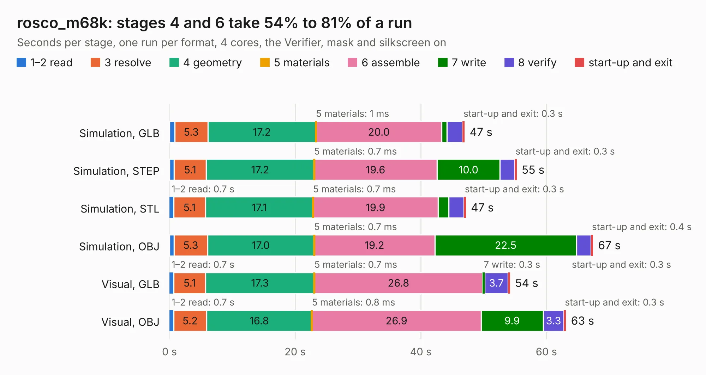

# 2419. rosco_m68k

Board 2,419 of the 3,138 of [Corpus Testing](../Corpus-Testing.md), on [Corpus Page 23](../CorpusTestingPages/Corpus-Testing-23.md#2419-rosco_m68k).

| Mode and format | 1–2 read | 3 resolve | 4 geometry | 5 materials | 6 assemble | 7 write | 8 verify | start-up and exit | Total |
|---|---:|---:|---:|---:|---:|---:|---:|---:|---:|
| Simulation, GLB | 0.8 | 5.3 | 17.2 | 1&nbsp;ms | 20.0 | 0.8 | 2.5 | 0.3 | 47.0 |
| Simulation, STEP | 0.7 | 5.1 | 17.2 | 0.7&nbsp;ms | 19.6 | 10.0 | 2.3 | 0.3 | 55.3 |
| Simulation, STL | 0.7 | 5.1 | 17.1 | 0.7&nbsp;ms | 19.9 | 1.7 | 2.4 | 0.3 | 47.2 |
| Simulation, OBJ | 0.7 | 5.3 | 17.0 | 0.7&nbsp;ms | 19.2 | 22.5 | 2.3 | 0.4 | 67.4 |
| Visual, GLB | 0.7 | 5.1 | 17.3 | 0.7&nbsp;ms | 26.8 | 0.3 | 3.7 | 0.3 | 54.2 |
| Visual, OBJ | 0.7 | 5.2 | 16.8 | 0.8&nbsp;ms | 26.9 | 9.9 | 3.3 | 0.3 | 63.1 |

<table align="center"><tr><td valign="top">

| Board | Repo: [rosco-m68k/rosco_m68k](https://github.com/rosco-m68k/rosco_m68k) Board: `rosco_m68k.kicad_pcb` |
|---|---|
| Folder | design / r0 / r0-kicad-import |
| Complexity | 240&nbsp;/&nbsp;1000 (size&nbsp;205, features&nbsp;35) |
| KESE&nbsp;features | through vias, filled zones |
| Tested | 9th November 2026 |
| Copper&nbsp;layers | 4 |
| File&nbsp;format | KiCad 5 (20171130) |
| Parts,&nbsp;tracks,&nbsp;vias | 69, 1,706, 160 |
| Triangles,&nbsp;simulation | 4,334,206 in 142 parts |
| Verifier | PASS in all six runs |

</td><td valign="top">

<table>
<tr><th>File type</th><th>File size</th><th>Peak memory used</th></tr>
<tr><th colspan="3" align="left">Simulation</th></tr>
<tr><td>GLB</td><td align="right">148&nbsp;MB</td><td align="right">1.0&nbsp;GB</td></tr>
<tr><td>STEP</td><td align="right">561&nbsp;MB</td><td align="right">1.4&nbsp;GB</td></tr>
<tr><td>STL</td><td align="right">217&nbsp;MB</td><td align="right">1.0&nbsp;GB</td></tr>
<tr><td>OBJ</td><td align="right">462&nbsp;MB</td><td align="right">2.8&nbsp;GB</td></tr>
<tr><th colspan="3" align="left">Visual</th></tr>
<tr><td>GLB</td><td align="right">65&nbsp;MB</td><td align="right">1.2&nbsp;GB</td></tr>
<tr><td>OBJ</td><td align="right">206&nbsp;MB</td><td align="right">1.5&nbsp;GB</td></tr>
</table>

</td></tr></table>

| Previous | Next |
|:---|---:|
| [2418. DCDCv9-3](b2418b_dcdc_DCDCv9-3.md) | [2420. rosco_m68k](b2420b_rosco-m68k_design-r1-2-kicad_rosco-m68k.md) |
