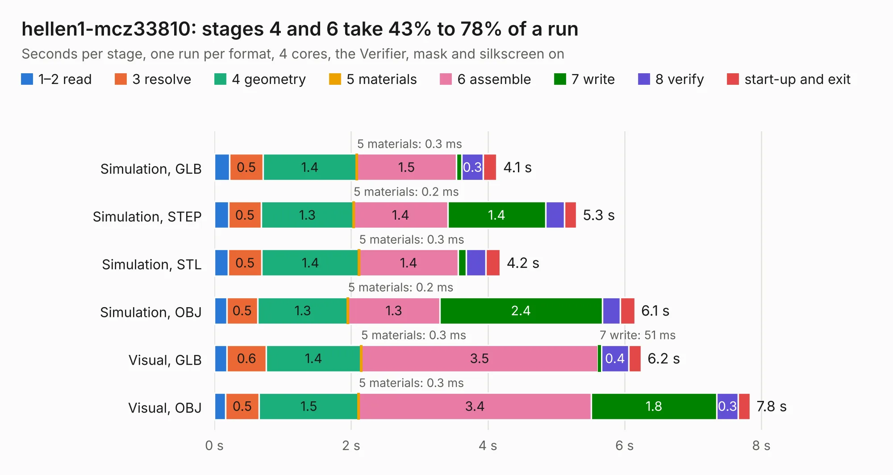

# 2420. hellen1-mcz33810

Board 2,420 of the 3,126 of [Corpus Testing](../Corpus-Testing.md), on [Corpus Page 23](../CorpusTestingPages/Corpus-Testing-23.md#2420-hellen1-mcz33810).

| Mode and format | 1–2 read | 3 resolve | 4 geometry | 5 materials | 6 assemble | 7 write | 8 verify | start-up and exit | Total |
|---|---:|---:|---:|---:|---:|---:|---:|---:|---:|
| Simulation, GLB | 0.2 | 0.5 | 1.4 | 0.3&nbsp;ms | 1.5 | 81&nbsp;ms | 0.3 | 0.2 | 4.1 |
| Simulation, STEP | 0.2 | 0.5 | 1.3 | 0.2&nbsp;ms | 1.4 | 1.4 | 0.3 | 0.2 | 5.3 |
| Simulation, STL | 0.2 | 0.5 | 1.4 | 0.3&nbsp;ms | 1.4 | 0.1 | 0.3 | 0.2 | 4.2 |
| Simulation, OBJ | 0.2 | 0.5 | 1.3 | 0.2&nbsp;ms | 1.3 | 2.4 | 0.3 | 0.2 | 6.1 |
| Visual, GLB | 0.2 | 0.6 | 1.4 | 0.3&nbsp;ms | 3.5 | 51&nbsp;ms | 0.4 | 0.2 | 6.2 |
| Visual, OBJ | 0.2 | 0.5 | 1.5 | 0.3&nbsp;ms | 3.4 | 1.8 | 0.3 | 0.2 | 7.8 |

<table align="center"><tr><td valign="top">

| Board | Repo: [rusefi/hellen-one](https://github.com/rusefi/hellen-one) Board: `hellen1-mcz33810.kicad_pcb` |
|---|---|
| Folder | kicad / modules / hellen1-mcz33810 |
| Complexity | 255&nbsp;/&nbsp;1000 (size&nbsp;175, features&nbsp;80) |
| KESE&nbsp;features | through vias, rounded, trapezoid or chamfered pads, filled zones, stack-up, dielectric εr and tanδ, mask and silkscreen colours |
| Tested | 9th November 2026 |
| Copper&nbsp;layers | 4 |
| File&nbsp;format | KiCad 7 (20221018) |
| Parts,&nbsp;tracks,&nbsp;vias | 32, 342, 72 |
| Triangles,&nbsp;simulation | 491,272 in 54 parts |
| Verifier | PASS in all six runs |

</td><td valign="top">

<table>
<tr><th>File type</th><th>File size</th><th>Peak memory used</th></tr>
<tr><th colspan="3" align="left">Simulation</th></tr>
<tr><td>GLB</td><td align="right">17&nbsp;MB</td><td align="right">312&nbsp;MB</td></tr>
<tr><td>STEP</td><td align="right">69&nbsp;MB</td><td align="right">334&nbsp;MB</td></tr>
<tr><td>STL</td><td align="right">25&nbsp;MB</td><td align="right">312&nbsp;MB</td></tr>
<tr><td>OBJ</td><td align="right">49&nbsp;MB</td><td align="right">378&nbsp;MB</td></tr>
<tr><th colspan="3" align="left">Visual</th></tr>
<tr><td>GLB</td><td align="right">12&nbsp;MB</td><td align="right">337&nbsp;MB</td></tr>
<tr><td>OBJ</td><td align="right">37&nbsp;MB</td><td align="right">337&nbsp;MB</td></tr>
</table>

</td></tr></table>

| Previous | Next |
|:---|---:|
| [2419. xoseram](b2419b_XoseraBoard_xoseram.md) | [2421. hellen1-motor-driver](b2421b_hellen-one_hellen1-motor-driver.md) |
