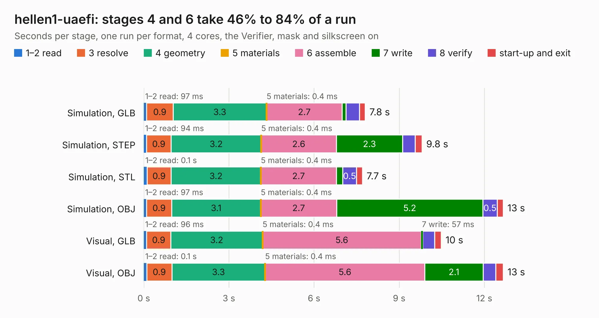

# 2420. hellen1-uaefi

Board 2,420 of the 3,124 of [Corpus Testing](../Corpus-Testing.md), on [Corpus Page 23](../CorpusTestingPages/Corpus-Testing-23.md#2420-hellen1-uaefi).

| Mode and format | 1–2 read | 3 resolve | 4 geometry | 5 materials | 6 assemble | 7 write | 8 verify | start-up and exit | Total |
|---|---:|---:|---:|---:|---:|---:|---:|---:|---:|
| Simulation, GLB | 97&nbsp;ms | 0.9 | 3.3 | 0.4&nbsp;ms | 2.7 | 0.1 | 0.5 | 0.2 | 7.8 |
| Simulation, STEP | 94&nbsp;ms | 0.9 | 3.2 | 0.4&nbsp;ms | 2.6 | 2.3 | 0.4 | 0.2 | 9.8 |
| Simulation, STL | 0.1 | 0.9 | 3.2 | 0.4&nbsp;ms | 2.7 | 0.2 | 0.5 | 0.2 | 7.7 |
| Simulation, OBJ | 97&nbsp;ms | 0.9 | 3.1 | 0.4&nbsp;ms | 2.7 | 5.2 | 0.5 | 0.2 | 12.7 |
| Visual, GLB | 96&nbsp;ms | 0.9 | 3.2 | 0.4&nbsp;ms | 5.6 | 57&nbsp;ms | 0.4 | 0.2 | 10.5 |
| Visual, OBJ | 0.1 | 0.9 | 3.3 | 0.4&nbsp;ms | 5.6 | 2.1 | 0.4 | 0.3 | 12.7 |

<table align="center"><tr><td valign="top">

| Board | Repo: [rusefi/hellen-one](https://github.com/rusefi/hellen-one) Board: `hellen1-uaefi.kicad_pcb` |
|---|---|
| Folder | kicad / modules / hellen1-uaefi |
| Complexity | 185&nbsp;/&nbsp;1000 (size&nbsp;115, features&nbsp;70) |
| KESE&nbsp;features | rounded, trapezoid or chamfered pads, arc tracks, curved board outline, stack-up, dielectric εr and tanδ, mask and silkscreen colours |
| Tested | 9th November 2026 |
| Copper&nbsp;layers | 4 |
| File&nbsp;format | KiCad 7 (20221018) |
| Parts,&nbsp;tracks,&nbsp;vias | 17, 20, 0 |
| Triangles,&nbsp;simulation | 789,278 in 94 parts |
| Verifier | PASS in all six runs |

</td><td valign="top">

<table>
<tr><th>File type</th><th>File size</th><th>Peak memory used</th></tr>
<tr><th colspan="3" align="left">Simulation</th></tr>
<tr><td>GLB</td><td align="right">25&nbsp;MB</td><td align="right">311&nbsp;MB</td></tr>
<tr><td>STEP</td><td align="right">85&nbsp;MB</td><td align="right">367&nbsp;MB</td></tr>
<tr><td>STL</td><td align="right">39&nbsp;MB</td><td align="right">303&nbsp;MB</td></tr>
<tr><td>OBJ</td><td align="right">80&nbsp;MB</td><td align="right">531&nbsp;MB</td></tr>
<tr><th colspan="3" align="left">Visual</th></tr>
<tr><td>GLB</td><td align="right">12&nbsp;MB</td><td align="right">373&nbsp;MB</td></tr>
<tr><td>OBJ</td><td align="right">35&nbsp;MB</td><td align="right">374&nbsp;MB</td></tr>
</table>

</td></tr></table>

| Previous | Next |
|:---|---:|
| [2419. hellen1-motor-driver](b2419b_hellen-one_hellen1-motor-driver.md) | [2421. hellen1-vr-discrete](b2421b_hellen-one_hellen1-vr-discrete.md) |
