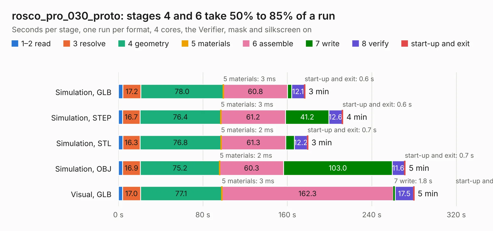

# 2420. rosco_pro_030_proto

Board 2,420 of the 3,130 of [Corpus Testing](../Corpus-Testing.md), on [Corpus Page 23](../CorpusTestingPages/Corpus-Testing-23.md#2420-rosco_pro_030_proto).

| Mode and format | 1–2 read | 3 resolve | 4 geometry | 5 materials | 6 assemble | 7 write | 8 verify | start-up and exit | Total |
|---|---:|---:|---:|---:|---:|---:|---:|---:|---:|
| Simulation, GLB | 4.2 | 17.2 | 78.0 | 3&nbsp;ms | 60.8 | 3.8 | 12.1 | 0.6 | 176.8 |
| Simulation, STEP | 3.9 | 16.7 | 76.4 | 3&nbsp;ms | 61.2 | 41.2 | 12.6 | 0.6 | 212.6 |
| Simulation, STL | 4.2 | 16.3 | 76.8 | 2&nbsp;ms | 61.3 | 8.1 | 12.2 | 0.7 | 179.5 |
| Simulation, OBJ | 4.0 | 16.9 | 75.2 | 2&nbsp;ms | 60.3 | 103.0 | 11.6 | 0.7 | 271.7 |
| Visual, GLB | 3.9 | 17.0 | 77.1 | 3&nbsp;ms | 162.3 | 1.8 | 17.5 | 0.6 | 280.1 |
| Visual, OBJ | 4.0 | 17.1 | 75.0 | 3&nbsp;ms | 157.7 | 45.8 | 16.1 | 0.4 | 316.0 |

<table align="center"><tr><td valign="top">

| Board | Repo: [rosco-m68k/rosco_m68k_pro](https://github.com/rosco-m68k/rosco_m68k_pro) Board: `rosco_pro_030_proto.kicad_pcb` |
|---|---|
| Folder | design / pro_030_proto / kicad |
| Complexity | 415&nbsp;/&nbsp;1000 (size&nbsp;285, features&nbsp;130) |
| KESE&nbsp;features | through vias, slotted holes, custom pads, rounded, trapezoid or chamfered pads, drill offsets, filled zones, copper drawings, curved board outline, stack-up, dielectric εr and tanδ |
| Tested | 9th November 2026 |
| Copper&nbsp;layers | 4 |
| File&nbsp;format | KiCad 6 (20211014) |
| Parts,&nbsp;tracks,&nbsp;vias | 241, 9,324, 390 |
| Triangles,&nbsp;simulation | 15,595,656 in 416 parts |
| Verifier | PASS in all six runs |

</td><td valign="top">

<table>
<tr><th>File type</th><th>File size</th><th>Peak memory used</th></tr>
<tr><th colspan="3" align="left">Simulation</th></tr>
<tr><td>GLB</td><td align="right">523&nbsp;MB</td><td align="right">3.5&nbsp;GB</td></tr>
<tr><td>STEP</td><td align="right">2.3&nbsp;GB</td><td align="right">4.6&nbsp;GB</td></tr>
<tr><td>STL</td><td align="right">780&nbsp;MB</td><td align="right">3.3&nbsp;GB</td></tr>
<tr><td>OBJ</td><td align="right">1.7&nbsp;GB</td><td align="right">9.8&nbsp;GB</td></tr>
<tr><th colspan="3" align="left">Visual</th></tr>
<tr><td>GLB</td><td align="right">265&nbsp;MB</td><td align="right">4.2&nbsp;GB</td></tr>
<tr><td>OBJ</td><td align="right">851&nbsp;MB</td><td align="right">5.4&nbsp;GB</td></tr>
</table>

</td></tr></table>

| Previous | Next |
|:---|---:|
| [2419. rosco_m68k](b2419b_rosco-m68k_design-r2030-kicad_rosco-m68k.md) | [2421. xoseram](b2421b_XoseraBoard_xoseram.md) |
