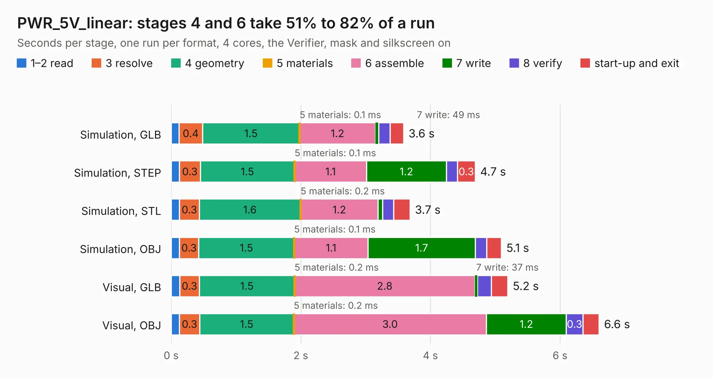

# 2420. PWR_5V_linear

Board 2,420 of the 3,111 of [Corpus Testing](../Corpus-Testing.md), on [Corpus Page 23](../CorpusTestingPages/Corpus-Testing-23.md#2420-pwr_5v_linear).

| Mode and format | 1–2 read | 3 resolve | 4 geometry | 5 materials | 6 assemble | 7 write | 8 verify | start-up and exit | Total |
|---|---:|---:|---:|---:|---:|---:|---:|---:|---:|
| Simulation, GLB | 0.1 | 0.4 | 1.5 | 0.1&nbsp;ms | 1.2 | 49&nbsp;ms | 0.2 | 0.2 | 3.6 |
| Simulation, STEP | 0.1 | 0.3 | 1.5 | 0.1&nbsp;ms | 1.1 | 1.2 | 0.2 | 0.3 | 4.7 |
| Simulation, STL | 0.1 | 0.3 | 1.6 | 0.2&nbsp;ms | 1.2 | 68&nbsp;ms | 0.2 | 0.3 | 3.7 |
| Simulation, OBJ | 0.1 | 0.3 | 1.5 | 0.1&nbsp;ms | 1.1 | 1.7 | 0.2 | 0.2 | 5.1 |
| Visual, GLB | 0.1 | 0.3 | 1.5 | 0.2&nbsp;ms | 2.8 | 37&nbsp;ms | 0.2 | 0.3 | 5.2 |
| Visual, OBJ | 0.1 | 0.3 | 1.5 | 0.2&nbsp;ms | 3.0 | 1.2 | 0.3 | 0.2 | 6.6 |

<table align="center"><tr><td valign="top">

| Board | Repo: [rusefi/rusefi-hardware](https://github.com/rusefi/rusefi-hardware) Board: `PWR_5V_linear.kicad_pcb` |
|---|---|
| Folder | classic-designs / 5V-regulator |
| Complexity | 170&nbsp;/&nbsp;1000 (size&nbsp;135, features&nbsp;35) |
| KESE&nbsp;features | through vias, filled zones |
| Tested | 9th November 2026 |
| Copper&nbsp;layers | 2 |
| File&nbsp;format | KiCad 4 (4) |
| Parts,&nbsp;tracks,&nbsp;vias | 16, 97, 38 |
| Triangles,&nbsp;simulation | 289,116 in 21 parts |
| Verifier | PASS in all six runs |

</td><td valign="top">

<table>
<tr><th>File type</th><th>File size</th><th>Peak memory used</th></tr>
<tr><th colspan="3" align="left">Simulation</th></tr>
<tr><td>GLB</td><td align="right">10&nbsp;MB</td><td align="right">231&nbsp;MB</td></tr>
<tr><td>STEP</td><td align="right">47&nbsp;MB</td><td align="right">247&nbsp;MB</td></tr>
<tr><td>STL</td><td align="right">14&nbsp;MB</td><td align="right">242&nbsp;MB</td></tr>
<tr><td>OBJ</td><td align="right">29&nbsp;MB</td><td align="right">232&nbsp;MB</td></tr>
<tr><th colspan="3" align="left">Visual</th></tr>
<tr><td>GLB</td><td align="right">7.2&nbsp;MB</td><td align="right">230&nbsp;MB</td></tr>
<tr><td>OBJ</td><td align="right">21&nbsp;MB</td><td align="right">251&nbsp;MB</td></tr>
</table>

</td></tr></table>

| Previous | Next |
|:---|---:|
| [2419. inj_6ch](b2419b_rusefi-hardware_classic-designs-1A-injector-6-channels_inj-6ch.md) | [2421. stepper_motor_driver](b2421b_rusefi-hardware_stepper-motor-driver.md) |
