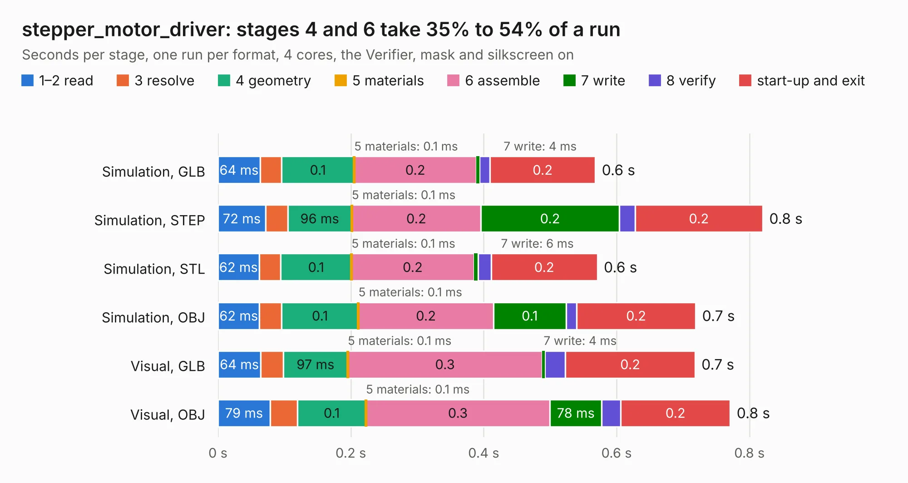

# 2420. stepper_motor_driver

Board 2,420 of the 3,110 of [Corpus Testing](../Corpus-Testing.md), on [Corpus Page 23](../CorpusTestingPages/Corpus-Testing-23.md#2420-stepper_motor_driver).

| Mode and format | 1–2 read | 3 resolve | 4 geometry | 5 materials | 6 assemble | 7 write | 8 verify | start-up and exit | Total |
|---|---:|---:|---:|---:|---:|---:|---:|---:|---:|
| Simulation, GLB | 64&nbsp;ms | 32&nbsp;ms | 0.1 | 0.1&nbsp;ms | 0.2 | 4&nbsp;ms | 16&nbsp;ms | 0.2 | 0.6 |
| Simulation, STEP | 72&nbsp;ms | 33&nbsp;ms | 96&nbsp;ms | 0.1&nbsp;ms | 0.2 | 0.2 | 24&nbsp;ms | 0.2 | 0.8 |
| Simulation, STL | 62&nbsp;ms | 33&nbsp;ms | 0.1 | 0.1&nbsp;ms | 0.2 | 6&nbsp;ms | 20&nbsp;ms | 0.2 | 0.6 |
| Simulation, OBJ | 62&nbsp;ms | 33&nbsp;ms | 0.1 | 0.1&nbsp;ms | 0.2 | 0.1 | 16&nbsp;ms | 0.2 | 0.7 |
| Visual, GLB | 64&nbsp;ms | 34&nbsp;ms | 97&nbsp;ms | 0.1&nbsp;ms | 0.3 | 4&nbsp;ms | 31&nbsp;ms | 0.2 | 0.7 |
| Visual, OBJ | 79&nbsp;ms | 41&nbsp;ms | 0.1 | 0.1&nbsp;ms | 0.3 | 78&nbsp;ms | 29&nbsp;ms | 0.2 | 0.8 |

<table align="center"><tr><td valign="top">

| Board | Repo: [rusefi/rusefi-hardware](https://github.com/rusefi/rusefi-hardware) Board: `stepper_motor_driver.kicad_pcb` |
|---|---|
| Folder | classic-designs / A4988_stepper_motor_driver |
| Complexity | 64&nbsp;/&nbsp;1000 (size&nbsp;64, features&nbsp;0) |
| Tested | 9th November 2026 |
| Copper&nbsp;layers | 2 |
| File&nbsp;format | KiCad 3 (3) |
| Parts,&nbsp;tracks,&nbsp;vias | 1, 0, 0 |
| Triangles,&nbsp;simulation | 27,684 in 9 parts |
| Verifier | PASS in all six runs |

</td><td valign="top">

<table>
<tr><th>File type</th><th>File size</th><th>Peak memory used</th></tr>
<tr><th colspan="3" align="left">Simulation</th></tr>
<tr><td>GLB</td><td align="right">986&nbsp;kB</td><td align="right">64&nbsp;MB</td></tr>
<tr><td>STEP</td><td align="right">4.1&nbsp;MB</td><td align="right">66&nbsp;MB</td></tr>
<tr><td>STL</td><td align="right">1.4&nbsp;MB</td><td align="right">65&nbsp;MB</td></tr>
<tr><td>OBJ</td><td align="right">2.7&nbsp;MB</td><td align="right">75&nbsp;MB</td></tr>
<tr><th colspan="3" align="left">Visual</th></tr>
<tr><td>GLB</td><td align="right">696&nbsp;kB</td><td align="right">81&nbsp;MB</td></tr>
<tr><td>OBJ</td><td align="right">1.9&nbsp;MB</td><td align="right">94&nbsp;MB</td></tr>
</table>

</td></tr></table>

| Previous | Next |
|:---|---:|
| [2419. PWR_5V_linear](b2419b_rusefi-hardware_PWR-5V-linear.md) | [2421. adc_amp_divider_vert](b2421b_rusefi-hardware_adc-amp-divider-vert.md) |
