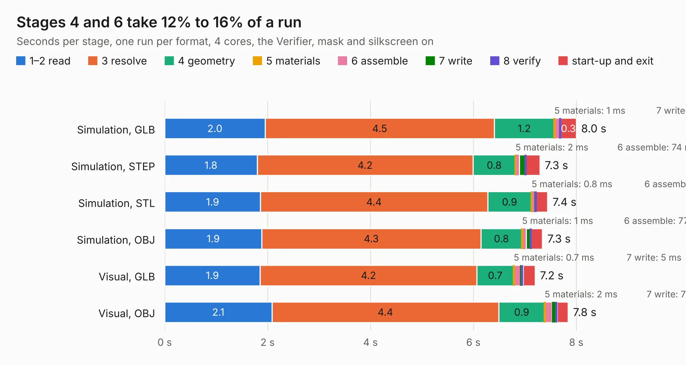

# 2421. output.Panel_R0.5.1_300x300_2layer_step1_Modified_1and5_only

Board 2,421 of the 3,121 of [Corpus Testing](../Corpus-Testing.md), on [Corpus Page 23](../CorpusTestingPages/Corpus-Testing-23.md#2421-outputpanel_r051_300x300_2layer_step1_modified_1and5_only).

| Mode and format | 1–2 read | 3 resolve | 4 geometry | 5 materials | 6 assemble | 7 write | 8 verify | start-up and exit | Total |
|---|---:|---:|---:|---:|---:|---:|---:|---:|---:|
| Simulation, GLB | 2.0 | 4.5 | 1.2 | 1&nbsp;ms | 0.1 | 4&nbsp;ms | 8&nbsp;ms | 0.3 | 8.0 |
| Simulation, STEP | 1.8 | 4.2 | 0.8 | 2&nbsp;ms | 74&nbsp;ms | 0.1 | 5&nbsp;ms | 0.3 | 7.3 |
| Simulation, STL | 1.9 | 4.4 | 0.9 | 0.8&nbsp;ms | 74&nbsp;ms | 4&nbsp;ms | 6&nbsp;ms | 0.2 | 7.4 |
| Simulation, OBJ | 1.9 | 4.3 | 0.8 | 1&nbsp;ms | 77&nbsp;ms | 85&nbsp;ms | 6&nbsp;ms | 0.2 | 7.3 |
| Visual, GLB | 1.9 | 4.2 | 0.7 | 0.7&nbsp;ms | 0.1 | 5&nbsp;ms | 36&nbsp;ms | 0.2 | 7.2 |
| Visual, OBJ | 2.1 | 4.4 | 0.9 | 2&nbsp;ms | 0.1 | 78&nbsp;ms | 24&nbsp;ms | 0.2 | 7.8 |

<table align="center"><tr><td valign="top">

| Board | Repo: [rusefi/hw_microrusefi](https://github.com/rusefi/hw_microrusefi) Board: `output.Panel_R0.5.1_300x300_2layer_step1_Modified_1and5_only.kicad_pcb` |
|---|---|
| Folder | gerbers / R0.5.1 / Panel_source_files |
| Complexity | 368&nbsp;/&nbsp;1000 (size&nbsp;293, features&nbsp;75) |
| KESE&nbsp;features | through vias, slotted holes, rounded, trapezoid or chamfered pads, filled zones, copper text, curved board outline |
| Tested | 9th November 2026 |
| Copper&nbsp;layers | 2 |
| File&nbsp;format | KiCad 5 (20171130) |
| Parts,&nbsp;tracks,&nbsp;vias | 487, 8,095, 1,691 |
| Triangles,&nbsp;simulation | 19,142 in 5 parts |
| Note | panel |
| Verifier | PASS in all six runs |

</td><td valign="top">

<table>
<tr><th>File type</th><th>File size</th><th>Peak memory used</th></tr>
<tr><th colspan="3" align="left">Simulation</th></tr>
<tr><td>GLB</td><td align="right">640&nbsp;kB</td><td align="right">248&nbsp;MB</td></tr>
<tr><td>STEP</td><td align="right">1.1&nbsp;MB</td><td align="right">265&nbsp;MB</td></tr>
<tr><td>STL</td><td align="right">958&nbsp;kB</td><td align="right">260&nbsp;MB</td></tr>
<tr><td>OBJ</td><td align="right">1.9&nbsp;MB</td><td align="right">261&nbsp;MB</td></tr>
<tr><th colspan="3" align="left">Visual</th></tr>
<tr><td>GLB</td><td align="right">723&nbsp;kB</td><td align="right">261&nbsp;MB</td></tr>
<tr><td>OBJ</td><td align="right">1.9&nbsp;MB</td><td align="right">249&nbsp;MB</td></tr>
</table>

</td></tr></table>

| Previous | Next |
|:---|---:|
| [2420. hellen1-wbo](b2420b_hellen-one_hellen1-wbo.md) | [2422. zMRETestFixture](b2422b_hw-microrusefi_zMRETestFixture.md) |
