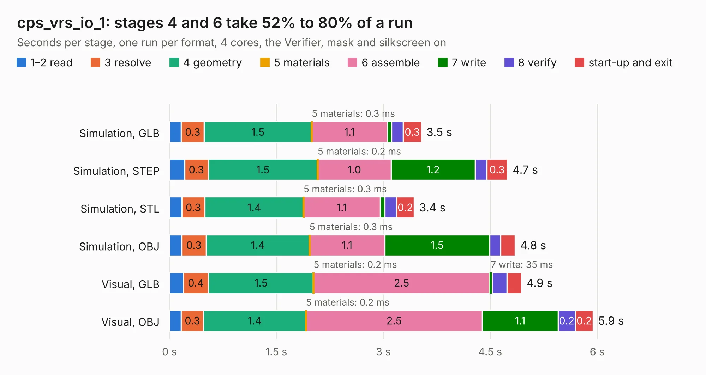

# 2422. cps_vrs_io_1

Board 2,422 of the 3,101 of [Corpus Testing](../Corpus-Testing.md), on [Corpus Page 23](../CorpusTestingPages/Corpus-Testing-23.md#2422-cps_vrs_io_1).

| Mode and format | 1–2 read | 3 resolve | 4 geometry | 5 materials | 6 assemble | 7 write | 8 verify | start-up and exit | Total |
|---|---:|---:|---:|---:|---:|---:|---:|---:|---:|
| Simulation, GLB | 0.2 | 0.3 | 1.5 | 0.3&nbsp;ms | 1.1 | 61&nbsp;ms | 0.2 | 0.3 | 3.5 |
| Simulation, STEP | 0.2 | 0.3 | 1.5 | 0.2&nbsp;ms | 1.0 | 1.2 | 0.2 | 0.3 | 4.7 |
| Simulation, STL | 0.2 | 0.3 | 1.4 | 0.3&nbsp;ms | 1.1 | 66&nbsp;ms | 0.2 | 0.2 | 3.4 |
| Simulation, OBJ | 0.2 | 0.3 | 1.4 | 0.3&nbsp;ms | 1.1 | 1.5 | 0.2 | 0.2 | 4.8 |
| Visual, GLB | 0.2 | 0.4 | 1.5 | 0.2&nbsp;ms | 2.5 | 35&nbsp;ms | 0.2 | 0.2 | 4.9 |
| Visual, OBJ | 0.2 | 0.3 | 1.4 | 0.2&nbsp;ms | 2.5 | 1.1 | 0.2 | 0.2 | 5.9 |

<table align="center"><tr><td valign="top">

| Board | Repo: [rusefi/rusefi-hardware](https://github.com/rusefi/rusefi-hardware) Board: `cps_vrs_io_1.kicad_pcb` |
|---|---|
| Folder | classic-designs / knock_VR_Art_ELectro |
| Complexity | 187&nbsp;/&nbsp;1000 (size&nbsp;142, features&nbsp;45) |
| KESE&nbsp;features | through vias, filled zones, curved board outline |
| Tested | 9th November 2026 |
| Copper&nbsp;layers | 2 |
| File&nbsp;format | KiCad 3 (3) |
| Parts,&nbsp;tracks,&nbsp;vias | 33, 173, 9 |
| Triangles,&nbsp;simulation | 244,486 in 41 parts |
| Verifier | PASS in all six runs |

</td><td valign="top">

<table>
<tr><th>File type</th><th>File size</th><th>Peak memory used</th></tr>
<tr><th colspan="3" align="left">Simulation</th></tr>
<tr><td>GLB</td><td align="right">8.9&nbsp;MB</td><td align="right">228&nbsp;MB</td></tr>
<tr><td>STEP</td><td align="right">46&nbsp;MB</td><td align="right">252&nbsp;MB</td></tr>
<tr><td>STL</td><td align="right">12&nbsp;MB</td><td align="right">241&nbsp;MB</td></tr>
<tr><td>OBJ</td><td align="right">25&nbsp;MB</td><td align="right">236&nbsp;MB</td></tr>
<tr><th colspan="3" align="left">Visual</th></tr>
<tr><td>GLB</td><td align="right">6.6&nbsp;MB</td><td align="right">229&nbsp;MB</td></tr>
<tr><td>OBJ</td><td align="right">19&nbsp;MB</td><td align="right">221&nbsp;MB</td></tr>
</table>

</td></tr></table>

| Previous | Next |
|:---|---:|
| [2421. VN750PS_E](b2421b_rusefi-hardware_VN750PS-E.md) | [2423. PWR_buck_12V_switcher](b2423b_rusefi-hardware_classic-designs-power-supply-kb1gtt_PWR-buck-12V-switcher.md) |
