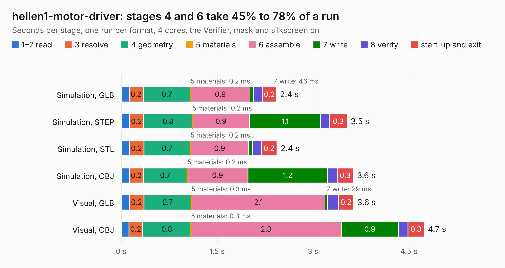

# 2423. hellen1-motor-driver

Board 2,423 of the 3,130 of [Corpus Testing](../Corpus-Testing.md), on [Corpus Page 23](../CorpusTestingPages/Corpus-Testing-23.md#2423-hellen1-motor-driver).

| Mode and format | 1–2 read | 3 resolve | 4 geometry | 5 materials | 6 assemble | 7 write | 8 verify | start-up and exit | Total |
|---|---:|---:|---:|---:|---:|---:|---:|---:|---:|
| Simulation, GLB | 0.1 | 0.2 | 0.7 | 0.2&nbsp;ms | 0.9 | 46&nbsp;ms | 0.1 | 0.2 | 2.4 |
| Simulation, STEP | 0.1 | 0.2 | 0.8 | 0.2&nbsp;ms | 0.9 | 1.1 | 0.1 | 0.3 | 3.5 |
| Simulation, STL | 0.1 | 0.2 | 0.7 | 0.2&nbsp;ms | 0.9 | 57&nbsp;ms | 0.1 | 0.2 | 2.4 |
| Simulation, OBJ | 0.1 | 0.2 | 0.7 | 0.2&nbsp;ms | 0.9 | 1.2 | 0.1 | 0.3 | 3.6 |
| Visual, GLB | 0.1 | 0.2 | 0.7 | 0.3&nbsp;ms | 2.1 | 29&nbsp;ms | 0.2 | 0.2 | 3.6 |
| Visual, OBJ | 0.1 | 0.2 | 0.8 | 0.3&nbsp;ms | 2.3 | 0.9 | 0.1 | 0.3 | 4.7 |

<table align="center"><tr><td valign="top">

| Board | Repo: [rusefi/hellen-one](https://github.com/rusefi/hellen-one) Board: `hellen1-motor-driver.kicad_pcb` |
|---|---|
| Folder | kicad / modules / hellen1-motor-driver |
| Complexity | 229&nbsp;/&nbsp;1000 (size&nbsp;149, features&nbsp;80) |
| KESE&nbsp;features | through vias, rounded, trapezoid or chamfered pads, filled zones, stack-up, dielectric εr and tanδ, mask and silkscreen colours |
| Tested | 9th November 2026 |
| Copper&nbsp;layers | 4 |
| File&nbsp;format | KiCad 7 (20221018) |
| Parts,&nbsp;tracks,&nbsp;vias | 17, 93, 27 |
| Triangles,&nbsp;simulation | 199,800 in 25 parts |
| Verifier | PASS in all six runs |

</td><td valign="top">

<table>
<tr><th>File type</th><th>File size</th><th>Peak memory used</th></tr>
<tr><th colspan="3" align="left">Simulation</th></tr>
<tr><td>GLB</td><td align="right">6.8&nbsp;MB</td><td align="right">220&nbsp;MB</td></tr>
<tr><td>STEP</td><td align="right">28&nbsp;MB</td><td align="right">221&nbsp;MB</td></tr>
<tr><td>STL</td><td align="right">10.0&nbsp;MB</td><td align="right">209&nbsp;MB</td></tr>
<tr><td>OBJ</td><td align="right">19&nbsp;MB</td><td align="right">209&nbsp;MB</td></tr>
<tr><th colspan="3" align="left">Visual</th></tr>
<tr><td>GLB</td><td align="right">4.8&nbsp;MB</td><td align="right">197&nbsp;MB</td></tr>
<tr><td>OBJ</td><td align="right">14&nbsp;MB</td><td align="right">198&nbsp;MB</td></tr>
</table>

</td></tr></table>

| Previous | Next |
|:---|---:|
| [2422. hellen1-mcz33810](b2422b_hellen-one_hellen1-mcz33810.md) | [2424. hellen1-uaefi](b2424b_hellen-one_hellen1-uaefi.md) |
