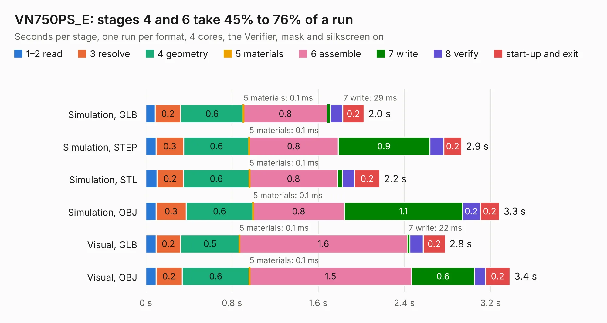

# 2426. VN750PS_E

Board 2,426 of the 3,106 of [Corpus Testing](../Corpus-Testing.md), on [Corpus Page 23](../CorpusTestingPages/Corpus-Testing-23.md#2426-vn750ps_e).

| Mode and format | 1–2 read | 3 resolve | 4 geometry | 5 materials | 6 assemble | 7 write | 8 verify | start-up and exit | Total |
|---|---:|---:|---:|---:|---:|---:|---:|---:|---:|
| Simulation, GLB | 89&nbsp;ms | 0.2 | 0.6 | 0.1&nbsp;ms | 0.8 | 29&nbsp;ms | 0.1 | 0.2 | 2.0 |
| Simulation, STEP | 95&nbsp;ms | 0.3 | 0.6 | 0.1&nbsp;ms | 0.8 | 0.9 | 0.1 | 0.2 | 2.9 |
| Simulation, STL | 0.1 | 0.2 | 0.6 | 0.1&nbsp;ms | 0.8 | 45&nbsp;ms | 0.1 | 0.2 | 2.2 |
| Simulation, OBJ | 95&nbsp;ms | 0.3 | 0.6 | 0.1&nbsp;ms | 0.8 | 1.1 | 0.2 | 0.2 | 3.3 |
| Visual, GLB | 95&nbsp;ms | 0.2 | 0.5 | 0.1&nbsp;ms | 1.6 | 22&nbsp;ms | 0.1 | 0.2 | 2.8 |
| Visual, OBJ | 95&nbsp;ms | 0.2 | 0.6 | 0.1&nbsp;ms | 1.5 | 0.6 | 0.1 | 0.2 | 3.4 |

<table align="center"><tr><td valign="top">

| Board | Repo: [rusefi/rusefi-hardware](https://github.com/rusefi/rusefi-hardware) Board: `VN750PS_E.kicad_pcb` |
|---|---|
| Folder | classic-designs / HighSideSwitch |
| Complexity | 187&nbsp;/&nbsp;1000 (size&nbsp;152, features&nbsp;35) |
| KESE&nbsp;features | through vias, filled zones |
| Tested | 9th November 2026 |
| Copper&nbsp;layers | 4 |
| File&nbsp;format | KiCad 3 (3) |
| Parts,&nbsp;tracks,&nbsp;vias | 8, 143, 58 |
| Triangles,&nbsp;simulation | 218,614 in 23 parts |
| Verifier | PASS in all six runs |

</td><td valign="top">

<table>
<tr><th>File type</th><th>File size</th><th>Peak memory used</th></tr>
<tr><th colspan="3" align="left">Simulation</th></tr>
<tr><td>GLB</td><td align="right">7.0&nbsp;MB</td><td align="right">222&nbsp;MB</td></tr>
<tr><td>STEP</td><td align="right">19&nbsp;MB</td><td align="right">223&nbsp;MB</td></tr>
<tr><td>STL</td><td align="right">11&nbsp;MB</td><td align="right">216&nbsp;MB</td></tr>
<tr><td>OBJ</td><td align="right">21&nbsp;MB</td><td align="right">215&nbsp;MB</td></tr>
<tr><th colspan="3" align="left">Visual</th></tr>
<tr><td>GLB</td><td align="right">4.2&nbsp;MB</td><td align="right">174&nbsp;MB</td></tr>
<tr><td>OBJ</td><td align="right">12&nbsp;MB</td><td align="right">177&nbsp;MB</td></tr>
</table>

</td></tr></table>

| Previous | Next |
|:---|---:|
| [2425. hi-lo](b2425b_rusefi-hardware_classic-designs-hi-lo-driver_hi-lo.md) | [2427. cps_vrs_io_1](b2427b_rusefi-hardware_classic-designs-knock-VR-Art-ELectro_cps-vrs-io-1.md) |
