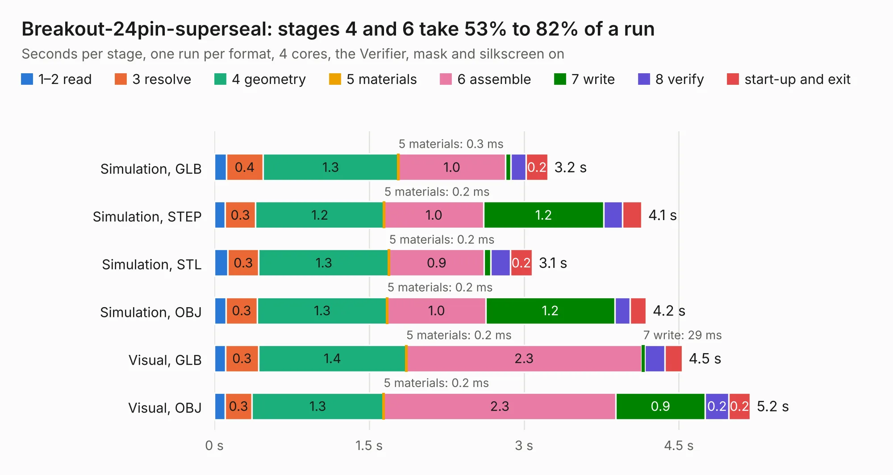

# 2427. Breakout-24pin-superseal

Board 2,427 of the 3,124 of [Corpus Testing](../Corpus-Testing.md), on [Corpus Page 23](../CorpusTestingPages/Corpus-Testing-23.md#2427-breakout-24pin-superseal).

| Mode and format | 1–2 read | 3 resolve | 4 geometry | 5 materials | 6 assemble | 7 write | 8 verify | start-up and exit | Total |
|---|---:|---:|---:|---:|---:|---:|---:|---:|---:|
| Simulation, GLB | 0.1 | 0.4 | 1.3 | 0.3&nbsp;ms | 1.0 | 52&nbsp;ms | 0.1 | 0.2 | 3.2 |
| Simulation, STEP | 0.1 | 0.3 | 1.2 | 0.2&nbsp;ms | 1.0 | 1.2 | 0.2 | 0.2 | 4.1 |
| Simulation, STL | 0.1 | 0.3 | 1.3 | 0.2&nbsp;ms | 0.9 | 65&nbsp;ms | 0.2 | 0.2 | 3.1 |
| Simulation, OBJ | 0.1 | 0.3 | 1.3 | 0.2&nbsp;ms | 1.0 | 1.2 | 0.1 | 0.2 | 4.2 |
| Visual, GLB | 0.1 | 0.3 | 1.4 | 0.2&nbsp;ms | 2.3 | 29&nbsp;ms | 0.2 | 0.2 | 4.5 |
| Visual, OBJ | 0.1 | 0.3 | 1.3 | 0.2&nbsp;ms | 2.3 | 0.9 | 0.2 | 0.2 | 5.2 |

<table align="center"><tr><td valign="top">

| Board | Repo: [rusefi/rusefi-hardware](https://github.com/rusefi/rusefi-hardware) Board: `Breakout-24pin-superseal.kicad_pcb` |
|---|---|
| Folder | breakout-boards / Breakout-24pin-superseal |
| Complexity | 149&nbsp;/&nbsp;1000 (size&nbsp;109, features&nbsp;40) |
| KESE&nbsp;features | slotted holes, stack-up, dielectric εr and tanδ |
| Tested | 9th November 2026 |
| Copper&nbsp;layers | 2 |
| File&nbsp;format | KiCad 8 (20240108) |
| Parts,&nbsp;tracks,&nbsp;vias | 2, 134, 0 |
| Triangles,&nbsp;simulation | 336,614 in 38 parts |
| Verifier | PASS in all six runs |

</td><td valign="top">

<table>
<tr><th>File type</th><th>File size</th><th>Peak memory used</th></tr>
<tr><th colspan="3" align="left">Simulation</th></tr>
<tr><td>GLB</td><td align="right">12&nbsp;MB</td><td align="right">239&nbsp;MB</td></tr>
<tr><td>STEP</td><td align="right">51&nbsp;MB</td><td align="right">262&nbsp;MB</td></tr>
<tr><td>STL</td><td align="right">17&nbsp;MB</td><td align="right">239&nbsp;MB</td></tr>
<tr><td>OBJ</td><td align="right">34&nbsp;MB</td><td align="right">278&nbsp;MB</td></tr>
<tr><th colspan="3" align="left">Visual</th></tr>
<tr><td>GLB</td><td align="right">7.5&nbsp;MB</td><td align="right">240&nbsp;MB</td></tr>
<tr><td>OBJ</td><td align="right">22&nbsp;MB</td><td align="right">228&nbsp;MB</td></tr>
</table>

</td></tr></table>

| Previous | Next |
|:---|---:|
| [2426. Motor_driver_A4988](b2426b_rusefi-hardware_Motor-driver-A4988.md) | [2428. 24pins_In_3conn](b2428b_rusefi-hardware_24pins-In-3conn.md) |
