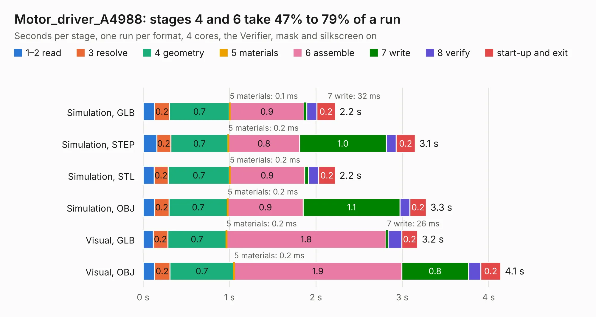

# 2428. Motor_driver_A4988

Board 2,428 of the 3,127 of [Corpus Testing](../Corpus-Testing.md), on [Corpus Page 23](../CorpusTestingPages/Corpus-Testing-23.md#2428-motor_driver_a4988).

| Mode and format | 1–2 read | 3 resolve | 4 geometry | 5 materials | 6 assemble | 7 write | 8 verify | start-up and exit | Total |
|---|---:|---:|---:|---:|---:|---:|---:|---:|---:|
| Simulation, GLB | 0.1 | 0.2 | 0.7 | 0.1&nbsp;ms | 0.9 | 32&nbsp;ms | 0.1 | 0.2 | 2.2 |
| Simulation, STEP | 0.2 | 0.2 | 0.7 | 0.2&nbsp;ms | 0.8 | 1.0 | 0.1 | 0.2 | 3.1 |
| Simulation, STL | 0.1 | 0.2 | 0.7 | 0.2&nbsp;ms | 0.9 | 47&nbsp;ms | 0.1 | 0.2 | 2.2 |
| Simulation, OBJ | 0.1 | 0.2 | 0.7 | 0.2&nbsp;ms | 0.9 | 1.1 | 0.1 | 0.2 | 3.3 |
| Visual, GLB | 0.1 | 0.2 | 0.7 | 0.2&nbsp;ms | 1.8 | 26&nbsp;ms | 0.2 | 0.2 | 3.2 |
| Visual, OBJ | 0.1 | 0.2 | 0.7 | 0.2&nbsp;ms | 1.9 | 0.8 | 0.1 | 0.2 | 4.1 |

<table align="center"><tr><td valign="top">

| Board | Repo: [rusefi/rusefi-hardware](https://github.com/rusefi/rusefi-hardware) Board: `Motor_driver_A4988.kicad_pcb` |
|---|---|
| Folder | A4988_stepper_motor_driver |
| Complexity | 255&nbsp;/&nbsp;1000 (size&nbsp;180, features&nbsp;75) |
| KESE&nbsp;features | through vias, rounded, trapezoid or chamfered pads, filled zones, stack-up, dielectric εr and tanδ |
| Tested | 9th November 2026 |
| Copper&nbsp;layers | 2 |
| File&nbsp;format | KiCad 7 (20221018) |
| Parts,&nbsp;tracks,&nbsp;vias | 19, 197, 21 |
| Triangles,&nbsp;simulation | 217,518 in 37 parts |
| Verifier | PASS in all six runs |

</td><td valign="top">

<table>
<tr><th>File type</th><th>File size</th><th>Peak memory used</th></tr>
<tr><th colspan="3" align="left">Simulation</th></tr>
<tr><td>GLB</td><td align="right">7.5&nbsp;MB</td><td align="right">213&nbsp;MB</td></tr>
<tr><td>STEP</td><td align="right">36&nbsp;MB</td><td align="right">240&nbsp;MB</td></tr>
<tr><td>STL</td><td align="right">11&nbsp;MB</td><td align="right">213&nbsp;MB</td></tr>
<tr><td>OBJ</td><td align="right">21&nbsp;MB</td><td align="right">213&nbsp;MB</td></tr>
<tr><th colspan="3" align="left">Visual</th></tr>
<tr><td>GLB</td><td align="right">5.6&nbsp;MB</td><td align="right">220&nbsp;MB</td></tr>
<tr><td>OBJ</td><td align="right">16&nbsp;MB</td><td align="right">221&nbsp;MB</td></tr>
</table>

</td></tr></table>

| Previous | Next |
|:---|---:|
| [2427. zMRETestFixture](b2427b_hw-microrusefi_zMRETestFixture.md) | [2429. Breakout-24pin-superseal](b2429b_rusefi-hardware_Breakout-24pin-superseal.md) |
