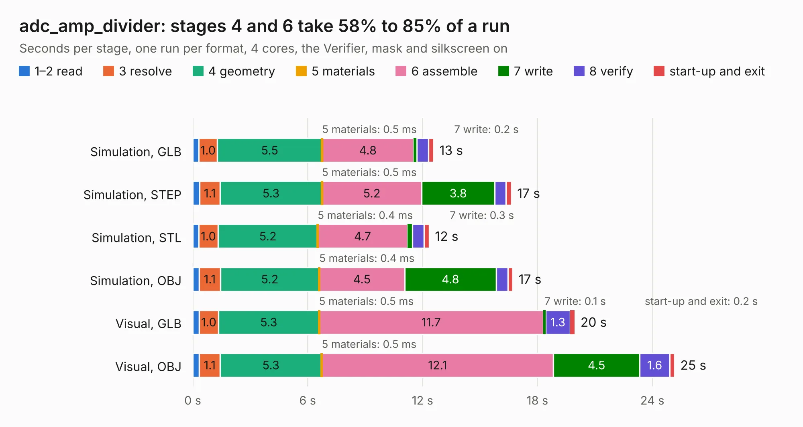

# 2429. adc_amp_divider

Board 2,429 of the 3,116 of [Corpus Testing](../Corpus-Testing.md), on [Corpus Page 23](../CorpusTestingPages/Corpus-Testing-23.md#2429-adc_amp_divider).

| Mode and format | 1–2 read | 3 resolve | 4 geometry | 5 materials | 6 assemble | 7 write | 8 verify | start-up and exit | Total |
|---|---:|---:|---:|---:|---:|---:|---:|---:|---:|
| Simulation, GLB | 0.3 | 1.0 | 5.5 | 0.5&nbsp;ms | 4.8 | 0.2 | 0.6 | 0.3 | 12.6 |
| Simulation, STEP | 0.4 | 1.1 | 5.3 | 0.5&nbsp;ms | 5.2 | 3.8 | 0.6 | 0.3 | 16.6 |
| Simulation, STL | 0.3 | 1.0 | 5.2 | 0.4&nbsp;ms | 4.7 | 0.3 | 0.6 | 0.3 | 12.3 |
| Simulation, OBJ | 0.3 | 1.1 | 5.2 | 0.4&nbsp;ms | 4.5 | 4.8 | 0.6 | 0.3 | 16.7 |
| Visual, GLB | 0.3 | 1.0 | 5.3 | 0.5&nbsp;ms | 11.7 | 0.1 | 1.3 | 0.2 | 19.9 |
| Visual, OBJ | 0.3 | 1.1 | 5.3 | 0.5&nbsp;ms | 12.1 | 4.5 | 1.6 | 0.3 | 25.2 |

<table align="center"><tr><td valign="top">

| Board | Repo: [rusefi/rusefi-hardware](https://github.com/rusefi/rusefi-hardware) Board: `adc_amp_divider.kicad_pcb` |
|---|---|
| Folder | classic-designs / adc_amp_divider |
| Complexity | 215&nbsp;/&nbsp;1000 (size&nbsp;180, features&nbsp;35) |
| KESE&nbsp;features | through vias, filled zones |
| Tested | 9th November 2026 |
| Copper&nbsp;layers | 2 |
| File&nbsp;format | KiCad 3 (3) |
| Parts,&nbsp;tracks,&nbsp;vias | 113, 743, 66 |
| Triangles,&nbsp;simulation | 883,980 in 79 parts |
| Verifier | PASS in all six runs |

</td><td valign="top">

<table>
<tr><th>File type</th><th>File size</th><th>Peak memory used</th></tr>
<tr><th colspan="3" align="left">Simulation</th></tr>
<tr><td>GLB</td><td align="right">31&nbsp;MB</td><td align="right">526&nbsp;MB</td></tr>
<tr><td>STEP</td><td align="right">172&nbsp;MB</td><td align="right">554&nbsp;MB</td></tr>
<tr><td>STL</td><td align="right">44&nbsp;MB</td><td align="right">513&nbsp;MB</td></tr>
<tr><td>OBJ</td><td align="right">91&nbsp;MB</td><td align="right">635&nbsp;MB</td></tr>
<tr><th colspan="3" align="left">Visual</th></tr>
<tr><td>GLB</td><td align="right">29&nbsp;MB</td><td align="right">753&nbsp;MB</td></tr>
<tr><td>OBJ</td><td align="right">85&nbsp;MB</td><td align="right">746&nbsp;MB</td></tr>
</table>

</td></tr></table>

| Previous | Next |
|:---|---:|
| [2428. adc_amp_divider](b2428b_rusefi-hardware_classic-designs-adc-amp-divider-vertical12_adc-amp-divider.md) | [2430. adc_amp_dividor](b2430b_rusefi-hardware_adc-amp-dividor.md) |
