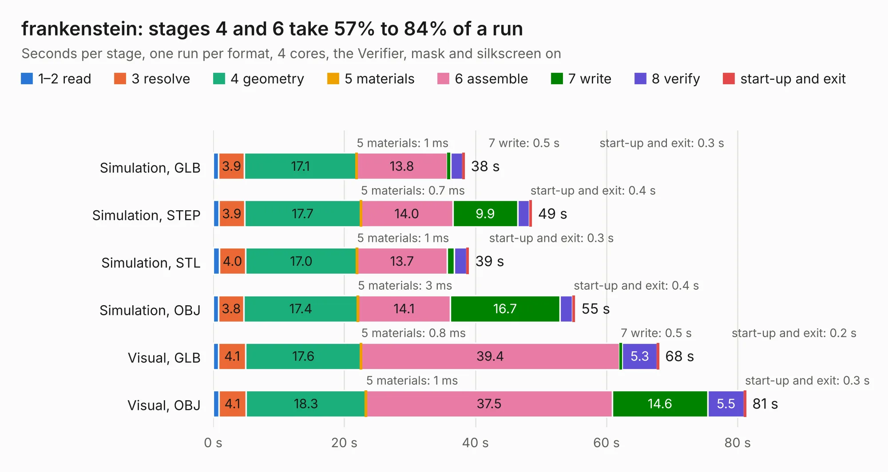

# 2430. frankenstein

Board 2,430 of the 3,112 of [Corpus Testing](../Corpus-Testing.md), on [Corpus Page 23](../CorpusTestingPages/Corpus-Testing-23.md#2430-frankenstein).

| Mode and format | 1–2 read | 3 resolve | 4 geometry | 5 materials | 6 assemble | 7 write | 8 verify | start-up and exit | Total |
|---|---:|---:|---:|---:|---:|---:|---:|---:|---:|
| Simulation, GLB | 0.8 | 3.9 | 17.1 | 1&nbsp;ms | 13.8 | 0.5 | 1.8 | 0.3 | 38.3 |
| Simulation, STEP | 0.9 | 3.9 | 17.7 | 0.7&nbsp;ms | 14.0 | 9.9 | 1.7 | 0.4 | 48.6 |
| Simulation, STL | 0.9 | 4.0 | 17.0 | 1&nbsp;ms | 13.7 | 1.1 | 1.9 | 0.3 | 39.0 |
| Simulation, OBJ | 0.8 | 3.8 | 17.4 | 3&nbsp;ms | 14.1 | 16.7 | 1.9 | 0.4 | 55.2 |
| Visual, GLB | 0.8 | 4.1 | 17.6 | 0.8&nbsp;ms | 39.4 | 0.5 | 5.3 | 0.2 | 68.0 |
| Visual, OBJ | 0.9 | 4.1 | 18.3 | 1&nbsp;ms | 37.5 | 14.6 | 5.5 | 0.3 | 81.3 |

<table align="center"><tr><td valign="top">

| Board | Repo: [rusefi/rusefi-hardware](https://github.com/rusefi/rusefi-hardware) Board: `frankenstein.kicad_pcb` |
|---|---|
| Folder | classic-designs / frankenstein |
| Complexity | 246&nbsp;/&nbsp;1000 (size&nbsp;211, features&nbsp;35) |
| KESE&nbsp;features | through vias, filled zones |
| Tested | 9th November 2026 |
| Copper&nbsp;layers | 2 |
| File&nbsp;format | KiCad 4 (4) |
| Parts,&nbsp;tracks,&nbsp;vias | 242, 2,835, 326 |
| Triangles,&nbsp;simulation | 3,108,884 in 196 parts |
| Verifier | PASS in all six runs |

</td><td valign="top">

<table>
<tr><th>File type</th><th>File size</th><th>Peak memory used</th></tr>
<tr><th colspan="3" align="left">Simulation</th></tr>
<tr><td>GLB</td><td align="right">108&nbsp;MB</td><td align="right">1.3&nbsp;GB</td></tr>
<tr><td>STEP</td><td align="right">564&nbsp;MB</td><td align="right">1.4&nbsp;GB</td></tr>
<tr><td>STL</td><td align="right">155&nbsp;MB</td><td align="right">1.2&nbsp;GB</td></tr>
<tr><td>OBJ</td><td align="right">331&nbsp;MB</td><td align="right">2.0&nbsp;GB</td></tr>
<tr><th colspan="3" align="left">Visual</th></tr>
<tr><td>GLB</td><td align="right">91&nbsp;MB</td><td align="right">1.7&nbsp;GB</td></tr>
<tr><td>OBJ</td><td align="right">280&nbsp;MB</td><td align="right">2.0&nbsp;GB</td></tr>
</table>

</td></tr></table>

| Previous | Next |
|:---|---:|
| [2429. frankenso](b2429b_rusefi-hardware_classic-designs-frankenso_frankenso.md) | [2431. hi-lo](b2431b_rusefi-hardware_classic-designs-hi-lo-driver_hi-lo.md) |
