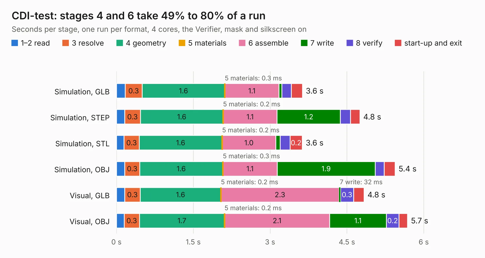

# 2431. CDI-test

Board 2,431 of the 3,125 of [Corpus Testing](../Corpus-Testing.md), on [Corpus Page 23](../CorpusTestingPages/Corpus-Testing-23.md#2431-cdi-test).

| Mode and format | 1–2 read | 3 resolve | 4 geometry | 5 materials | 6 assemble | 7 write | 8 verify | start-up and exit | Total |
|---|---:|---:|---:|---:|---:|---:|---:|---:|---:|
| Simulation, GLB | 0.2 | 0.3 | 1.6 | 0.3&nbsp;ms | 1.1 | 57&nbsp;ms | 0.2 | 0.2 | 3.6 |
| Simulation, STEP | 0.2 | 0.3 | 1.6 | 0.2&nbsp;ms | 1.1 | 1.2 | 0.2 | 0.2 | 4.8 |
| Simulation, STL | 0.1 | 0.3 | 1.6 | 0.2&nbsp;ms | 1.0 | 85&nbsp;ms | 0.2 | 0.2 | 3.6 |
| Simulation, OBJ | 0.2 | 0.3 | 1.6 | 0.3&nbsp;ms | 1.1 | 1.9 | 0.2 | 0.2 | 5.4 |
| Visual, GLB | 0.2 | 0.3 | 1.6 | 0.2&nbsp;ms | 2.3 | 32&nbsp;ms | 0.3 | 0.2 | 4.8 |
| Visual, OBJ | 0.2 | 0.3 | 1.7 | 0.2&nbsp;ms | 2.1 | 1.1 | 0.2 | 0.2 | 5.7 |

<table align="center"><tr><td valign="top">

| Board | Repo: [rusefi/rusefi-hardware](https://github.com/rusefi/rusefi-hardware) Board: `CDI-test.kicad_pcb` |
|---|---|
| Folder | CDI-test |
| Complexity | 186&nbsp;/&nbsp;1000 (size&nbsp;131, features&nbsp;55) |
| KESE&nbsp;features | through vias, rounded, trapezoid or chamfered pads, filled zones, curved board outline |
| Tested | 9th November 2026 |
| Copper&nbsp;layers | 2 |
| File&nbsp;format | KiCad 8 (20240108) |
| Parts,&nbsp;tracks,&nbsp;vias | 17, 37, 40 |
| Triangles,&nbsp;simulation | 381,408 in 22 parts |
| Verifier | PASS in all six runs |

</td><td valign="top">

<table>
<tr><th>File type</th><th>File size</th><th>Peak memory used</th></tr>
<tr><th colspan="3" align="left">Simulation</th></tr>
<tr><td>GLB</td><td align="right">12&nbsp;MB</td><td align="right">274&nbsp;MB</td></tr>
<tr><td>STEP</td><td align="right">47&nbsp;MB</td><td align="right">288&nbsp;MB</td></tr>
<tr><td>STL</td><td align="right">19&nbsp;MB</td><td align="right">275&nbsp;MB</td></tr>
<tr><td>OBJ</td><td align="right">38&nbsp;MB</td><td align="right">293&nbsp;MB</td></tr>
<tr><th colspan="3" align="left">Visual</th></tr>
<tr><td>GLB</td><td align="right">8.0&nbsp;MB</td><td align="right">267&nbsp;MB</td></tr>
<tr><td>OBJ</td><td align="right">23&nbsp;MB</td><td align="right">267&nbsp;MB</td></tr>
</table>

</td></tr></table>

| Previous | Next |
|:---|---:|
| [2430. 284617-1](b2430b_rusefi-hardware_284617-1.md) | [2432. inj_12ch](b2432b_rusefi-hardware_inj-12ch.md) |
