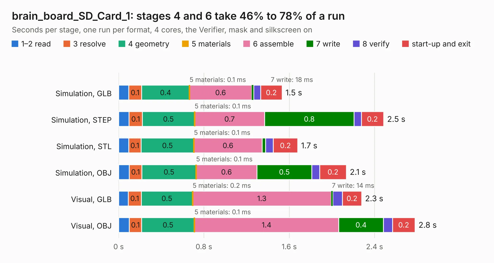

# 2431. brain_board_SD_Card_1

Board 2,431 of the 3,104 of [Corpus Testing](../Corpus-Testing.md), on [Corpus Page 23](../CorpusTestingPages/Corpus-Testing-23.md#2431-brain_board_sd_card_1).

| Mode and format | 1–2 read | 3 resolve | 4 geometry | 5 materials | 6 assemble | 7 write | 8 verify | start-up and exit | Total |
|---|---:|---:|---:|---:|---:|---:|---:|---:|---:|
| Simulation, GLB | 94&nbsp;ms | 0.1 | 0.4 | 0.1&nbsp;ms | 0.6 | 18&nbsp;ms | 66&nbsp;ms | 0.2 | 1.5 |
| Simulation, STEP | 98&nbsp;ms | 0.1 | 0.5 | 0.1&nbsp;ms | 0.7 | 0.8 | 68&nbsp;ms | 0.2 | 2.5 |
| Simulation, STL | 94&nbsp;ms | 0.1 | 0.5 | 0.1&nbsp;ms | 0.6 | 32&nbsp;ms | 73&nbsp;ms | 0.2 | 1.7 |
| Simulation, OBJ | 0.1 | 0.1 | 0.5 | 0.1&nbsp;ms | 0.6 | 0.5 | 74&nbsp;ms | 0.2 | 2.1 |
| Visual, GLB | 90&nbsp;ms | 0.1 | 0.5 | 0.2&nbsp;ms | 1.3 | 14&nbsp;ms | 92&nbsp;ms | 0.2 | 2.3 |
| Visual, OBJ | 0.1 | 0.1 | 0.5 | 0.1&nbsp;ms | 1.4 | 0.4 | 85&nbsp;ms | 0.2 | 2.8 |

<table align="center"><tr><td valign="top">

| Board | Repo: [rusefi/rusefi-hardware](https://github.com/rusefi/rusefi-hardware) Board: `brain_board_SD_Card_1.kicad_pcb` |
|---|---|
| Folder | classic-designs / rusefi_hardware_history / brain_board_SD_Card_1_rev00.10 |
| Complexity | 140&nbsp;/&nbsp;1000 (size&nbsp;105, features&nbsp;35) |
| KESE&nbsp;features | through vias, filled zones |
| Tested | 9th November 2026 |
| Copper&nbsp;layers | 2 |
| File&nbsp;format | KiCad 4 (4) |
| Parts,&nbsp;tracks,&nbsp;vias | 5, 40, 8 |
| Triangles,&nbsp;simulation | 104,462 in 18 parts |
| Verifier | PASS in all six runs |

</td><td valign="top">

<table>
<tr><th>File type</th><th>File size</th><th>Peak memory used</th></tr>
<tr><th colspan="3" align="left">Simulation</th></tr>
<tr><td>GLB</td><td align="right">3.7&nbsp;MB</td><td align="right">179&nbsp;MB</td></tr>
<tr><td>STEP</td><td align="right">19&nbsp;MB</td><td align="right">187&nbsp;MB</td></tr>
<tr><td>STL</td><td align="right">5.2&nbsp;MB</td><td align="right">176&nbsp;MB</td></tr>
<tr><td>OBJ</td><td align="right">10&nbsp;MB</td><td align="right">183&nbsp;MB</td></tr>
<tr><th colspan="3" align="left">Visual</th></tr>
<tr><td>GLB</td><td align="right">3.0&nbsp;MB</td><td align="right">157&nbsp;MB</td></tr>
<tr><td>OBJ</td><td align="right">8.2&nbsp;MB</td><td align="right">159&nbsp;MB</td></tr>
</table>

</td></tr></table>

| Previous | Next |
|:---|---:|
| [2430. brain_board_STM32F407](b2430b_rusefi-hardware_classic-designs-rusefi-hardware-history-brain-board-rev00-30-brain-board_brain-board-STM32F407.md) | [2432. pin_board_1](b2432b_rusefi-hardware_pin-board-1.md) |
