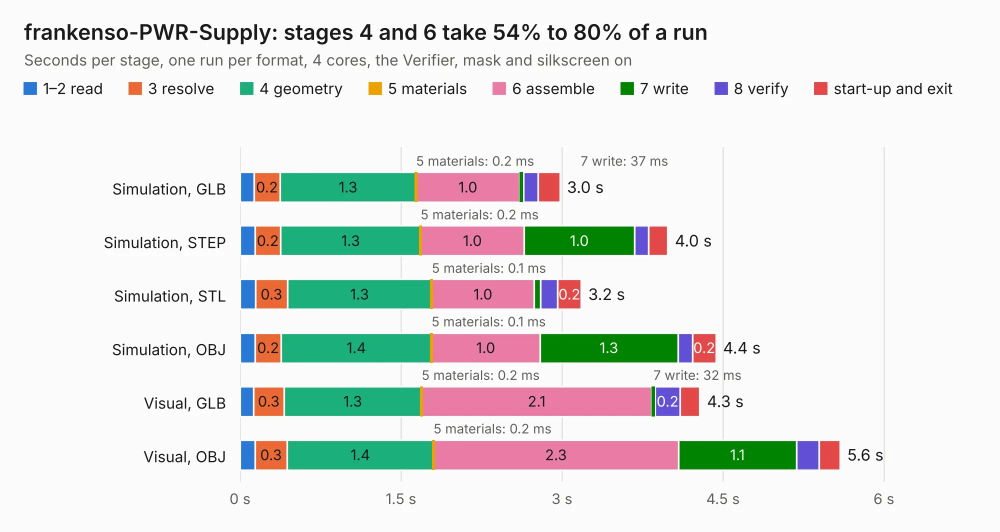

# 2432. frankenso-PWR-Supply

Board 2,432 of the 3,116 of [Corpus Testing](../Corpus-Testing.md), on [Corpus Page 23](../CorpusTestingPages/Corpus-Testing-23.md#2432-frankenso-pwr-supply).

| Mode and format | 1–2 read | 3 resolve | 4 geometry | 5 materials | 6 assemble | 7 write | 8 verify | start-up and exit | Total |
|---|---:|---:|---:|---:|---:|---:|---:|---:|---:|
| Simulation, GLB | 0.1 | 0.2 | 1.3 | 0.2&nbsp;ms | 1.0 | 37&nbsp;ms | 0.1 | 0.2 | 3.0 |
| Simulation, STEP | 0.1 | 0.2 | 1.3 | 0.2&nbsp;ms | 1.0 | 1.0 | 0.1 | 0.2 | 4.0 |
| Simulation, STL | 0.1 | 0.3 | 1.3 | 0.1&nbsp;ms | 1.0 | 61&nbsp;ms | 0.2 | 0.2 | 3.2 |
| Simulation, OBJ | 0.1 | 0.2 | 1.4 | 0.1&nbsp;ms | 1.0 | 1.3 | 0.1 | 0.2 | 4.4 |
| Visual, GLB | 0.1 | 0.3 | 1.3 | 0.2&nbsp;ms | 2.1 | 32&nbsp;ms | 0.2 | 0.2 | 4.3 |
| Visual, OBJ | 0.1 | 0.3 | 1.4 | 0.2&nbsp;ms | 2.3 | 1.1 | 0.2 | 0.2 | 5.6 |

<table align="center"><tr><td valign="top">

| Board | Repo: [rusefi/rusefi-hardware](https://github.com/rusefi/rusefi-hardware) Board: `frankenso-PWR-Supply.kicad_pcb` |
|---|---|
| Folder | classic-designs / frankenso-PWR-Supply |
| Complexity | 190&nbsp;/&nbsp;1000 (size&nbsp;135, features&nbsp;55) |
| KESE&nbsp;features | through vias, slotted holes, filled zones, copper text |
| Tested | 9th November 2026 |
| Copper&nbsp;layers | 2 |
| File&nbsp;format | KiCad 4 (4) |
| Parts,&nbsp;tracks,&nbsp;vias | 21, 106, 25 |
| Triangles,&nbsp;simulation | 262,346 in 24 parts |
| Verifier | PASS in all six runs |

</td><td valign="top">

<table>
<tr><th>File type</th><th>File size</th><th>Peak memory used</th></tr>
<tr><th colspan="3" align="left">Simulation</th></tr>
<tr><td>GLB</td><td align="right">9.4&nbsp;MB</td><td align="right">247&nbsp;MB</td></tr>
<tr><td>STEP</td><td align="right">47&nbsp;MB</td><td align="right">257&nbsp;MB</td></tr>
<tr><td>STL</td><td align="right">13&nbsp;MB</td><td align="right">246&nbsp;MB</td></tr>
<tr><td>OBJ</td><td align="right">27&nbsp;MB</td><td align="right">237&nbsp;MB</td></tr>
<tr><th colspan="3" align="left">Visual</th></tr>
<tr><td>GLB</td><td align="right">6.9&nbsp;MB</td><td align="right">222&nbsp;MB</td></tr>
<tr><td>OBJ</td><td align="right">20&nbsp;MB</td><td align="right">216&nbsp;MB</td></tr>
</table>

</td></tr></table>

| Previous | Next |
|:---|---:|
| [2431. adc_amp_divider](b2431b_rusefi-hardware_classic-designs-adc-amp-divider-history-rev00-20_adc-amp-divider.md) | [2433. frankenso](b2433b_rusefi-hardware_classic-designs-frankenso_frankenso.md) |
