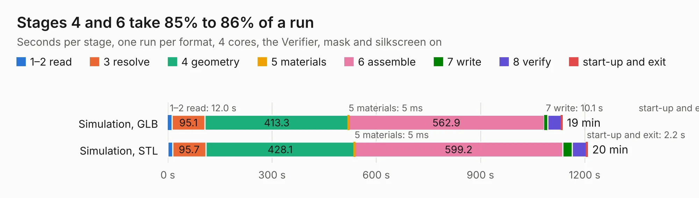

# 2433 output.Panel_R0.5.1_300x300_2layer_step1

Board 2,433 of the 3,138 of [Corpus Testing](../Corpus-Testing.md), on [Corpus Page 23](../CorpusTestingPages/Corpus-Testing-23.md#2433-outputpanel_r051_300x300_2layer_step1).

| Mode and format | 1–2 read | 3 resolve | 4 geometry | 5 materials | 6 assemble | 7 write | 8 verify | start-up and exit | Total |
|---|---:|---:|---:|---:|---:|---:|---:|---:|---:|
| Simulation, GLB | 12.0 | 95.1 | 413.3 | 5&nbsp;ms | 562.9 | 10.1 | 39.6 | 1.6 | 1134.5 |
| Simulation, STEP |  |  |  |  |  |  |  |  | exceeded 11 GB on a 15 GB machine (stopped there, not a KESE failure); it will be run again on a machine with more memory |
| Simulation, STL | 13.7 | 95.7 | 428.1 | 5&nbsp;ms | 599.2 | 27.8 | 40.6 | 2.2 | 1207.3 |
| Simulation, OBJ |  |  |  |  |  |  |  |  | exceeded 11 GB on a 15 GB machine (stopped there, not a KESE failure); it will be run again on a machine with more memory |
| Visual, GLB |  |  |  |  |  |  |  |  | exceeded 11 GB on a 15 GB machine (stopped there, not a KESE failure); it will be run again on a machine with more memory |
| Visual, OBJ |  |  |  |  |  |  |  |  | exceeded 11 GB on a 15 GB machine (stopped there, not a KESE failure); it will be run again on a machine with more memory |

<table align="center"><tr><td valign="top">

| Board | Repo: [rusefi/hw_microrusefi](https://github.com/rusefi/hw_microrusefi) Board: `output.Panel_R0.5.1_300x300_2layer_step1.kicad_pcb` |
|---|---|
| Folder | gerbers / R0.5.1 / Panel_source_files |
| Complexity | 423&nbsp;/&nbsp;1000 (size&nbsp;348, features&nbsp;75) |
| KESE&nbsp;features | through vias, slotted holes, rounded, trapezoid or chamfered pads, filled zones, copper text, curved board outline |
| Tested | 9th November 2026 to 10th November 2026 |
| Copper&nbsp;layers | 2 |
| File&nbsp;format | KiCad 5 (20171130) |
| Parts,&nbsp;tracks,&nbsp;vias | 2,241, 36,405, 7,605 |
| Triangles,&nbsp;simulation | 43,922,064 in 237 parts |
| Note | panel |
| Verifier | Simulation, STEP: exceeded 11 GB on a 15 GB machine (stopped there, not a KESE failure); it will be run again on a machine with more memory Simulation, OBJ: exceeded 11 GB on a 15 GB machine (stopped there, not a KESE failure); it will be run again on a machine with more memory Visual, GLB: exceeded 11 GB on a 15 GB machine (stopped there, not a KESE failure); it will be run again on a machine with more memory Visual, OBJ: exceeded 11 GB on a 15 GB machine (stopped there, not a KESE failure); it will be run again on a machine with more memory |
| Run&nbsp;again | Simulation, GLB; Simulation, STL: failed in the corpus run, run again with the memory cap raised from 11 GB to 14.5 GB, and passed |

</td><td valign="top">

<table>
<tr><th>File type</th><th>File size</th><th>Peak memory used</th></tr>
<tr><th colspan="3" align="left">Simulation</th></tr>
<tr><td>GLB</td><td align="right">1.5&nbsp;GB</td><td align="right">12&nbsp;GB</td></tr>
<tr><td>STEP</td><td align="right">–</td><td align="right">11&nbsp;GB</td></tr>
<tr><td>STL</td><td align="right">2.2&nbsp;GB</td><td align="right">12&nbsp;GB</td></tr>
<tr><td>OBJ</td><td align="right">–</td><td align="right">11&nbsp;GB</td></tr>
<tr><th colspan="3" align="left">Visual</th></tr>
<tr><td>GLB</td><td align="right">–</td><td align="right">11&nbsp;GB</td></tr>
<tr><td>OBJ</td><td align="right">–</td><td align="right">11&nbsp;GB</td></tr>
</table>

</td></tr></table>

| Previous | Next |
|:---|---:|
| [2432 hellen1-wbo](b2432b_hellen-one_hellen1-wbo.md) | [2434 output.Panel_R0.5.1_300x300_2layer_step1_Modified](b2434b_hw-microrusefi_output-Panel-R0-5-1-300x300-2layer-step1-Modified.md) |
