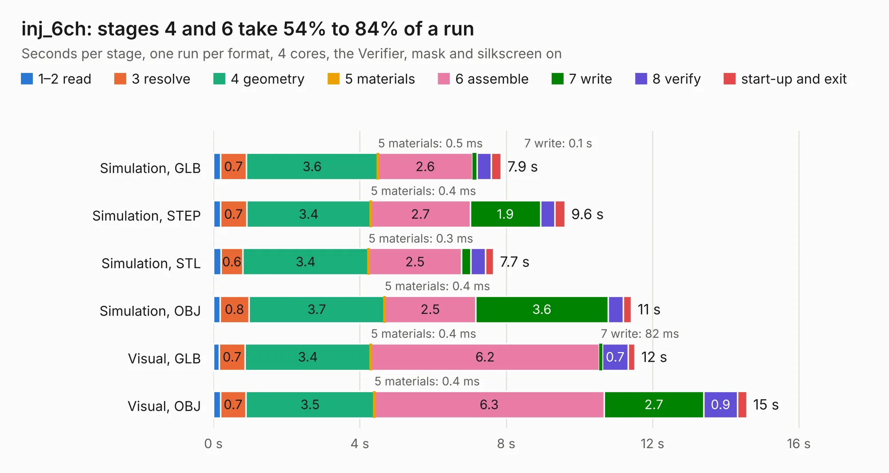

# 2433. inj_6ch

Board 2,433 of the 3,125 of [Corpus Testing](../Corpus-Testing.md), on [Corpus Page 23](../CorpusTestingPages/Corpus-Testing-23.md#2433-inj_6ch).

| Mode and format | 1–2 read | 3 resolve | 4 geometry | 5 materials | 6 assemble | 7 write | 8 verify | start-up and exit | Total |
|---|---:|---:|---:|---:|---:|---:|---:|---:|---:|
| Simulation, GLB | 0.2 | 0.7 | 3.6 | 0.5&nbsp;ms | 2.6 | 0.1 | 0.4 | 0.3 | 7.9 |
| Simulation, STEP | 0.2 | 0.7 | 3.4 | 0.4&nbsp;ms | 2.7 | 1.9 | 0.4 | 0.3 | 9.6 |
| Simulation, STL | 0.2 | 0.6 | 3.4 | 0.3&nbsp;ms | 2.5 | 0.3 | 0.4 | 0.2 | 7.7 |
| Simulation, OBJ | 0.2 | 0.8 | 3.7 | 0.4&nbsp;ms | 2.5 | 3.6 | 0.4 | 0.2 | 11.4 |
| Visual, GLB | 0.2 | 0.7 | 3.4 | 0.4&nbsp;ms | 6.2 | 82&nbsp;ms | 0.7 | 0.2 | 11.5 |
| Visual, OBJ | 0.2 | 0.7 | 3.5 | 0.4&nbsp;ms | 6.3 | 2.7 | 0.9 | 0.3 | 14.6 |

<table align="center"><tr><td valign="top">

| Board | Repo: [rusefi/rusefi-hardware](https://github.com/rusefi/rusefi-hardware) Board: `inj_6ch.kicad_pcb` |
|---|---|
| Folder | classic-designs / 1A_injector_6-channels |
| Complexity | 210&nbsp;/&nbsp;1000 (size&nbsp;165, features&nbsp;45) |
| KESE&nbsp;features | through vias, filled zones, curved board outline |
| Tested | 9th November 2026 |
| Copper&nbsp;layers | 2 |
| File&nbsp;format | KiCad 3 (3) |
| Parts,&nbsp;tracks,&nbsp;vias | 35, 472, 114 |
| Triangles,&nbsp;simulation | 757,786 in 44 parts |
| Verifier | PASS in all six runs |

</td><td valign="top">

<table>
<tr><th>File type</th><th>File size</th><th>Peak memory used</th></tr>
<tr><th colspan="3" align="left">Simulation</th></tr>
<tr><td>GLB</td><td align="right">27&nbsp;MB</td><td align="right">351&nbsp;MB</td></tr>
<tr><td>STEP</td><td align="right">134&nbsp;MB</td><td align="right">415&nbsp;MB</td></tr>
<tr><td>STL</td><td align="right">38&nbsp;MB</td><td align="right">391&nbsp;MB</td></tr>
<tr><td>OBJ</td><td align="right">80&nbsp;MB</td><td align="right">564&nbsp;MB</td></tr>
<tr><th colspan="3" align="left">Visual</th></tr>
<tr><td>GLB</td><td align="right">19&nbsp;MB</td><td align="right">441&nbsp;MB</td></tr>
<tr><td>OBJ</td><td align="right">58&nbsp;MB</td><td align="right">476&nbsp;MB</td></tr>
</table>

</td></tr></table>

| Previous | Next |
|:---|---:|
| [2432. inj_12ch](b2432b_rusefi-hardware_inj-12ch.md) | [2434. PWR_5V_linear](b2434b_rusefi-hardware_PWR-5V-linear.md) |
