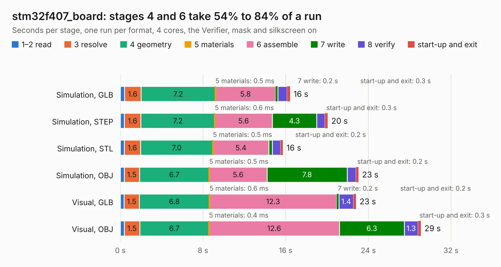

# 2434. stm32f407_board

Board 2,434 of the 3,110 of [Corpus Testing](../Corpus-Testing.md), on [Corpus Page 23](../CorpusTestingPages/Corpus-Testing-23.md#2434-stm32f407_board).

| Mode and format | 1–2 read | 3 resolve | 4 geometry | 5 materials | 6 assemble | 7 write | 8 verify | start-up and exit | Total |
|---|---:|---:|---:|---:|---:|---:|---:|---:|---:|
| Simulation, GLB | 0.4 | 1.6 | 7.2 | 0.5&nbsp;ms | 5.8 | 0.2 | 0.9 | 0.3 | 16.4 |
| Simulation, STEP | 0.4 | 1.6 | 7.2 | 0.6&nbsp;ms | 5.6 | 4.3 | 0.8 | 0.3 | 20.1 |
| Simulation, STL | 0.4 | 1.6 | 7.0 | 0.5&nbsp;ms | 5.4 | 0.3 | 0.8 | 0.2 | 15.7 |
| Simulation, OBJ | 0.4 | 1.5 | 6.7 | 0.5&nbsp;ms | 5.6 | 7.8 | 0.9 | 0.2 | 23.1 |
| Visual, GLB | 0.4 | 1.5 | 6.8 | 0.6&nbsp;ms | 12.3 | 0.2 | 1.4 | 0.2 | 22.8 |
| Visual, OBJ | 0.4 | 1.5 | 6.7 | 0.4&nbsp;ms | 12.6 | 6.3 | 1.3 | 0.3 | 29.1 |

<table align="center"><tr><td valign="top">

| Board | Repo: [rusefi/rusefi-hardware](https://github.com/rusefi/rusefi-hardware) Board: `stm32f407_board.kicad_pcb` |
|---|---|
| Folder | classic-designs / rusefi_hardware_history / brain_board_rev00.10 |
| Complexity | 255&nbsp;/&nbsp;1000 (size&nbsp;220, features&nbsp;35) |
| KESE&nbsp;features | through vias, filled zones |
| Tested | 9th November 2026 |
| Copper&nbsp;layers | 2 |
| File&nbsp;format | KiCad 3 (3) |
| Parts,&nbsp;tracks,&nbsp;vias | 66, 1,158, 61 |
| Triangles,&nbsp;simulation | 1,389,348 in 131 parts |
| Verifier | PASS in all six runs |

</td><td valign="top">

<table>
<tr><th>File type</th><th>File size</th><th>Peak memory used</th></tr>
<tr><th colspan="3" align="left">Simulation</th></tr>
<tr><td>GLB</td><td align="right">48&nbsp;MB</td><td align="right">525&nbsp;MB</td></tr>
<tr><td>STEP</td><td align="right">249&nbsp;MB</td><td align="right">724&nbsp;MB</td></tr>
<tr><td>STL</td><td align="right">69&nbsp;MB</td><td align="right">517&nbsp;MB</td></tr>
<tr><td>OBJ</td><td align="right">144&nbsp;MB</td><td align="right">934&nbsp;MB</td></tr>
<tr><th colspan="3" align="left">Visual</th></tr>
<tr><td>GLB</td><td align="right">41&nbsp;MB</td><td align="right">733&nbsp;MB</td></tr>
<tr><td>OBJ</td><td align="right">122&nbsp;MB</td><td align="right">929&nbsp;MB</td></tr>
</table>

</td></tr></table>

| Previous | Next |
|:---|---:|
| [2433. inj_6ch](b2433b_rusefi-hardware_classic-designs-rusefi-hardware-history-1A-injector-6-channels-rev00-20_inj-6ch.md) | [2435. brain_board_STM32F407](b2435b_rusefi-hardware_classic-designs-rusefi-hardware-history-brain-board-rev00-20_brain-board-STM32F407.md) |
