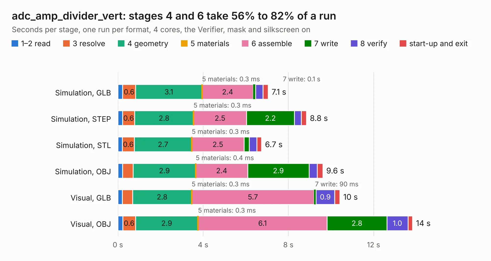

# 2436. adc_amp_divider_vert

Board 2,436 of the 3,125 of [Corpus Testing](../Corpus-Testing.md), on [Corpus Page 23](../CorpusTestingPages/Corpus-Testing-23.md#2436-adc_amp_divider_vert).

| Mode and format | 1–2 read | 3 resolve | 4 geometry | 5 materials | 6 assemble | 7 write | 8 verify | start-up and exit | Total |
|---|---:|---:|---:|---:|---:|---:|---:|---:|---:|
| Simulation, GLB | 0.2 | 0.6 | 3.1 | 0.3&nbsp;ms | 2.4 | 0.1 | 0.3 | 0.2 | 7.1 |
| Simulation, STEP | 0.2 | 0.6 | 2.8 | 0.3&nbsp;ms | 2.5 | 2.2 | 0.3 | 0.2 | 8.8 |
| Simulation, STL | 0.2 | 0.6 | 2.7 | 0.3&nbsp;ms | 2.5 | 0.2 | 0.3 | 0.2 | 6.7 |
| Simulation, OBJ | 0.2 | 0.5 | 2.9 | 0.4&nbsp;ms | 2.4 | 2.9 | 0.4 | 0.3 | 9.6 |
| Visual, GLB | 0.2 | 0.5 | 2.8 | 0.3&nbsp;ms | 5.7 | 90&nbsp;ms | 0.9 | 0.2 | 10.4 |
| Visual, OBJ | 0.2 | 0.6 | 2.9 | 0.3&nbsp;ms | 6.1 | 2.8 | 1.0 | 0.2 | 13.8 |

<table align="center"><tr><td valign="top">

| Board | Repo: [rusefi/rusefi-hardware](https://github.com/rusefi/rusefi-hardware) Board: `adc_amp_divider_vert.kicad_pcb` |
|---|---|
| Folder | classic-designs / adc_amp_divider.vertical |
| Complexity | 206&nbsp;/&nbsp;1000 (size&nbsp;171, features&nbsp;35) |
| KESE&nbsp;features | through vias, filled zones |
| Tested | 9th November 2026 |
| Copper&nbsp;layers | 2 |
| File&nbsp;format | KiCad 3 (3) |
| Parts,&nbsp;tracks,&nbsp;vias | 75, 554, 42 |
| Triangles,&nbsp;simulation | 626,696 in 58 parts |
| Verifier | PASS in all six runs |

</td><td valign="top">

<table>
<tr><th>File type</th><th>File size</th><th>Peak memory used</th></tr>
<tr><th colspan="3" align="left">Simulation</th></tr>
<tr><td>GLB</td><td align="right">22&nbsp;MB</td><td align="right">385&nbsp;MB</td></tr>
<tr><td>STEP</td><td align="right">124&nbsp;MB</td><td align="right">438&nbsp;MB</td></tr>
<tr><td>STL</td><td align="right">31&nbsp;MB</td><td align="right">401&nbsp;MB</td></tr>
<tr><td>OBJ</td><td align="right">64&nbsp;MB</td><td align="right">464&nbsp;MB</td></tr>
<tr><th colspan="3" align="left">Visual</th></tr>
<tr><td>GLB</td><td align="right">20&nbsp;MB</td><td align="right">543&nbsp;MB</td></tr>
<tr><td>OBJ</td><td align="right">58&nbsp;MB</td><td align="right">534&nbsp;MB</td></tr>
</table>

</td></tr></table>

| Previous | Next |
|:---|---:|
| [2435. stepper_motor_driver](b2435b_rusefi-hardware_stepper-motor-driver.md) | [2437. adc_amp_divider](b2437b_rusefi-hardware_classic-designs-adc-amp-divider-vertical12_adc-amp-divider.md) |
