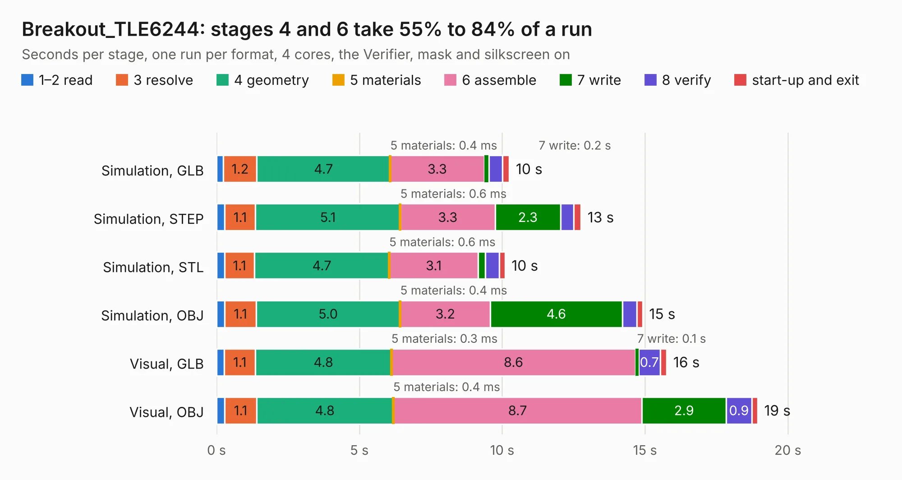

# 2438. Breakout_TLE6244

Board 2,438 of the 3,108 of [Corpus Testing](../Corpus-Testing.md), on [Corpus Page 23](../CorpusTestingPages/Corpus-Testing-23.md#2438-breakout_tle6244).

| Mode and format | 1–2 read | 3 resolve | 4 geometry | 5 materials | 6 assemble | 7 write | 8 verify | start-up and exit | Total |
|---|---:|---:|---:|---:|---:|---:|---:|---:|---:|
| Simulation, GLB | 0.2 | 1.2 | 4.7 | 0.4&nbsp;ms | 3.3 | 0.2 | 0.5 | 0.2 | 10.3 |
| Simulation, STEP | 0.3 | 1.1 | 5.1 | 0.6&nbsp;ms | 3.3 | 2.3 | 0.5 | 0.3 | 12.8 |
| Simulation, STL | 0.3 | 1.1 | 4.7 | 0.6&nbsp;ms | 3.1 | 0.2 | 0.5 | 0.2 | 10.1 |
| Simulation, OBJ | 0.3 | 1.1 | 5.0 | 0.4&nbsp;ms | 3.2 | 4.6 | 0.5 | 0.2 | 14.9 |
| Visual, GLB | 0.3 | 1.1 | 4.8 | 0.3&nbsp;ms | 8.6 | 0.1 | 0.7 | 0.2 | 15.8 |
| Visual, OBJ | 0.3 | 1.1 | 4.8 | 0.4&nbsp;ms | 8.7 | 2.9 | 0.9 | 0.2 | 18.9 |

<table align="center"><tr><td valign="top">

| Board | Repo: [rusefi/rusefi-hardware](https://github.com/rusefi/rusefi-hardware) Board: `Breakout_TLE6244.kicad_pcb` |
|---|---|
| Folder | classic-designs / rusefi_hardware_history / Breakout_TLE6244_rev00.10 / Breakout_TLE6244 |
| Complexity | 275&nbsp;/&nbsp;1000 (size&nbsp;230, features&nbsp;45) |
| KESE&nbsp;features | through vias, filled zones, curved board outline |
| Tested | 9th November 2026 |
| Copper&nbsp;layers | 4 |
| File&nbsp;format | KiCad 3 (3) |
| Parts,&nbsp;tracks,&nbsp;vias | 73, 517, 100 |
| Triangles,&nbsp;simulation | 977,132 in 94 parts |
| Verifier | PASS in all six runs |

</td><td valign="top">

<table>
<tr><th>File type</th><th>File size</th><th>Peak memory used</th></tr>
<tr><th colspan="3" align="left">Simulation</th></tr>
<tr><td>GLB</td><td align="right">34&nbsp;MB</td><td align="right">395&nbsp;MB</td></tr>
<tr><td>STEP</td><td align="right">147&nbsp;MB</td><td align="right">474&nbsp;MB</td></tr>
<tr><td>STL</td><td align="right">49&nbsp;MB</td><td align="right">420&nbsp;MB</td></tr>
<tr><td>OBJ</td><td align="right">101&nbsp;MB</td><td align="right">706&nbsp;MB</td></tr>
<tr><th colspan="3" align="left">Visual</th></tr>
<tr><td>GLB</td><td align="right">22&nbsp;MB</td><td align="right">504&nbsp;MB</td></tr>
<tr><td>OBJ</td><td align="right">66&nbsp;MB</td><td align="right">546&nbsp;MB</td></tr>
</table>

</td></tr></table>

| Previous | Next |
|:---|---:|
| [2437. pin_board_1_x2](b2437b_rusefi-hardware_pin-board-1-x2.md) | [2439. denso079721_outline-append](b2439b_rusefi-hardware_denso079721-outline-append.md) |
