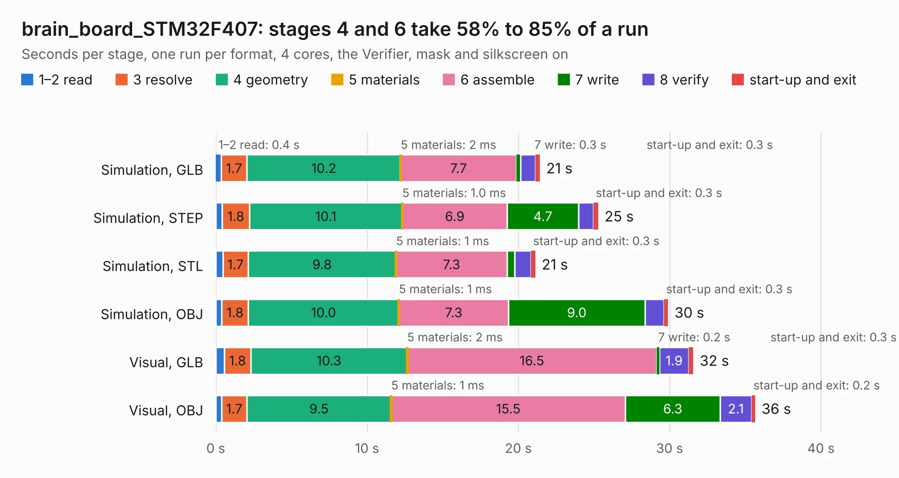

# 2438. brain_board_STM32F407

Board 2,438 of the 3,112 of [Corpus Testing](../Corpus-Testing.md), on [Corpus Page 23](../CorpusTestingPages/Corpus-Testing-23.md#2438-brain_board_stm32f407).

| Mode and format | 1–2 read | 3 resolve | 4 geometry | 5 materials | 6 assemble | 7 write | 8 verify | start-up and exit | Total |
|---|---:|---:|---:|---:|---:|---:|---:|---:|---:|
| Simulation, GLB | 0.4 | 1.7 | 10.2 | 2&nbsp;ms | 7.7 | 0.3 | 1.0 | 0.3 | 21.4 |
| Simulation, STEP | 0.4 | 1.8 | 10.1 | 1.0&nbsp;ms | 6.9 | 4.7 | 1.0 | 0.3 | 25.3 |
| Simulation, STL | 0.5 | 1.7 | 9.8 | 1&nbsp;ms | 7.3 | 0.5 | 1.1 | 0.3 | 21.1 |
| Simulation, OBJ | 0.4 | 1.8 | 10.0 | 1&nbsp;ms | 7.3 | 9.0 | 1.3 | 0.3 | 29.9 |
| Visual, GLB | 0.6 | 1.8 | 10.3 | 2&nbsp;ms | 16.5 | 0.2 | 1.9 | 0.3 | 31.6 |
| Visual, OBJ | 0.4 | 1.7 | 9.5 | 1&nbsp;ms | 15.5 | 6.3 | 2.1 | 0.2 | 35.7 |

<table align="center"><tr><td valign="top">

| Board | Repo: [rusefi/rusefi-hardware](https://github.com/rusefi/rusefi-hardware) Board: `brain_board_STM32F407.kicad_pcb` |
|---|---|
| Folder | classic-designs / rusefi_hardware_history / brain_board_rev00.30 / brain_board |
| Complexity | 271&nbsp;/&nbsp;1000 (size&nbsp;226, features&nbsp;45) |
| KESE&nbsp;features | through vias, slotted holes, filled zones |
| Tested | 9th November 2026 |
| Copper&nbsp;layers | 2 |
| File&nbsp;format | KiCad 4 (4) |
| Parts,&nbsp;tracks,&nbsp;vias | 69, 1,561, 92 |
| Triangles,&nbsp;simulation | 1,683,722 in 123 parts |
| Verifier | PASS in all six runs |

</td><td valign="top">

<table>
<tr><th>File type</th><th>File size</th><th>Peak memory used</th></tr>
<tr><th colspan="3" align="left">Simulation</th></tr>
<tr><td>GLB</td><td align="right">59&nbsp;MB</td><td align="right">697&nbsp;MB</td></tr>
<tr><td>STEP</td><td align="right">321&nbsp;MB</td><td align="right">744&nbsp;MB</td></tr>
<tr><td>STL</td><td align="right">84&nbsp;MB</td><td align="right">634&nbsp;MB</td></tr>
<tr><td>OBJ</td><td align="right">179&nbsp;MB</td><td align="right">1.2&nbsp;GB</td></tr>
<tr><th colspan="3" align="left">Visual</th></tr>
<tr><td>GLB</td><td align="right">45&nbsp;MB</td><td align="right">936&nbsp;MB</td></tr>
<tr><td>OBJ</td><td align="right">134&nbsp;MB</td><td align="right">925&nbsp;MB</td></tr>
</table>

</td></tr></table>

| Previous | Next |
|:---|---:|
| [2437. brain_board_STM32F407](b2437b_rusefi-hardware_classic-designs-rusefi-hardware-history-brain-board-rev00-20_brain-board-STM32F407.md) | [2439. brain_board_SD_Card_1](b2439b_rusefi-hardware_brain-board-SD-Card-1.md) |
