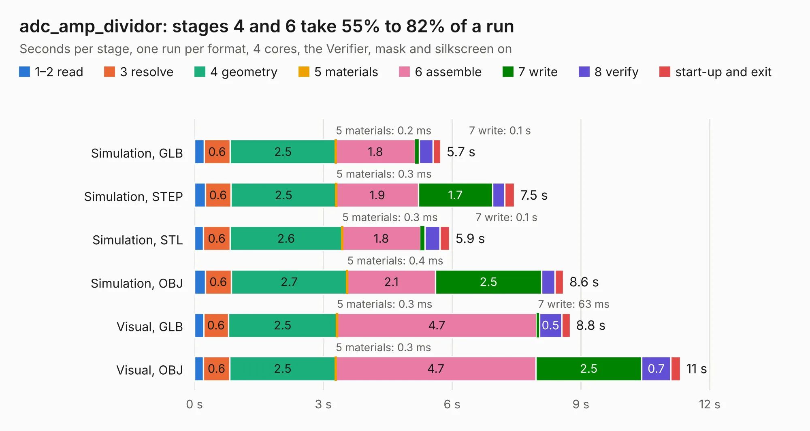

# 2439. adc_amp_dividor

Board 2,439 of the 3,125 of [Corpus Testing](../Corpus-Testing.md), on [Corpus Page 23](../CorpusTestingPages/Corpus-Testing-23.md#2439-adc_amp_dividor).

| Mode and format | 1–2 read | 3 resolve | 4 geometry | 5 materials | 6 assemble | 7 write | 8 verify | start-up and exit | Total |
|---|---:|---:|---:|---:|---:|---:|---:|---:|---:|
| Simulation, GLB | 0.2 | 0.6 | 2.5 | 0.2&nbsp;ms | 1.8 | 0.1 | 0.3 | 0.2 | 5.7 |
| Simulation, STEP | 0.3 | 0.6 | 2.5 | 0.3&nbsp;ms | 1.9 | 1.7 | 0.3 | 0.2 | 7.5 |
| Simulation, STL | 0.2 | 0.6 | 2.6 | 0.3&nbsp;ms | 1.8 | 0.1 | 0.4 | 0.2 | 5.9 |
| Simulation, OBJ | 0.3 | 0.6 | 2.7 | 0.4&nbsp;ms | 2.1 | 2.5 | 0.3 | 0.2 | 8.6 |
| Visual, GLB | 0.2 | 0.6 | 2.5 | 0.3&nbsp;ms | 4.7 | 63&nbsp;ms | 0.5 | 0.2 | 8.8 |
| Visual, OBJ | 0.2 | 0.6 | 2.5 | 0.3&nbsp;ms | 4.7 | 2.5 | 0.7 | 0.2 | 11.3 |

<table align="center"><tr><td valign="top">

| Board | Repo: [rusefi/rusefi-hardware](https://github.com/rusefi/rusefi-hardware) Board: `adc_amp_dividor.kicad_pcb` |
|---|---|
| Folder | classic-designs / adc_amp_divider / history / rev00.10 |
| Complexity | 210&nbsp;/&nbsp;1000 (size&nbsp;175, features&nbsp;35) |
| KESE&nbsp;features | through vias, filled zones |
| Tested | 9th November 2026 |
| Copper&nbsp;layers | 2 |
| File&nbsp;format | KiCad 3 (3) |
| Parts,&nbsp;tracks,&nbsp;vias | 84, 684, 55 |
| Triangles,&nbsp;simulation | 489,820 in 56 parts |
| Verifier | PASS in all six runs |

</td><td valign="top">

<table>
<tr><th>File type</th><th>File size</th><th>Peak memory used</th></tr>
<tr><th colspan="3" align="left">Simulation</th></tr>
<tr><td>GLB</td><td align="right">17&nbsp;MB</td><td align="right">311&nbsp;MB</td></tr>
<tr><td>STEP</td><td align="right">85&nbsp;MB</td><td align="right">376&nbsp;MB</td></tr>
<tr><td>STL</td><td align="right">24&nbsp;MB</td><td align="right">317&nbsp;MB</td></tr>
<tr><td>OBJ</td><td align="right">51&nbsp;MB</td><td align="right">395&nbsp;MB</td></tr>
<tr><th colspan="3" align="left">Visual</th></tr>
<tr><td>GLB</td><td align="right">15&nbsp;MB</td><td align="right">443&nbsp;MB</td></tr>
<tr><td>OBJ</td><td align="right">45&nbsp;MB</td><td align="right">445&nbsp;MB</td></tr>
</table>

</td></tr></table>

| Previous | Next |
|:---|---:|
| [2438. adc_amp_divider](b2438b_rusefi-hardware_classic-designs-adc-amp-divider_adc-amp-divider.md) | [2440. adc_amp_divider](b2440b_rusefi-hardware_classic-designs-adc-amp-divider-history-rev00-20_adc-amp-divider.md) |
