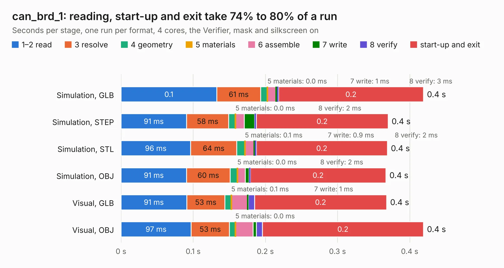

# 2439. can_brd_1

Board 2,439 of the 3,107 of [Corpus Testing](../Corpus-Testing.md), on [Corpus Page 23](../CorpusTestingPages/Corpus-Testing-23.md#2439-can_brd_1).

| Mode and format | 1–2 read | 3 resolve | 4 geometry | 5 materials | 6 assemble | 7 write | 8 verify | start-up and exit | Total |
|---|---:|---:|---:|---:|---:|---:|---:|---:|---:|
| Simulation, GLB | 0.1 | 61&nbsp;ms | 9&nbsp;ms | 0.0&nbsp;ms | 12&nbsp;ms | 1&nbsp;ms | 3&nbsp;ms | 0.2 | 0.4 |
| Simulation, STEP | 91&nbsp;ms | 58&nbsp;ms | 9&nbsp;ms | 0.0&nbsp;ms | 12&nbsp;ms | 14&nbsp;ms | 2&nbsp;ms | 0.2 | 0.4 |
| Simulation, STL | 96&nbsp;ms | 64&nbsp;ms | 11&nbsp;ms | 0.1&nbsp;ms | 13&nbsp;ms | 0.9&nbsp;ms | 2&nbsp;ms | 0.2 | 0.4 |
| Simulation, OBJ | 91&nbsp;ms | 60&nbsp;ms | 10&nbsp;ms | 0.0&nbsp;ms | 11&nbsp;ms | 5&nbsp;ms | 2&nbsp;ms | 0.2 | 0.4 |
| Visual, GLB | 91&nbsp;ms | 53&nbsp;ms | 9&nbsp;ms | 0.1&nbsp;ms | 22&nbsp;ms | 1&nbsp;ms | 9&nbsp;ms | 0.2 | 0.4 |
| Visual, OBJ | 97&nbsp;ms | 53&nbsp;ms | 8&nbsp;ms | 0.0&nbsp;ms | 25&nbsp;ms | 5&nbsp;ms | 8&nbsp;ms | 0.2 | 0.4 |

<table align="center"><tr><td valign="top">

| Board | Repo: [rusefi/rusefi-hardware](https://github.com/rusefi/rusefi-hardware) Board: `can_brd_1.kicad_pcb` |
|---|---|
| Folder | classic-designs / rusefi_hardware_history / can_board_rev00.10 |
| Complexity | 164&nbsp;/&nbsp;1000 (size&nbsp;119, features&nbsp;45) |
| KESE&nbsp;features | through vias, filled zones, curved board outline |
| Tested | 9th November 2026 |
| Copper&nbsp;layers | 2 |
| File&nbsp;format | KiCad 3 (3) |
| Parts,&nbsp;tracks,&nbsp;vias | 10, 87, 6 |
| Triangles,&nbsp;simulation | 840 in 3 parts |
| Verifier | PASS in all six runs |

</td><td valign="top">

<table>
<tr><th>File type</th><th>File size</th><th>Peak memory used</th></tr>
<tr><th colspan="3" align="left">Simulation</th></tr>
<tr><td>GLB</td><td align="right">27&nbsp;kB</td><td align="right">58&nbsp;MB</td></tr>
<tr><td>STEP</td><td align="right">20&nbsp;kB</td><td align="right">60&nbsp;MB</td></tr>
<tr><td>STL</td><td align="right">42&nbsp;kB</td><td align="right">60&nbsp;MB</td></tr>
<tr><td>OBJ</td><td align="right">76&nbsp;kB</td><td align="right">60&nbsp;MB</td></tr>
<tr><th colspan="3" align="left">Visual</th></tr>
<tr><td>GLB</td><td align="right">34&nbsp;kB</td><td align="right">64&nbsp;MB</td></tr>
<tr><td>OBJ</td><td align="right">76&nbsp;kB</td><td align="right">65&nbsp;MB</td></tr>
</table>

</td></tr></table>

| Previous | Next |
|:---|---:|
| [2438. denso079721_outline-append](b2438b_rusefi-hardware_denso079721-outline-append.md) | [2440. can_brd_1](b2440b_rusefi-hardware_classic-designs-rusefi-hardware-history-can-board-rev00-20-can-board_can-brd-1.md) |
