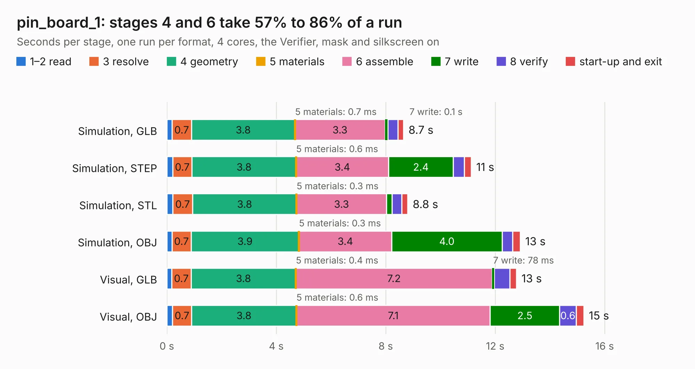

# 2440. pin_board_1

Board 2,440 of the 3,112 of [Corpus Testing](../Corpus-Testing.md), on [Corpus Page 23](../CorpusTestingPages/Corpus-Testing-23.md#2440-pin_board_1).

| Mode and format | 1–2 read | 3 resolve | 4 geometry | 5 materials | 6 assemble | 7 write | 8 verify | start-up and exit | Total |
|---|---:|---:|---:|---:|---:|---:|---:|---:|---:|
| Simulation, GLB | 0.2 | 0.7 | 3.8 | 0.7&nbsp;ms | 3.3 | 0.1 | 0.4 | 0.2 | 8.7 |
| Simulation, STEP | 0.2 | 0.7 | 3.8 | 0.6&nbsp;ms | 3.4 | 2.4 | 0.4 | 0.3 | 11.1 |
| Simulation, STL | 0.2 | 0.7 | 3.8 | 0.3&nbsp;ms | 3.3 | 0.2 | 0.4 | 0.2 | 8.8 |
| Simulation, OBJ | 0.2 | 0.7 | 3.9 | 0.3&nbsp;ms | 3.4 | 4.0 | 0.4 | 0.3 | 12.9 |
| Visual, GLB | 0.2 | 0.7 | 3.8 | 0.4&nbsp;ms | 7.2 | 78&nbsp;ms | 0.6 | 0.2 | 12.8 |
| Visual, OBJ | 0.2 | 0.7 | 3.8 | 0.6&nbsp;ms | 7.1 | 2.5 | 0.6 | 0.3 | 15.2 |

<table align="center"><tr><td valign="top">

| Board | Repo: [rusefi/rusefi-hardware](https://github.com/rusefi/rusefi-hardware) Board: `pin_board_1.kicad_pcb` |
|---|---|
| Folder | classic-designs / rusefi_hardware_history / breakout_board_rev00.10 |
| Complexity | 181&nbsp;/&nbsp;1000 (size&nbsp;136, features&nbsp;45) |
| KESE&nbsp;features | through vias, filled zones, curved board outline |
| Tested | 9th November 2026 |
| Copper&nbsp;layers | 2 |
| File&nbsp;format | KiCad 3 (3) |
| Parts,&nbsp;tracks,&nbsp;vias | 50, 77, 9 |
| Triangles,&nbsp;simulation | 680,032 in 42 parts |
| Verifier | PASS in all six runs |

</td><td valign="top">

<table>
<tr><th>File type</th><th>File size</th><th>Peak memory used</th></tr>
<tr><th colspan="3" align="left">Simulation</th></tr>
<tr><td>GLB</td><td align="right">22&nbsp;MB</td><td align="right">343&nbsp;MB</td></tr>
<tr><td>STEP</td><td align="right">104&nbsp;MB</td><td align="right">424&nbsp;MB</td></tr>
<tr><td>STL</td><td align="right">34&nbsp;MB</td><td align="right">335&nbsp;MB</td></tr>
<tr><td>OBJ</td><td align="right">68&nbsp;MB</td><td align="right">498&nbsp;MB</td></tr>
<tr><th colspan="3" align="left">Visual</th></tr>
<tr><td>GLB</td><td align="right">15&nbsp;MB</td><td align="right">441&nbsp;MB</td></tr>
<tr><td>OBJ</td><td align="right">45&nbsp;MB</td><td align="right">439&nbsp;MB</td></tr>
</table>

</td></tr></table>

| Previous | Next |
|:---|---:|
| [2439. brain_board_SD_Card_1](b2439b_rusefi-hardware_brain-board-SD-Card-1.md) | [2441. pin_board_1_x2](b2441b_rusefi-hardware_pin-board-1-x2.md) |
