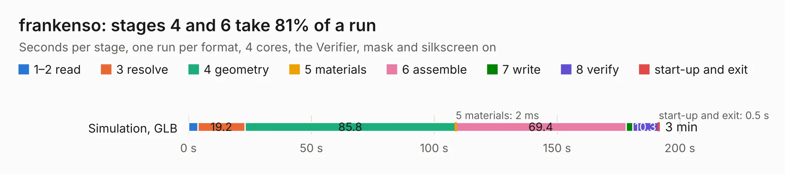

# 2441. frankenso

Board 2,441 of the 3,124 of [Corpus Testing](../Corpus-Testing.md), on [Corpus Page 23](../CorpusTestingPages/Corpus-Testing-23.md#2441-frankenso).

| Mode and format | 1–2 read | 3 resolve | 4 geometry | 5 materials | 6 assemble | 7 write | 8 verify | start-up and exit | Total |
|---|---:|---:|---:|---:|---:|---:|---:|---:|---:|
| Simulation, GLB | 3.8 | 19.2 | 85.8 | 2&nbsp;ms | 69.4 | 2.8 | 10.3 | 0.5 | 191.7 |
| Simulation, STEP | 3.7 | 19.0 | 85.4 | 2&nbsp;ms | 68.2 | 36.9 | 9.8 | 0.5 | 223.6 |
| Simulation, STL | 3.7 | 19.1 | 83.0 | 3&nbsp;ms | 70.8 | 6.1 | 10.5 | 0.6 | 193.9 |
| Simulation, OBJ | 4.0 | 19.8 | 89.0 | 2&nbsp;ms | 69.0 | 88.2 | 10.7 | 0.5 | 281.2 |
| Visual, GLB | 3.8 | 19.7 | 87.9 | 2&nbsp;ms | 176.9 | 1.6 | 12.8 | 0.5 | 303.1 |
| Visual, OBJ | 3.9 | 19.3 | 89.3 | 2&nbsp;ms | 173.6 | 48.7 | 12.3 | 0.4 | 347.5 |

<table align="center"><tr><td valign="top">

| Board | Repo: [rusefi/rusefi-hardware](https://github.com/rusefi/rusefi-hardware) Board: `frankenso.kicad_pcb` |
|---|---|
| Folder | classic-designs / frankenso |
| Complexity | 356&nbsp;/&nbsp;1000 (size&nbsp;291, features&nbsp;65) |
| KESE&nbsp;features | through vias, slotted holes, filled zones, copper text, curved board outline |
| Tested | 9th November 2026 |
| Copper&nbsp;layers | 4 |
| File&nbsp;format | KiCad 5 (20171130) |
| Parts,&nbsp;tracks,&nbsp;vias | 551, 5,736, 1,102 |
| Triangles,&nbsp;simulation | 14,232,850 in 426 parts |
| Verifier | PASS in all six runs |

</td><td valign="top">

<table>
<tr><th>File type</th><th>File size</th><th>Peak memory used</th></tr>
<tr><th colspan="3" align="left">Simulation</th></tr>
<tr><td>GLB</td><td align="right">493&nbsp;MB</td><td align="right">3.1&nbsp;GB</td></tr>
<tr><td>STEP</td><td align="right">2.2&nbsp;GB</td><td align="right">4.2&nbsp;GB</td></tr>
<tr><td>STL</td><td align="right">712&nbsp;MB</td><td align="right">3.0&nbsp;GB</td></tr>
<tr><td>OBJ</td><td align="right">1.6&nbsp;GB</td><td align="right">9.1&nbsp;GB</td></tr>
<tr><th colspan="3" align="left">Visual</th></tr>
<tr><td>GLB</td><td align="right">296&nbsp;MB</td><td align="right">4.5&nbsp;GB</td></tr>
<tr><td>OBJ</td><td align="right">942&nbsp;MB</td><td align="right">5.8&nbsp;GB</td></tr>
</table>

</td></tr></table>

| Previous | Next |
|:---|---:|
| [2440. frankenso-PWR-Supply](b2440b_rusefi-hardware_classic-designs-frankenso-PWR-Supply_frankenso-PWR-Supply.md) | [2442. frankenstein](b2442b_rusefi-hardware_classic-designs-frankenstein_frankenstein.md) |
