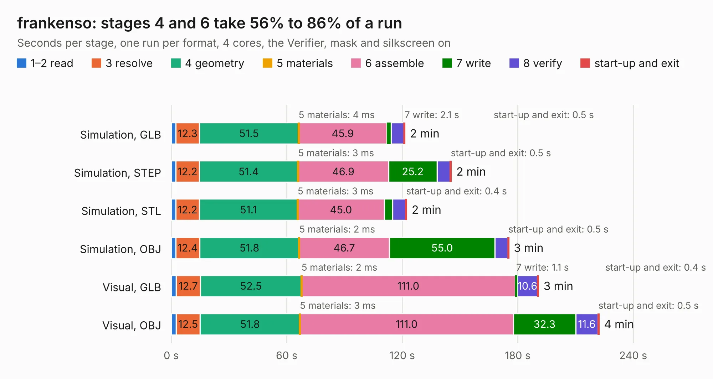

# 2441. frankenso

Board 2,441 of the 3,104 of [Corpus Testing](../Corpus-Testing.md), on [Corpus Page 23](../CorpusTestingPages/Corpus-Testing-23.md#2441-frankenso).

| Mode and format | 1–2 read | 3 resolve | 4 geometry | 5 materials | 6 assemble | 7 write | 8 verify | start-up and exit | Total |
|---|---:|---:|---:|---:|---:|---:|---:|---:|---:|
| Simulation, GLB | 2.4 | 12.3 | 51.5 | 4&nbsp;ms | 45.9 | 2.1 | 6.6 | 0.5 | 121.4 |
| Simulation, STEP | 2.4 | 12.2 | 51.4 | 3&nbsp;ms | 46.9 | 25.2 | 6.9 | 0.5 | 145.5 |
| Simulation, STL | 2.4 | 12.2 | 51.1 | 3&nbsp;ms | 45.0 | 4.3 | 6.8 | 0.4 | 122.3 |
| Simulation, OBJ | 2.3 | 12.4 | 51.8 | 2&nbsp;ms | 46.7 | 55.0 | 6.6 | 0.5 | 175.3 |
| Visual, GLB | 2.5 | 12.7 | 52.5 | 2&nbsp;ms | 111.0 | 1.1 | 10.6 | 0.4 | 190.8 |
| Visual, OBJ | 2.5 | 12.5 | 51.8 | 3&nbsp;ms | 111.0 | 32.3 | 11.6 | 0.5 | 222.2 |

<table align="center"><tr><td valign="top">

| Board | Repo: [rusefi/rusefi-hardware](https://github.com/rusefi/rusefi-hardware) Board: `frankenso.kicad_pcb` |
|---|---|
| Folder | classic-designs / rusefi_hardware_history / frankenso_rev00.20 / frankenso |
| Complexity | 339&nbsp;/&nbsp;1000 (size&nbsp;284, features&nbsp;55) |
| KESE&nbsp;features | through vias, slotted holes, filled zones, curved board outline |
| Tested | 9th November 2026 |
| Copper&nbsp;layers | 4 |
| File&nbsp;format | KiCad 3 (3) |
| Parts,&nbsp;tracks,&nbsp;vias | 483, 4,621, 660 |
| Triangles,&nbsp;simulation | 9,519,422 in 372 parts |
| Verifier | PASS in all six runs |

</td><td valign="top">

<table>
<tr><th>File type</th><th>File size</th><th>Peak memory used</th></tr>
<tr><th colspan="3" align="left">Simulation</th></tr>
<tr><td>GLB</td><td align="right">332&nbsp;MB</td><td align="right">2.1&nbsp;GB</td></tr>
<tr><td>STEP</td><td align="right">1.6&nbsp;GB</td><td align="right">3.0&nbsp;GB</td></tr>
<tr><td>STL</td><td align="right">476&nbsp;MB</td><td align="right">2.1&nbsp;GB</td></tr>
<tr><td>OBJ</td><td align="right">1.0&nbsp;GB</td><td align="right">6.1&nbsp;GB</td></tr>
<tr><th colspan="3" align="left">Visual</th></tr>
<tr><td>GLB</td><td align="right">207&nbsp;MB</td><td align="right">3.1&nbsp;GB</td></tr>
<tr><td>OBJ</td><td align="right">656&nbsp;MB</td><td align="right">4.1&nbsp;GB</td></tr>
</table>

</td></tr></table>

| Previous | Next |
|:---|---:|
| [2440. frankenso-PWR-Supply](b2440b_rusefi-hardware_classic-designs-rusefi-hardware-history-frankenso-power-supply-rev00-10-frankenso-PWR-Supply_frankenso-PWR-Supply.md) | [2442. frankenso](b2442b_rusefi-hardware_classic-designs-rusefi-hardware-history-frankenso-rev00-40-frankenso_frankenso.md) |
