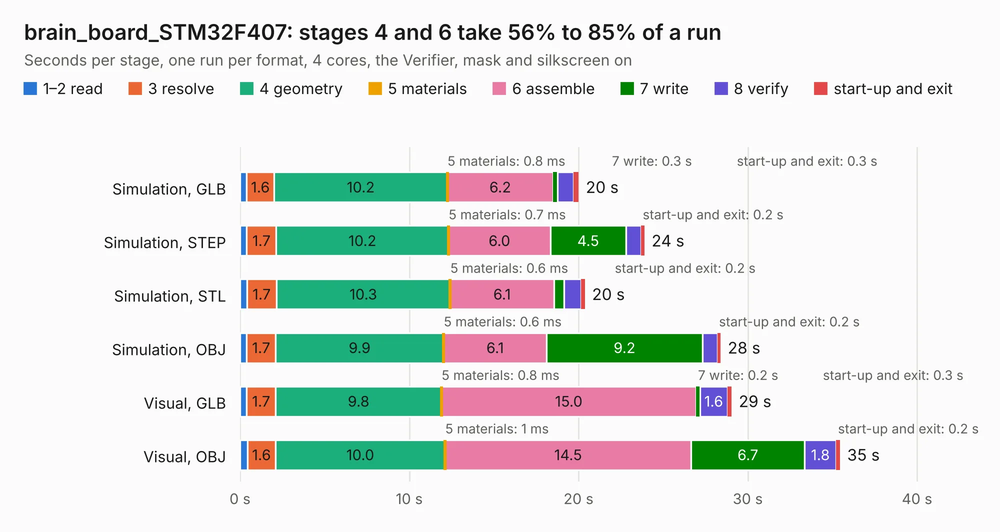

# 2442. brain_board_STM32F407

Board 2,442 of the 3,117 of [Corpus Testing](../Corpus-Testing.md), on [Corpus Page 23](../CorpusTestingPages/Corpus-Testing-23.md#2442-brain_board_stm32f407).

| Mode and format | 1–2 read | 3 resolve | 4 geometry | 5 materials | 6 assemble | 7 write | 8 verify | start-up and exit | Total |
|---|---:|---:|---:|---:|---:|---:|---:|---:|---:|
| Simulation, GLB | 0.4 | 1.6 | 10.2 | 0.8&nbsp;ms | 6.2 | 0.3 | 1.0 | 0.3 | 20.0 |
| Simulation, STEP | 0.4 | 1.7 | 10.2 | 0.7&nbsp;ms | 6.0 | 4.5 | 0.9 | 0.2 | 23.9 |
| Simulation, STL | 0.4 | 1.7 | 10.3 | 0.6&nbsp;ms | 6.1 | 0.6 | 1.0 | 0.2 | 20.4 |
| Simulation, OBJ | 0.4 | 1.7 | 9.9 | 0.6&nbsp;ms | 6.1 | 9.2 | 0.9 | 0.2 | 28.4 |
| Visual, GLB | 0.4 | 1.7 | 9.8 | 0.8&nbsp;ms | 15.0 | 0.2 | 1.6 | 0.3 | 29.0 |
| Visual, OBJ | 0.4 | 1.6 | 10.0 | 1&nbsp;ms | 14.5 | 6.7 | 1.8 | 0.2 | 35.4 |

<table align="center"><tr><td valign="top">

| Board | Repo: [rusefi/rusefi-hardware](https://github.com/rusefi/rusefi-hardware) Board: `brain_board_STM32F407.kicad_pcb` |
|---|---|
| Folder | classic-designs / rusefi_hardware_history / brain_board_rev00.20 |
| Complexity | 268&nbsp;/&nbsp;1000 (size&nbsp;223, features&nbsp;45) |
| KESE&nbsp;features | through vias, slotted holes, filled zones |
| Tested | 9th November 2026 |
| Copper&nbsp;layers | 2 |
| File&nbsp;format | KiCad 4 (4) |
| Parts,&nbsp;tracks,&nbsp;vias | 69, 1,301, 83 |
| Triangles,&nbsp;simulation | 1,706,544 in 123 parts |
| Verifier | PASS in all six runs |

</td><td valign="top">

<table>
<tr><th>File type</th><th>File size</th><th>Peak memory used</th></tr>
<tr><th colspan="3" align="left">Simulation</th></tr>
<tr><td>GLB</td><td align="right">60&nbsp;MB</td><td align="right">690&nbsp;MB</td></tr>
<tr><td>STEP</td><td align="right">325&nbsp;MB</td><td align="right">773&nbsp;MB</td></tr>
<tr><td>STL</td><td align="right">85&nbsp;MB</td><td align="right">659&nbsp;MB</td></tr>
<tr><td>OBJ</td><td align="right">182&nbsp;MB</td><td align="right">1.2&nbsp;GB</td></tr>
<tr><th colspan="3" align="left">Visual</th></tr>
<tr><td>GLB</td><td align="right">46&nbsp;MB</td><td align="right">984&nbsp;MB</td></tr>
<tr><td>OBJ</td><td align="right">139&nbsp;MB</td><td align="right">971&nbsp;MB</td></tr>
</table>

</td></tr></table>

| Previous | Next |
|:---|---:|
| [2441. stm32f407_board](b2441b_rusefi-hardware_stm32f407-board.md) | [2443. brain_board_STM32F407](b2443b_rusefi-hardware_classic-designs-rusefi-hardware-history-brain-board-rev00-30-brain-board_brain-board-STM32F407.md) |
