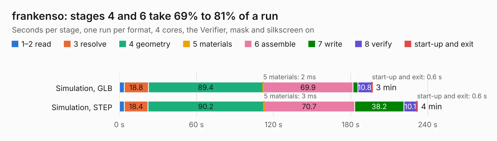

# 2442. frankenso

Board 2,442 of the 3,103 of [Corpus Testing](../Corpus-Testing.md), on [Corpus Page 23](../CorpusTestingPages/Corpus-Testing-23.md#2442-frankenso).

| Mode and format | 1–2 read | 3 resolve | 4 geometry | 5 materials | 6 assemble | 7 write | 8 verify | start-up and exit | Total |
|---|---:|---:|---:|---:|---:|---:|---:|---:|---:|
| Simulation, GLB | 3.8 | 18.8 | 89.4 | 2&nbsp;ms | 69.9 | 3.7 | 10.8 | 0.6 | 196.9 |
| Simulation, STEP | 3.9 | 18.4 | 90.2 | 3&nbsp;ms | 70.7 | 38.2 | 10.1 | 0.6 | 232.1 |
| Simulation, STL | 3.6 | 18.2 | 88.2 | 2&nbsp;ms | 65.8 | 6.8 | 10.2 | 0.5 | 193.3 |
| Simulation, OBJ | 3.5 | 17.7 | 85.5 | 3&nbsp;ms | 66.3 | 89.5 | 10.1 | 0.5 | 273.0 |
| Visual, GLB | 4.0 | 17.7 | 85.4 | 3&nbsp;ms | 180.6 | 1.6 | 15.1 | 0.5 | 304.9 |
| Visual, OBJ | 4.2 | 19.9 | 94.2 | 2&nbsp;ms | 230.2 | 64.0 | 16.3 | 0.6 | 429.3 |

<table align="center"><tr><td valign="top">

| Board | Repo: [rusefi/rusefi-hardware](https://github.com/rusefi/rusefi-hardware) Board: `frankenso.kicad_pcb` |
|---|---|
| Folder | classic-designs / rusefi_hardware_history / frankenso_rev00.50 / frankenso |
| Complexity | 355&nbsp;/&nbsp;1000 (size&nbsp;290, features&nbsp;65) |
| KESE&nbsp;features | through vias, slotted holes, filled zones, copper text, curved board outline |
| Tested | 9th November 2026 |
| Copper&nbsp;layers | 4 |
| File&nbsp;format | KiCad 4 (4) |
| Parts,&nbsp;tracks,&nbsp;vias | 552, 5,576, 1,031 |
| Triangles,&nbsp;simulation | 14,019,168 in 435 parts |
| Verifier | PASS in all six runs |

</td><td valign="top">

<table>
<tr><th>File type</th><th>File size</th><th>Peak memory used</th></tr>
<tr><th colspan="3" align="left">Simulation</th></tr>
<tr><td>GLB</td><td align="right">486&nbsp;MB</td><td align="right">3.0&nbsp;GB</td></tr>
<tr><td>STEP</td><td align="right">2.2&nbsp;GB</td><td align="right">4.2&nbsp;GB</td></tr>
<tr><td>STL</td><td align="right">701&nbsp;MB</td><td align="right">2.9&nbsp;GB</td></tr>
<tr><td>OBJ</td><td align="right">1.5&nbsp;GB</td><td align="right">9.0&nbsp;GB</td></tr>
<tr><th colspan="3" align="left">Visual</th></tr>
<tr><td>GLB</td><td align="right">289&nbsp;MB</td><td align="right">4.3&nbsp;GB</td></tr>
<tr><td>OBJ</td><td align="right">919&nbsp;MB</td><td align="right">5.8&nbsp;GB</td></tr>
</table>

</td></tr></table>

| Previous | Next |
|:---|---:|
| [2441. frankenso](b2441b_rusefi-hardware_classic-designs-rusefi-hardware-history-frankenso-rev00-40-frankenso_frankenso.md) | [2443. discovery](b2443b_rusefi-hardware_discovery.md) |
