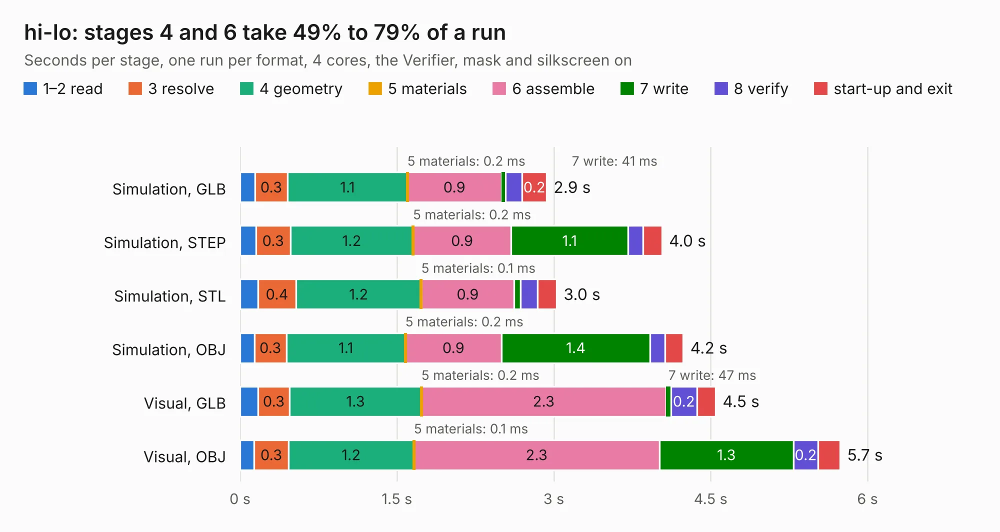

# 2443. hi-lo

Board 2,443 of the 3,124 of [Corpus Testing](../Corpus-Testing.md), on [Corpus Page 23](../CorpusTestingPages/Corpus-Testing-23.md#2443-hi-lo).

| Mode and format | 1–2 read | 3 resolve | 4 geometry | 5 materials | 6 assemble | 7 write | 8 verify | start-up and exit | Total |
|---|---:|---:|---:|---:|---:|---:|---:|---:|---:|
| Simulation, GLB | 0.1 | 0.3 | 1.1 | 0.2&nbsp;ms | 0.9 | 41&nbsp;ms | 0.2 | 0.2 | 2.9 |
| Simulation, STEP | 0.2 | 0.3 | 1.2 | 0.2&nbsp;ms | 0.9 | 1.1 | 0.1 | 0.2 | 4.0 |
| Simulation, STL | 0.2 | 0.4 | 1.2 | 0.1&nbsp;ms | 0.9 | 60&nbsp;ms | 0.2 | 0.2 | 3.0 |
| Simulation, OBJ | 0.1 | 0.3 | 1.1 | 0.2&nbsp;ms | 0.9 | 1.4 | 0.1 | 0.2 | 4.2 |
| Visual, GLB | 0.2 | 0.3 | 1.3 | 0.2&nbsp;ms | 2.3 | 47&nbsp;ms | 0.2 | 0.2 | 4.5 |
| Visual, OBJ | 0.1 | 0.3 | 1.2 | 0.1&nbsp;ms | 2.3 | 1.3 | 0.2 | 0.2 | 5.7 |

<table align="center"><tr><td valign="top">

| Board | Repo: [rusefi/rusefi-hardware](https://github.com/rusefi/rusefi-hardware) Board: `hi-lo.kicad_pcb` |
|---|---|
| Folder | classic-designs / hi-lo_driver |
| Complexity | 183&nbsp;/&nbsp;1000 (size&nbsp;148, features&nbsp;35) |
| KESE&nbsp;features | through vias, filled zones |
| Tested | 9th November 2026 |
| Copper&nbsp;layers | 2 |
| File&nbsp;format | KiCad 3 (3) |
| Parts,&nbsp;tracks,&nbsp;vias | 28, 208, 41 |
| Triangles,&nbsp;simulation | 286,036 in 38 parts |
| Verifier | PASS in all six runs |

</td><td valign="top">

<table>
<tr><th>File type</th><th>File size</th><th>Peak memory used</th></tr>
<tr><th colspan="3" align="left">Simulation</th></tr>
<tr><td>GLB</td><td align="right">10.0&nbsp;MB</td><td align="right">256&nbsp;MB</td></tr>
<tr><td>STEP</td><td align="right">46&nbsp;MB</td><td align="right">259&nbsp;MB</td></tr>
<tr><td>STL</td><td align="right">14&nbsp;MB</td><td align="right">248&nbsp;MB</td></tr>
<tr><td>OBJ</td><td align="right">29&nbsp;MB</td><td align="right">251&nbsp;MB</td></tr>
<tr><th colspan="3" align="left">Visual</th></tr>
<tr><td>GLB</td><td align="right">8.5&nbsp;MB</td><td align="right">262&nbsp;MB</td></tr>
<tr><td>OBJ</td><td align="right">25&nbsp;MB</td><td align="right">259&nbsp;MB</td></tr>
</table>

</td></tr></table>

| Previous | Next |
|:---|---:|
| [2442. frankenstein](b2442b_rusefi-hardware_classic-designs-frankenstein_frankenstein.md) | [2444. VN750PS_E](b2444b_rusefi-hardware_VN750PS-E.md) |
