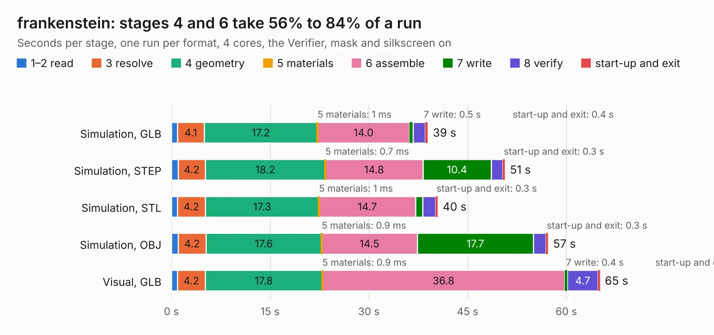

# 2445. frankenstein

Board 2,445 of the 3,103 of [Corpus Testing](../Corpus-Testing.md), on [Corpus Page 23](../CorpusTestingPages/Corpus-Testing-23.md#2445-frankenstein).

| Mode and format | 1–2 read | 3 resolve | 4 geometry | 5 materials | 6 assemble | 7 write | 8 verify | start-up and exit | Total |
|---|---:|---:|---:|---:|---:|---:|---:|---:|---:|
| Simulation, GLB | 0.9 | 4.1 | 17.2 | 1&nbsp;ms | 14.0 | 0.5 | 1.8 | 0.4 | 39.0 |
| Simulation, STEP | 1.0 | 4.2 | 18.2 | 0.7&nbsp;ms | 14.8 | 10.4 | 1.8 | 0.3 | 50.7 |
| Simulation, STL | 0.9 | 4.2 | 17.3 | 1&nbsp;ms | 14.7 | 1.1 | 1.9 | 0.3 | 40.4 |
| Simulation, OBJ | 1.0 | 4.2 | 17.6 | 0.9&nbsp;ms | 14.5 | 17.7 | 1.9 | 0.3 | 57.2 |
| Visual, GLB | 0.9 | 4.2 | 17.8 | 0.9&nbsp;ms | 36.8 | 0.4 | 4.7 | 0.3 | 65.1 |
| Visual, OBJ | 0.9 | 4.2 | 17.8 | 1&nbsp;ms | 35.4 | 14.7 | 4.9 | 0.2 | 78.2 |

<table align="center"><tr><td valign="top">

| Board | Repo: [rusefi/rusefi-hardware](https://github.com/rusefi/rusefi-hardware) Board: `frankenstein.kicad_pcb` |
|---|---|
| Folder | classic-designs / rusefi_hardware_history / frankenstein_rev00.11 |
| Complexity | 246&nbsp;/&nbsp;1000 (size&nbsp;211, features&nbsp;35) |
| KESE&nbsp;features | through vias, filled zones |
| Tested | 9th November 2026 |
| Copper&nbsp;layers | 2 |
| File&nbsp;format | KiCad 3 (3) |
| Parts,&nbsp;tracks,&nbsp;vias | 242, 2,835, 326 |
| Triangles,&nbsp;simulation | 3,189,268 in 196 parts |
| Verifier | PASS in all six runs |

</td><td valign="top">

<table>
<tr><th>File type</th><th>File size</th><th>Peak memory used</th></tr>
<tr><th colspan="3" align="left">Simulation</th></tr>
<tr><td>GLB</td><td align="right">111&nbsp;MB</td><td align="right">1.2&nbsp;GB</td></tr>
<tr><td>STEP</td><td align="right">586&nbsp;MB</td><td align="right">1.4&nbsp;GB</td></tr>
<tr><td>STL</td><td align="right">159&nbsp;MB</td><td align="right">1.1&nbsp;GB</td></tr>
<tr><td>OBJ</td><td align="right">341&nbsp;MB</td><td align="right">2.1&nbsp;GB</td></tr>
<tr><th colspan="3" align="left">Visual</th></tr>
<tr><td>GLB</td><td align="right">94&nbsp;MB</td><td align="right">1.4&nbsp;GB</td></tr>
<tr><td>OBJ</td><td align="right">290&nbsp;MB</td><td align="right">1.9&nbsp;GB</td></tr>
</table>

</td></tr></table>

| Previous | Next |
|:---|---:|
| [2444. frankenstein](b2444b_rusefi-hardware_classic-designs-rusefi-hardware-history-frankenstein-rev00-10_frankenstein.md) | [2446. hi-lo](b2446b_rusefi-hardware_classic-designs-rusefi-hardware-history-hi-lo-driver-rev00-10_hi-lo.md) |
