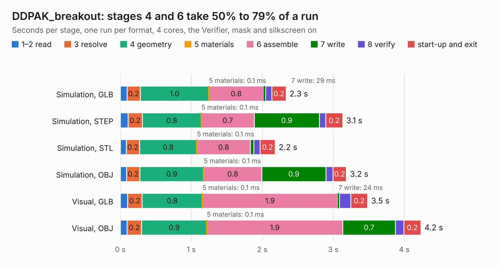

# 2447. DDPAK_breakout

Board 2,447 of the 3,112 of [Corpus Testing](../Corpus-Testing.md), on [Corpus Page 23](../CorpusTestingPages/Corpus-Testing-23.md#2447-ddpak_breakout).

| Mode and format | 1–2 read | 3 resolve | 4 geometry | 5 materials | 6 assemble | 7 write | 8 verify | start-up and exit | Total |
|---|---:|---:|---:|---:|---:|---:|---:|---:|---:|
| Simulation, GLB | 96&nbsp;ms | 0.2 | 1.0 | 0.1&nbsp;ms | 0.8 | 29&nbsp;ms | 89&nbsp;ms | 0.2 | 2.3 |
| Simulation, STEP | 0.1 | 0.2 | 0.8 | 0.1&nbsp;ms | 0.7 | 0.9 | 89&nbsp;ms | 0.2 | 3.1 |
| Simulation, STL | 86&nbsp;ms | 0.2 | 0.8 | 0.1&nbsp;ms | 0.8 | 47&nbsp;ms | 90&nbsp;ms | 0.2 | 2.2 |
| Simulation, OBJ | 89&nbsp;ms | 0.2 | 0.9 | 0.1&nbsp;ms | 0.8 | 0.9 | 99&nbsp;ms | 0.2 | 3.2 |
| Visual, GLB | 0.1 | 0.2 | 0.8 | 0.1&nbsp;ms | 1.9 | 24&nbsp;ms | 0.2 | 0.2 | 3.5 |
| Visual, OBJ | 95&nbsp;ms | 0.2 | 0.9 | 0.1&nbsp;ms | 1.9 | 0.7 | 0.1 | 0.2 | 4.2 |

<table align="center"><tr><td valign="top">

| Board | Repo: [rusefi/rusefi-hardware](https://github.com/rusefi/rusefi-hardware) Board: `DDPAK_breakout.kicad_pcb` |
|---|---|
| Folder | classic-designs / rusefi_hardware_history / DDPAK_breakout_rev00.10 / DDPAK_breakout |
| Complexity | 165&nbsp;/&nbsp;1000 (size&nbsp;130, features&nbsp;35) |
| KESE&nbsp;features | through vias, filled zones |
| Tested | 9th November 2026 |
| Copper&nbsp;layers | 2 |
| File&nbsp;format | KiCad 3 (3) |
| Parts,&nbsp;tracks,&nbsp;vias | 4, 112, 76 |
| Triangles,&nbsp;simulation | 180,580 in 15 parts |
| Verifier | PASS in all six runs |

</td><td valign="top">

<table>
<tr><th>File type</th><th>File size</th><th>Peak memory used</th></tr>
<tr><th colspan="3" align="left">Simulation</th></tr>
<tr><td>GLB</td><td align="right">6.2&nbsp;MB</td><td align="right">200&nbsp;MB</td></tr>
<tr><td>STEP</td><td align="right">24&nbsp;MB</td><td align="right">215&nbsp;MB</td></tr>
<tr><td>STL</td><td align="right">9.0&nbsp;MB</td><td align="right">200&nbsp;MB</td></tr>
<tr><td>OBJ</td><td align="right">18&nbsp;MB</td><td align="right">201&nbsp;MB</td></tr>
<tr><th colspan="3" align="left">Visual</th></tr>
<tr><td>GLB</td><td align="right">4.7&nbsp;MB</td><td align="right">190&nbsp;MB</td></tr>
<tr><td>OBJ</td><td align="right">13&nbsp;MB</td><td align="right">190&nbsp;MB</td></tr>
</table>

</td></tr></table>

| Previous | Next |
|:---|---:|
| [2446. O2_input_CJ125](b2446b_rusefi-hardware_O2-input-CJ125.md) | [2448. frankenso-PWR-Supply](b2448b_rusefi-hardware_classic-designs-rusefi-hardware-history-frankenso-power-supply-rev00-10-frankenso-PWR-Supply_frankenso-PWR-Supply.md) |
