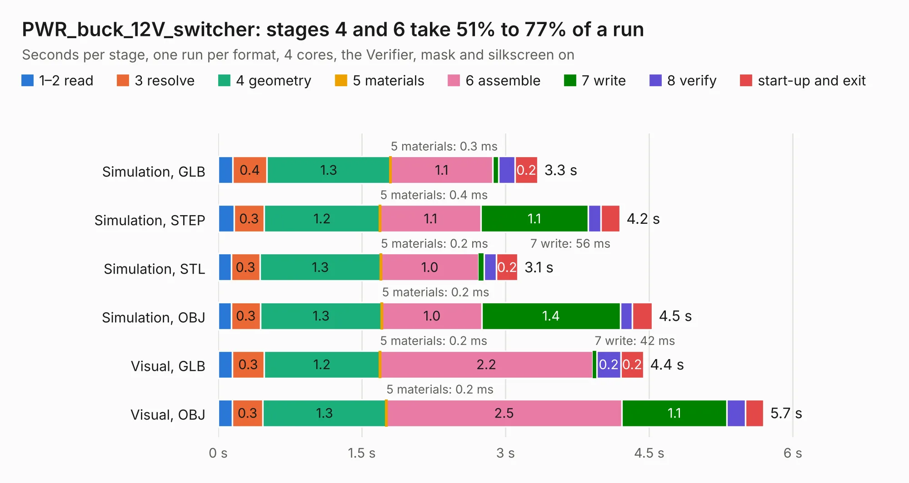

# 2447. PWR_buck_12V_switcher

Board 2,447 of the 3,125 of [Corpus Testing](../Corpus-Testing.md), on [Corpus Page 23](../CorpusTestingPages/Corpus-Testing-23.md#2447-pwr_buck_12v_switcher).

| Mode and format | 1–2 read | 3 resolve | 4 geometry | 5 materials | 6 assemble | 7 write | 8 verify | start-up and exit | Total |
|---|---:|---:|---:|---:|---:|---:|---:|---:|---:|
| Simulation, GLB | 0.2 | 0.4 | 1.3 | 0.3&nbsp;ms | 1.1 | 62&nbsp;ms | 0.2 | 0.2 | 3.3 |
| Simulation, STEP | 0.2 | 0.3 | 1.2 | 0.4&nbsp;ms | 1.1 | 1.1 | 0.1 | 0.2 | 4.2 |
| Simulation, STL | 0.1 | 0.3 | 1.3 | 0.2&nbsp;ms | 1.0 | 56&nbsp;ms | 0.1 | 0.2 | 3.1 |
| Simulation, OBJ | 0.1 | 0.3 | 1.3 | 0.2&nbsp;ms | 1.0 | 1.4 | 0.1 | 0.2 | 4.5 |
| Visual, GLB | 0.1 | 0.3 | 1.2 | 0.2&nbsp;ms | 2.2 | 42&nbsp;ms | 0.2 | 0.2 | 4.4 |
| Visual, OBJ | 0.1 | 0.3 | 1.3 | 0.2&nbsp;ms | 2.5 | 1.1 | 0.2 | 0.2 | 5.7 |

<table align="center"><tr><td valign="top">

| Board | Repo: [rusefi/rusefi-hardware](https://github.com/rusefi/rusefi-hardware) Board: `PWR_buck_12V_switcher.kicad_pcb` |
|---|---|
| Folder | classic-designs / power_supply_kb1gtt |
| Complexity | 169&nbsp;/&nbsp;1000 (size&nbsp;134, features&nbsp;35) |
| KESE&nbsp;features | through vias, filled zones |
| Tested | 9th November 2026 |
| Copper&nbsp;layers | 2 |
| File&nbsp;format | KiCad 4 (4) |
| Parts,&nbsp;tracks,&nbsp;vias | 21, 104, 22 |
| Triangles,&nbsp;simulation | 255,264 in 23 parts |
| Verifier | PASS in all six runs |

</td><td valign="top">

<table>
<tr><th>File type</th><th>File size</th><th>Peak memory used</th></tr>
<tr><th colspan="3" align="left">Simulation</th></tr>
<tr><td>GLB</td><td align="right">9.2&nbsp;MB</td><td align="right">232&nbsp;MB</td></tr>
<tr><td>STEP</td><td align="right">46&nbsp;MB</td><td align="right">246&nbsp;MB</td></tr>
<tr><td>STL</td><td align="right">13&nbsp;MB</td><td align="right">224&nbsp;MB</td></tr>
<tr><td>OBJ</td><td align="right">27&nbsp;MB</td><td align="right">231&nbsp;MB</td></tr>
<tr><th colspan="3" align="left">Visual</th></tr>
<tr><td>GLB</td><td align="right">7.0&nbsp;MB</td><td align="right">210&nbsp;MB</td></tr>
<tr><td>OBJ</td><td align="right">20&nbsp;MB</td><td align="right">210&nbsp;MB</td></tr>
</table>

</td></tr></table>

| Previous | Next |
|:---|---:|
| [2446. cps_vrs_io_1](b2446b_rusefi-hardware_classic-designs-knock-VR-Art-ELectro_cps-vrs-io-1.md) | [2448. inj_6ch](b2448b_rusefi-hardware_classic-designs-rusefi-hardware-history-1A-injector-6-channels-rev00-20_inj-6ch.md) |
