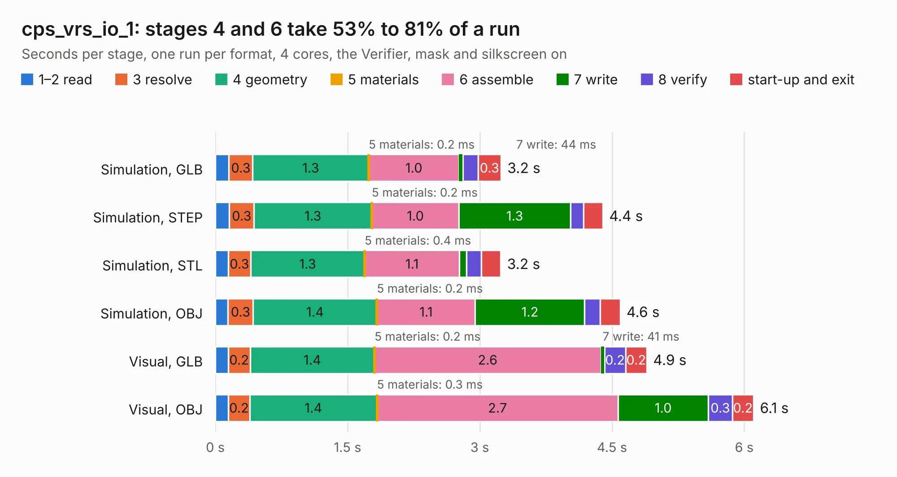

# 2448. cps_vrs_io_1

Board 2,448 of the 3,103 of [Corpus Testing](../Corpus-Testing.md), on [Corpus Page 23](../CorpusTestingPages/Corpus-Testing-23.md#2448-cps_vrs_io_1).

| Mode and format | 1–2 read | 3 resolve | 4 geometry | 5 materials | 6 assemble | 7 write | 8 verify | start-up and exit | Total |
|---|---:|---:|---:|---:|---:|---:|---:|---:|---:|
| Simulation, GLB | 0.2 | 0.3 | 1.3 | 0.2&nbsp;ms | 1.0 | 44&nbsp;ms | 0.2 | 0.3 | 3.2 |
| Simulation, STEP | 0.2 | 0.3 | 1.3 | 0.2&nbsp;ms | 1.0 | 1.3 | 0.1 | 0.2 | 4.4 |
| Simulation, STL | 0.1 | 0.3 | 1.3 | 0.4&nbsp;ms | 1.1 | 81&nbsp;ms | 0.2 | 0.2 | 3.2 |
| Simulation, OBJ | 0.1 | 0.3 | 1.4 | 0.2&nbsp;ms | 1.1 | 1.2 | 0.2 | 0.2 | 4.6 |
| Visual, GLB | 0.1 | 0.2 | 1.4 | 0.2&nbsp;ms | 2.6 | 41&nbsp;ms | 0.2 | 0.2 | 4.9 |
| Visual, OBJ | 0.1 | 0.2 | 1.4 | 0.3&nbsp;ms | 2.7 | 1.0 | 0.3 | 0.2 | 6.1 |

<table align="center"><tr><td valign="top">

| Board | Repo: [rusefi/rusefi-hardware](https://github.com/rusefi/rusefi-hardware) Board: `cps_vrs_io_1.kicad_pcb` |
|---|---|
| Folder | classic-designs / rusefi_hardware_history / knock_VR_Art_ELectro_rev00.10 |
| Complexity | 187&nbsp;/&nbsp;1000 (size&nbsp;142, features&nbsp;45) |
| KESE&nbsp;features | through vias, filled zones, curved board outline |
| Tested | 9th November 2026 |
| Copper&nbsp;layers | 2 |
| File&nbsp;format | KiCad 3 (3) |
| Parts,&nbsp;tracks,&nbsp;vias | 32, 182, 8 |
| Triangles,&nbsp;simulation | 236,430 in 42 parts |
| Verifier | PASS in all six runs |

</td><td valign="top">

<table>
<tr><th>File type</th><th>File size</th><th>Peak memory used</th></tr>
<tr><th colspan="3" align="left">Simulation</th></tr>
<tr><td>GLB</td><td align="right">8.6&nbsp;MB</td><td align="right">222&nbsp;MB</td></tr>
<tr><td>STEP</td><td align="right">44&nbsp;MB</td><td align="right">248&nbsp;MB</td></tr>
<tr><td>STL</td><td align="right">12&nbsp;MB</td><td align="right">222&nbsp;MB</td></tr>
<tr><td>OBJ</td><td align="right">24&nbsp;MB</td><td align="right">227&nbsp;MB</td></tr>
<tr><th colspan="3" align="left">Visual</th></tr>
<tr><td>GLB</td><td align="right">6.4&nbsp;MB</td><td align="right">216&nbsp;MB</td></tr>
<tr><td>OBJ</td><td align="right">18&nbsp;MB</td><td align="right">218&nbsp;MB</td></tr>
</table>

</td></tr></table>

| Previous | Next |
|:---|---:|
| [2447. DD HIP9011](b2447b_rusefi-hardware_DD-HIP9011.md) | [2449. tle6240_driver](b2449b_rusefi-hardware_classic-designs-rusefi-hardware-history-low-side-tle6240-rev00-10_tle6240-driver.md) |
