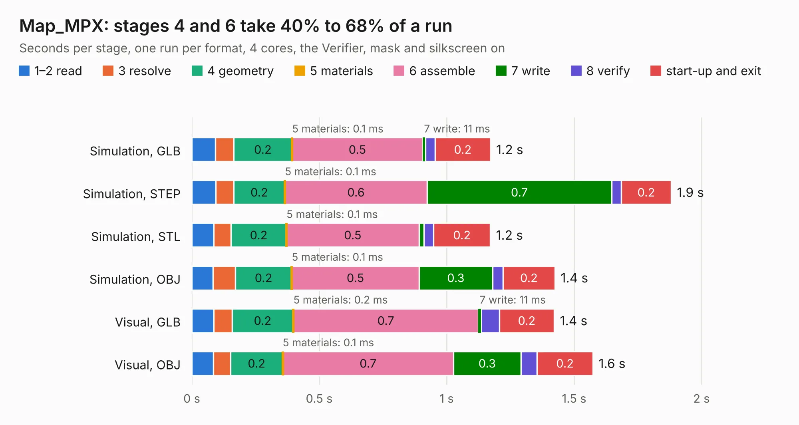

# 2450. Map_MPX

Board 2,450 of the 3,102 of [Corpus Testing](../Corpus-Testing.md), on [Corpus Page 23](../CorpusTestingPages/Corpus-Testing-23.md#2450-map_mpx).

| Mode and format | 1–2 read | 3 resolve | 4 geometry | 5 materials | 6 assemble | 7 write | 8 verify | start-up and exit | Total |
|---|---:|---:|---:|---:|---:|---:|---:|---:|---:|
| Simulation, GLB | 92&nbsp;ms | 72&nbsp;ms | 0.2 | 0.1&nbsp;ms | 0.5 | 11&nbsp;ms | 38&nbsp;ms | 0.2 | 1.2 |
| Simulation, STEP | 95&nbsp;ms | 69&nbsp;ms | 0.2 | 0.1&nbsp;ms | 0.6 | 0.7 | 37&nbsp;ms | 0.2 | 1.9 |
| Simulation, STL | 86&nbsp;ms | 68&nbsp;ms | 0.2 | 0.1&nbsp;ms | 0.5 | 19&nbsp;ms | 39&nbsp;ms | 0.2 | 1.2 |
| Simulation, OBJ | 83&nbsp;ms | 88&nbsp;ms | 0.2 | 0.1&nbsp;ms | 0.5 | 0.3 | 40&nbsp;ms | 0.2 | 1.4 |
| Visual, GLB | 86&nbsp;ms | 72&nbsp;ms | 0.2 | 0.2&nbsp;ms | 0.7 | 11&nbsp;ms | 71&nbsp;ms | 0.2 | 1.4 |
| Visual, OBJ | 85&nbsp;ms | 67&nbsp;ms | 0.2 | 0.1&nbsp;ms | 0.7 | 0.3 | 63&nbsp;ms | 0.2 | 1.6 |

<table align="center"><tr><td valign="top">

| Board | Repo: [rusefi/rusefi-hardware](https://github.com/rusefi/rusefi-hardware) Board: `Map_MPX.kicad_pcb` |
|---|---|
| Folder | classic-designs / rusefi_hardware_history / Map_MPX_rev00.20 / Map_MPX |
| Complexity | 127&nbsp;/&nbsp;1000 (size&nbsp;92, features&nbsp;35) |
| KESE&nbsp;features | through vias, filled zones |
| Tested | 9th November 2026 |
| Copper&nbsp;layers | 2 |
| File&nbsp;format | KiCad 3 (3) |
| Parts,&nbsp;tracks,&nbsp;vias | 6, 21, 2 |
| Triangles,&nbsp;simulation | 61,680 in 15 parts |
| Verifier | PASS in all six runs |

</td><td valign="top">

<table>
<tr><th>File type</th><th>File size</th><th>Peak memory used</th></tr>
<tr><th colspan="3" align="left">Simulation</th></tr>
<tr><td>GLB</td><td align="right">2.2&nbsp;MB</td><td align="right">71&nbsp;MB</td></tr>
<tr><td>STEP</td><td align="right">12&nbsp;MB</td><td align="right">182&nbsp;MB</td></tr>
<tr><td>STL</td><td align="right">3.1&nbsp;MB</td><td align="right">73&nbsp;MB</td></tr>
<tr><td>OBJ</td><td align="right">6.0&nbsp;MB</td><td align="right">84&nbsp;MB</td></tr>
<tr><th colspan="3" align="left">Visual</th></tr>
<tr><td>GLB</td><td align="right">2.0&nbsp;MB</td><td align="right">113&nbsp;MB</td></tr>
<tr><td>OBJ</td><td align="right">5.6&nbsp;MB</td><td align="right">114&nbsp;MB</td></tr>
</table>

</td></tr></table>

| Previous | Next |
|:---|---:|
| [2449. tle6240_driver](b2449b_rusefi-hardware_classic-designs-rusefi-hardware-history-low-side-tle6240-rev00-11_tle6240-driver.md) | [2451. mini48-stm32](b2451b_rusefi-hardware_classic-designs-rusefi-hardware-history-mini48-stm32-rev00-20-mini48-stm32_mini48-stm32.md) |
