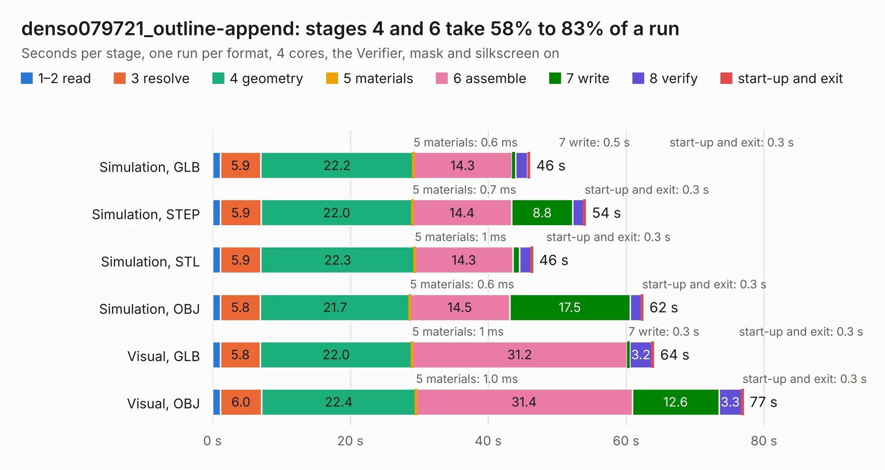

# 2450. denso079721_outline-append

Board 2,450 of the 3,119 of [Corpus Testing](../Corpus-Testing.md), on [Corpus Page 23](../CorpusTestingPages/Corpus-Testing-23.md#2450-denso079721_outline-append).

| Mode and format | 1–2 read | 3 resolve | 4 geometry | 5 materials | 6 assemble | 7 write | 8 verify | start-up and exit | Total |
|---|---:|---:|---:|---:|---:|---:|---:|---:|---:|
| Simulation, GLB | 1.1 | 5.9 | 22.2 | 0.6&nbsp;ms | 14.3 | 0.5 | 1.8 | 0.3 | 46.0 |
| Simulation, STEP | 1.2 | 5.9 | 22.0 | 0.7&nbsp;ms | 14.4 | 8.8 | 1.6 | 0.3 | 54.1 |
| Simulation, STL | 1.2 | 5.9 | 22.3 | 1&nbsp;ms | 14.3 | 0.9 | 1.7 | 0.3 | 46.5 |
| Simulation, OBJ | 1.2 | 5.8 | 21.7 | 0.6&nbsp;ms | 14.5 | 17.5 | 1.6 | 0.3 | 62.5 |
| Visual, GLB | 1.1 | 5.8 | 22.0 | 1&nbsp;ms | 31.2 | 0.3 | 3.2 | 0.3 | 64.0 |
| Visual, OBJ | 1.1 | 6.0 | 22.4 | 1.0&nbsp;ms | 31.4 | 12.6 | 3.3 | 0.3 | 77.0 |

<table align="center"><tr><td valign="top">

| Board | Repo: [rusefi/rusefi-hardware](https://github.com/rusefi/rusefi-hardware) Board: `denso079721_outline-append.kicad_pcb` |
|---|---|
| Folder | classic-designs / rusefi_hardware_history / Breakout_TLE6244_rev00.10 / rusefi_lib / outlines |
| Complexity | 302&nbsp;/&nbsp;1000 (size&nbsp;257, features&nbsp;45) |
| KESE&nbsp;features | through vias, filled zones, curved board outline |
| Tested | 9th November 2026 |
| Copper&nbsp;layers | 2 |
| File&nbsp;format | KiCad 3 (3) |
| Parts,&nbsp;tracks,&nbsp;vias | 341, 3,172, 406 |
| Triangles,&nbsp;simulation | 3,221,878 in 198 parts |
| Verifier | Simulation, GLB: Verifier FAIL Simulation, STEP: Verifier FAIL Simulation, STL: Verifier FAIL Simulation, OBJ: Verifier FAIL |
| Bad&nbsp;design | Bad design according to KESE: copper of two nets on top of each other in the file, a short KiCad's DRC reports; a plated hole with no net overlaps a GND plated hole at (214.30, 108.84) mm. KESE models what the file says, so the Verifier rightly finds the two nets' solids overlapping |

</td><td valign="top">

<table>
<tr><th>File type</th><th>File size</th><th>Peak memory used</th></tr>
<tr><th colspan="3" align="left">Simulation</th></tr>
<tr><td>GLB</td><td align="right">114&nbsp;MB</td><td align="right">1.1&nbsp;GB</td></tr>
<tr><td>STEP</td><td align="right">606&nbsp;MB</td><td align="right">1.3&nbsp;GB</td></tr>
<tr><td>STL</td><td align="right">161&nbsp;MB</td><td align="right">1.1&nbsp;GB</td></tr>
<tr><td>OBJ</td><td align="right">350&nbsp;MB</td><td align="right">2.2&nbsp;GB</td></tr>
<tr><th colspan="3" align="left">Visual</th></tr>
<tr><td>GLB</td><td align="right">83&nbsp;MB</td><td align="right">1.5&nbsp;GB</td></tr>
<tr><td>OBJ</td><td align="right">259&nbsp;MB</td><td align="right">1.7&nbsp;GB</td></tr>
</table>

</td></tr></table>

| Previous | Next |
|:---|---:|
| [2449. Breakout_TLE6244](b2449b_rusefi-hardware_Breakout-TLE6244.md) | [2451. can_brd_1](b2451b_rusefi-hardware_classic-designs-rusefi-hardware-history-can-board-rev00-10_can-brd-1.md) |
