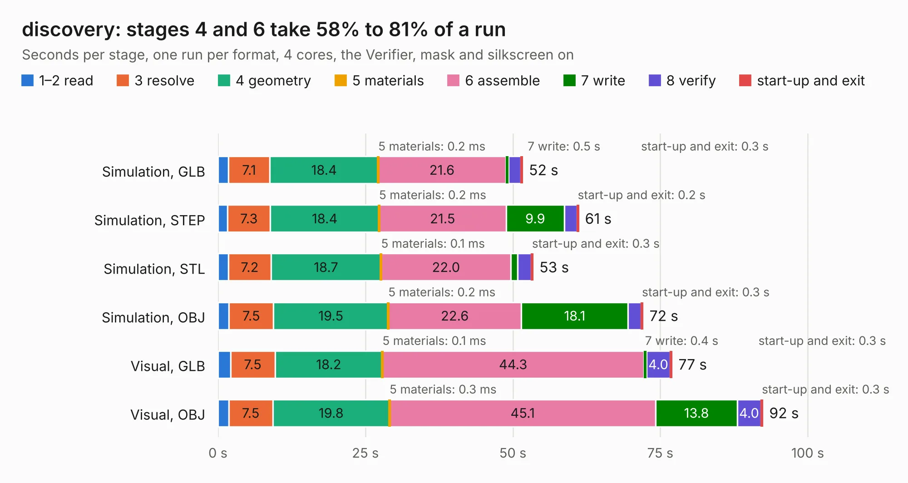

# 2450. discovery

Board 2,450 of the 3,110 of [Corpus Testing](../Corpus-Testing.md), on [Corpus Page 23](../CorpusTestingPages/Corpus-Testing-23.md#2450-discovery).

| Mode and format | 1–2 read | 3 resolve | 4 geometry | 5 materials | 6 assemble | 7 write | 8 verify | start-up and exit | Total |
|---|---:|---:|---:|---:|---:|---:|---:|---:|---:|
| Simulation, GLB | 1.7 | 7.1 | 18.4 | 0.2&nbsp;ms | 21.6 | 0.5 | 2.1 | 0.3 | 51.6 |
| Simulation, STEP | 1.6 | 7.3 | 18.4 | 0.2&nbsp;ms | 21.5 | 9.9 | 2.1 | 0.2 | 61.1 |
| Simulation, STL | 1.8 | 7.2 | 18.7 | 0.1&nbsp;ms | 22.0 | 1.1 | 2.3 | 0.3 | 53.4 |
| Simulation, OBJ | 1.9 | 7.5 | 19.5 | 0.2&nbsp;ms | 22.6 | 18.1 | 2.2 | 0.3 | 72.1 |
| Visual, GLB | 2.1 | 7.5 | 18.2 | 0.1&nbsp;ms | 44.3 | 0.4 | 4.0 | 0.3 | 77.0 |
| Visual, OBJ | 1.8 | 7.5 | 19.8 | 0.3&nbsp;ms | 45.1 | 13.8 | 4.0 | 0.3 | 92.4 |

<table align="center"><tr><td valign="top">

| Board | Repo: [rusefi/rusefi-hardware](https://github.com/rusefi/rusefi-hardware) Board: `discovery.kicad_pcb` |
|---|---|
| Folder | classic-designs / rusefi_hardware_history / frankenso_rev00.50 / rusefi_lib / outlines / stm-discovery-F4 |
| Complexity | 198&nbsp;/&nbsp;1000 (size&nbsp;183, features&nbsp;15) |
| KESE&nbsp;features | through vias |
| Tested | 9th November 2026 |
| Copper&nbsp;layers | 2 |
| File&nbsp;format | KiCad 3 (3) |
| Parts,&nbsp;tracks,&nbsp;vias | 0, 22,985, 884 |
| Triangles,&nbsp;simulation | 3,312,690 in 12 parts |
| Note | no components |
| Verifier | PASS in all six runs |

</td><td valign="top">

<table>
<tr><th>File type</th><th>File size</th><th>Peak memory used</th></tr>
<tr><th colspan="3" align="left">Simulation</th></tr>
<tr><td>GLB</td><td align="right">114&nbsp;MB</td><td align="right">1.3&nbsp;GB</td></tr>
<tr><td>STEP</td><td align="right">703&nbsp;MB</td><td align="right">1.6&nbsp;GB</td></tr>
<tr><td>STL</td><td align="right">166&nbsp;MB</td><td align="right">1.3&nbsp;GB</td></tr>
<tr><td>OBJ</td><td align="right">353&nbsp;MB</td><td align="right">2.2&nbsp;GB</td></tr>
<tr><th colspan="3" align="left">Visual</th></tr>
<tr><td>GLB</td><td align="right">88&nbsp;MB</td><td align="right">1.5&nbsp;GB</td></tr>
<tr><td>OBJ</td><td align="right">277&nbsp;MB</td><td align="right">1.8&nbsp;GB</td></tr>
</table>

</td></tr></table>

| Previous | Next |
|:---|---:|
| [2449. frankenso](b2449b_rusefi-hardware_classic-designs-rusefi-hardware-history-frankenso-rev00-50-frankenso_frankenso.md) | [2451. frankenstein](b2451b_rusefi-hardware_classic-designs-rusefi-hardware-history-frankenstein-rev00-10_frankenstein.md) |
