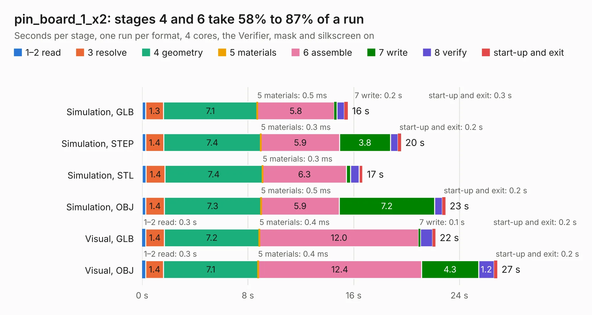

# 2450. pin_board_1_x2

Board 2,450 of the 3,121 of [Corpus Testing](../Corpus-Testing.md), on [Corpus Page 23](../CorpusTestingPages/Corpus-Testing-23.md#2450-pin_board_1_x2).

| Mode and format | 1–2 read | 3 resolve | 4 geometry | 5 materials | 6 assemble | 7 write | 8 verify | start-up and exit | Total |
|---|---:|---:|---:|---:|---:|---:|---:|---:|---:|
| Simulation, GLB | 0.3 | 1.3 | 7.1 | 0.5&nbsp;ms | 5.8 | 0.2 | 0.6 | 0.3 | 15.6 |
| Simulation, STEP | 0.3 | 1.4 | 7.4 | 0.3&nbsp;ms | 5.9 | 3.8 | 0.6 | 0.2 | 19.6 |
| Simulation, STL | 0.3 | 1.4 | 7.4 | 0.3&nbsp;ms | 6.3 | 0.3 | 0.6 | 0.3 | 16.7 |
| Simulation, OBJ | 0.3 | 1.4 | 7.3 | 0.5&nbsp;ms | 5.9 | 7.2 | 0.6 | 0.2 | 22.9 |
| Visual, GLB | 0.3 | 1.4 | 7.2 | 0.4&nbsp;ms | 12.0 | 0.1 | 0.9 | 0.2 | 22.2 |
| Visual, OBJ | 0.3 | 1.4 | 7.1 | 0.4&nbsp;ms | 12.4 | 4.3 | 1.2 | 0.2 | 26.9 |

<table align="center"><tr><td valign="top">

| Board | Repo: [rusefi/rusefi-hardware](https://github.com/rusefi/rusefi-hardware) Board: `pin_board_1_x2.kicad_pcb` |
|---|---|
| Folder | classic-designs / rusefi_hardware_history / breakout_board_rev00.10 |
| Complexity | 199&nbsp;/&nbsp;1000 (size&nbsp;154, features&nbsp;45) |
| KESE&nbsp;features | through vias, filled zones, curved board outline |
| Tested | 9th November 2026 |
| Copper&nbsp;layers | 2 |
| File&nbsp;format | KiCad 3 (3) |
| Parts,&nbsp;tracks,&nbsp;vias | 100, 154, 18 |
| Triangles,&nbsp;simulation | 1,290,772 in 72 parts |
| Verifier | PASS in all six runs |

</td><td valign="top">

<table>
<tr><th>File type</th><th>File size</th><th>Peak memory used</th></tr>
<tr><th colspan="3" align="left">Simulation</th></tr>
<tr><td>GLB</td><td align="right">44&nbsp;MB</td><td align="right">476&nbsp;MB</td></tr>
<tr><td>STEP</td><td align="right">199&nbsp;MB</td><td align="right">626&nbsp;MB</td></tr>
<tr><td>STL</td><td align="right">65&nbsp;MB</td><td align="right">539&nbsp;MB</td></tr>
<tr><td>OBJ</td><td align="right">133&nbsp;MB</td><td align="right">851&nbsp;MB</td></tr>
<tr><th colspan="3" align="left">Visual</th></tr>
<tr><td>GLB</td><td align="right">27&nbsp;MB</td><td align="right">623&nbsp;MB</td></tr>
<tr><td>OBJ</td><td align="right">82&nbsp;MB</td><td align="right">711&nbsp;MB</td></tr>
</table>

</td></tr></table>

| Previous | Next |
|:---|---:|
| [2449. pin_board_1](b2449b_rusefi-hardware_pin-board-1.md) | [2451. Breakout_TLE6244](b2451b_rusefi-hardware_Breakout-TLE6244.md) |
