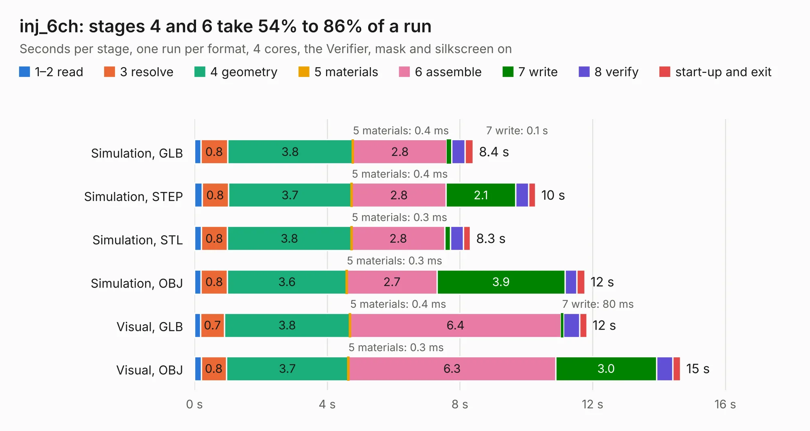

# 2451. inj_6ch

Board 2,451 of the 3,130 of [Corpus Testing](../Corpus-Testing.md), on [Corpus Page 23](../CorpusTestingPages/Corpus-Testing-23.md#2451-inj_6ch).

| Mode and format | 1–2 read | 3 resolve | 4 geometry | 5 materials | 6 assemble | 7 write | 8 verify | start-up and exit | Total |
|---|---:|---:|---:|---:|---:|---:|---:|---:|---:|
| Simulation, GLB | 0.2 | 0.8 | 3.8 | 0.4&nbsp;ms | 2.8 | 0.1 | 0.4 | 0.2 | 8.4 |
| Simulation, STEP | 0.2 | 0.8 | 3.7 | 0.4&nbsp;ms | 2.8 | 2.1 | 0.4 | 0.2 | 10.3 |
| Simulation, STL | 0.2 | 0.8 | 3.8 | 0.3&nbsp;ms | 2.8 | 0.2 | 0.4 | 0.2 | 8.3 |
| Simulation, OBJ | 0.2 | 0.8 | 3.6 | 0.3&nbsp;ms | 2.7 | 3.9 | 0.4 | 0.2 | 11.8 |
| Visual, GLB | 0.2 | 0.7 | 3.8 | 0.4&nbsp;ms | 6.4 | 80&nbsp;ms | 0.5 | 0.2 | 11.8 |
| Visual, OBJ | 0.2 | 0.8 | 3.7 | 0.3&nbsp;ms | 6.3 | 3.0 | 0.5 | 0.2 | 14.6 |

<table align="center"><tr><td valign="top">

| Board | Repo: [rusefi/rusefi-hardware](https://github.com/rusefi/rusefi-hardware) Board: `inj_6ch.kicad_pcb` |
|---|---|
| Folder | classic-designs / rusefi_hardware_history / 1A_injector_6-channels_rev00.20 |
| Complexity | 210&nbsp;/&nbsp;1000 (size&nbsp;165, features&nbsp;45) |
| KESE&nbsp;features | through vias, filled zones, curved board outline |
| Tested | 9th November 2026 |
| Copper&nbsp;layers | 2 |
| File&nbsp;format | KiCad 3 (3) |
| Parts,&nbsp;tracks,&nbsp;vias | 35, 472, 114 |
| Triangles,&nbsp;simulation | 741,604 in 44 parts |
| Verifier | PASS in all six runs |

</td><td valign="top">

<table>
<tr><th>File type</th><th>File size</th><th>Peak memory used</th></tr>
<tr><th colspan="3" align="left">Simulation</th></tr>
<tr><td>GLB</td><td align="right">26&nbsp;MB</td><td align="right">362&nbsp;MB</td></tr>
<tr><td>STEP</td><td align="right">130&nbsp;MB</td><td align="right">403&nbsp;MB</td></tr>
<tr><td>STL</td><td align="right">37&nbsp;MB</td><td align="right">341&nbsp;MB</td></tr>
<tr><td>OBJ</td><td align="right">78&nbsp;MB</td><td align="right">556&nbsp;MB</td></tr>
<tr><th colspan="3" align="left">Visual</th></tr>
<tr><td>GLB</td><td align="right">19&nbsp;MB</td><td align="right">443&nbsp;MB</td></tr>
<tr><td>OBJ</td><td align="right">56&nbsp;MB</td><td align="right">439&nbsp;MB</td></tr>
</table>

</td></tr></table>

| Previous | Next |
|:---|---:|
| [2450. PWR_buck_12V_switcher](b2450b_rusefi-hardware_classic-designs-power-supply-kb1gtt_PWR-buck-12V-switcher.md) | [2452. stm32f407_board](b2452b_rusefi-hardware_stm32f407-board.md) |
