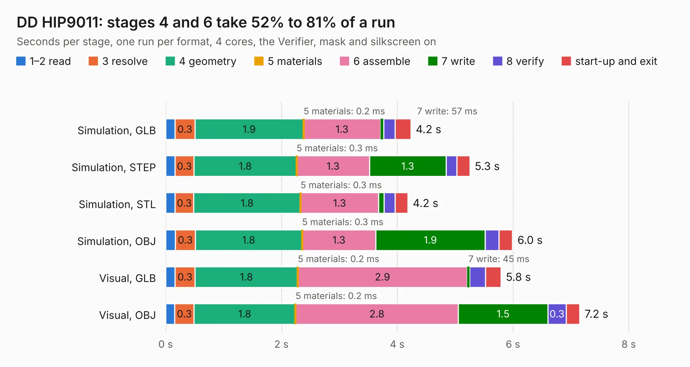

# 2455. DD HIP9011

Board 2,455 of the 3,111 of [Corpus Testing](../Corpus-Testing.md), on [Corpus Page 23](../CorpusTestingPages/Corpus-Testing-23.md#2455-dd-hip9011).

| Mode and format | 1–2 read | 3 resolve | 4 geometry | 5 materials | 6 assemble | 7 write | 8 verify | start-up and exit | Total |
|---|---:|---:|---:|---:|---:|---:|---:|---:|---:|
| Simulation, GLB | 0.2 | 0.3 | 1.9 | 0.2&nbsp;ms | 1.3 | 57&nbsp;ms | 0.2 | 0.3 | 4.2 |
| Simulation, STEP | 0.2 | 0.3 | 1.8 | 0.3&nbsp;ms | 1.3 | 1.3 | 0.2 | 0.2 | 5.3 |
| Simulation, STL | 0.2 | 0.3 | 1.8 | 0.3&nbsp;ms | 1.3 | 94&nbsp;ms | 0.2 | 0.2 | 4.2 |
| Simulation, OBJ | 0.2 | 0.3 | 1.8 | 0.3&nbsp;ms | 1.3 | 1.9 | 0.2 | 0.2 | 6.0 |
| Visual, GLB | 0.2 | 0.3 | 1.8 | 0.2&nbsp;ms | 2.9 | 45&nbsp;ms | 0.3 | 0.3 | 5.8 |
| Visual, OBJ | 0.2 | 0.3 | 1.8 | 0.2&nbsp;ms | 2.8 | 1.5 | 0.3 | 0.2 | 7.2 |

<table align="center"><tr><td valign="top">

| Board | Repo: [rusefi/rusefi-hardware](https://github.com/rusefi/rusefi-hardware) Board: `DD HIP9011.kicad_pcb` |
|---|---|
| Folder | classic-designs / rusefi_hardware_history / hip9011_rev00.10 |
| Complexity | 180&nbsp;/&nbsp;1000 (size&nbsp;145, features&nbsp;35) |
| KESE&nbsp;features | through vias, filled zones |
| Tested | 9th November 2026 |
| Copper&nbsp;layers | 2 |
| File&nbsp;format | KiCad 3 (3) |
| Parts,&nbsp;tracks,&nbsp;vias | 34, 201, 10 |
| Triangles,&nbsp;simulation | 319,850 in 36 parts |
| Verifier | PASS in all six runs |

</td><td valign="top">

<table>
<tr><th>File type</th><th>File size</th><th>Peak memory used</th></tr>
<tr><th colspan="3" align="left">Simulation</th></tr>
<tr><td>GLB</td><td align="right">11&nbsp;MB</td><td align="right">247&nbsp;MB</td></tr>
<tr><td>STEP</td><td align="right">60&nbsp;MB</td><td align="right">285&nbsp;MB</td></tr>
<tr><td>STL</td><td align="right">16&nbsp;MB</td><td align="right">246&nbsp;MB</td></tr>
<tr><td>OBJ</td><td align="right">33&nbsp;MB</td><td align="right">251&nbsp;MB</td></tr>
<tr><th colspan="3" align="left">Visual</th></tr>
<tr><td>GLB</td><td align="right">8.9&nbsp;MB</td><td align="right">272&nbsp;MB</td></tr>
<tr><td>OBJ</td><td align="right">26&nbsp;MB</td><td align="right">270&nbsp;MB</td></tr>
</table>

</td></tr></table>

| Previous | Next |
|:---|---:|
| [2454. hi-lo](b2454b_rusefi-hardware_classic-designs-rusefi-hardware-history-hi-lo-driver-rev00-10_hi-lo.md) | [2456. cps_vrs_io_1](b2456b_rusefi-hardware_classic-designs-rusefi-hardware-history-knock-VR-Art-ELectro-rev00-10_cps-vrs-io-1.md) |
