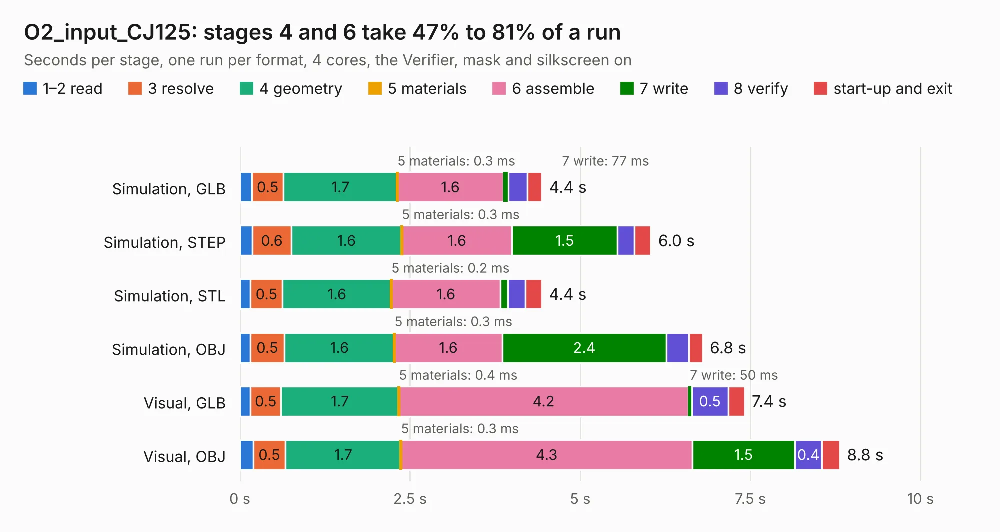

# 2455. O2_input_CJ125

Board 2,455 of the 3,121 of [Corpus Testing](../Corpus-Testing.md), on [Corpus Page 23](../CorpusTestingPages/Corpus-Testing-23.md#2455-o2_input_cj125).

| Mode and format | 1–2 read | 3 resolve | 4 geometry | 5 materials | 6 assemble | 7 write | 8 verify | start-up and exit | Total |
|---|---:|---:|---:|---:|---:|---:|---:|---:|---:|
| Simulation, GLB | 0.2 | 0.5 | 1.7 | 0.3&nbsp;ms | 1.6 | 77&nbsp;ms | 0.3 | 0.2 | 4.4 |
| Simulation, STEP | 0.2 | 0.6 | 1.6 | 0.3&nbsp;ms | 1.6 | 1.5 | 0.3 | 0.2 | 6.0 |
| Simulation, STL | 0.2 | 0.5 | 1.6 | 0.2&nbsp;ms | 1.6 | 0.1 | 0.3 | 0.2 | 4.4 |
| Simulation, OBJ | 0.2 | 0.5 | 1.6 | 0.3&nbsp;ms | 1.6 | 2.4 | 0.3 | 0.2 | 6.8 |
| Visual, GLB | 0.2 | 0.5 | 1.7 | 0.4&nbsp;ms | 4.2 | 50&nbsp;ms | 0.5 | 0.2 | 7.4 |
| Visual, OBJ | 0.2 | 0.5 | 1.7 | 0.3&nbsp;ms | 4.3 | 1.5 | 0.4 | 0.3 | 8.8 |

<table align="center"><tr><td valign="top">

| Board | Repo: [rusefi/rusefi-hardware](https://github.com/rusefi/rusefi-hardware) Board: `O2_input_CJ125.kicad_pcb` |
|---|---|
| Folder | classic-designs / rusefi_hardware_history / CJ125_board_rev00.20 |
| Complexity | 214&nbsp;/&nbsp;1000 (size&nbsp;169, features&nbsp;45) |
| KESE&nbsp;features | through vias, filled zones, copper text |
| Tested | 9th November 2026 |
| Copper&nbsp;layers | 4 |
| File&nbsp;format | KiCad 4 (4) |
| Parts,&nbsp;tracks,&nbsp;vias | 31, 244, 48 |
| Triangles,&nbsp;simulation | 453,734 in 45 parts |
| Verifier | PASS in all six runs |

</td><td valign="top">

<table>
<tr><th>File type</th><th>File size</th><th>Peak memory used</th></tr>
<tr><th colspan="3" align="left">Simulation</th></tr>
<tr><td>GLB</td><td align="right">16&nbsp;MB</td><td align="right">274&nbsp;MB</td></tr>
<tr><td>STEP</td><td align="right">67&nbsp;MB</td><td align="right">298&nbsp;MB</td></tr>
<tr><td>STL</td><td align="right">23&nbsp;MB</td><td align="right">282&nbsp;MB</td></tr>
<tr><td>OBJ</td><td align="right">47&nbsp;MB</td><td align="right">349&nbsp;MB</td></tr>
<tr><th colspan="3" align="left">Visual</th></tr>
<tr><td>GLB</td><td align="right">10&nbsp;MB</td><td align="right">287&nbsp;MB</td></tr>
<tr><td>OBJ</td><td align="right">31&nbsp;MB</td><td align="right">299&nbsp;MB</td></tr>
</table>

</td></tr></table>

| Previous | Next |
|:---|---:|
| [2454. can_brd_1](b2454b_rusefi-hardware_classic-designs-rusefi-hardware-history-can-board-rev00-20-can-board_can-brd-1.md) | [2456. DDPAK_breakout](b2456b_rusefi-hardware_DDPAK-breakout.md) |
