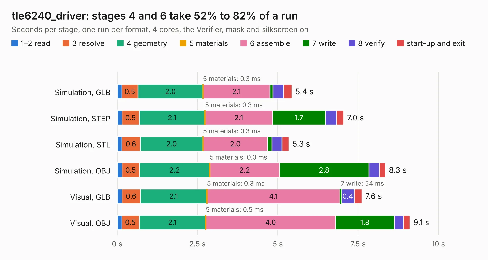

# 2456. tle6240_driver

Board 2,456 of the 3,110 of [Corpus Testing](../Corpus-Testing.md), on [Corpus Page 23](../CorpusTestingPages/Corpus-Testing-23.md#2456-tle6240_driver).

| Mode and format | 1–2 read | 3 resolve | 4 geometry | 5 materials | 6 assemble | 7 write | 8 verify | start-up and exit | Total |
|---|---:|---:|---:|---:|---:|---:|---:|---:|---:|
| Simulation, GLB | 0.1 | 0.5 | 2.0 | 0.3&nbsp;ms | 2.1 | 92&nbsp;ms | 0.3 | 0.3 | 5.4 |
| Simulation, STEP | 0.2 | 0.5 | 2.1 | 0.3&nbsp;ms | 2.1 | 1.7 | 0.3 | 0.2 | 7.0 |
| Simulation, STL | 0.1 | 0.6 | 2.0 | 0.3&nbsp;ms | 2.0 | 0.1 | 0.3 | 0.2 | 5.3 |
| Simulation, OBJ | 0.2 | 0.5 | 2.2 | 0.3&nbsp;ms | 2.2 | 2.8 | 0.3 | 0.2 | 8.3 |
| Visual, GLB | 0.1 | 0.6 | 2.1 | 0.3&nbsp;ms | 4.1 | 54&nbsp;ms | 0.4 | 0.2 | 7.6 |
| Visual, OBJ | 0.1 | 0.5 | 2.1 | 0.5&nbsp;ms | 4.0 | 1.8 | 0.3 | 0.2 | 9.1 |

<table align="center"><tr><td valign="top">

| Board | Repo: [rusefi/rusefi-hardware](https://github.com/rusefi/rusefi-hardware) Board: `tle6240_driver.kicad_pcb` |
|---|---|
| Folder | classic-designs / rusefi_hardware_history / low_side_tle6240_rev00.10 |
| Complexity | 181&nbsp;/&nbsp;1000 (size&nbsp;146, features&nbsp;35) |
| KESE&nbsp;features | through vias, filled zones |
| Tested | 9th November 2026 |
| Copper&nbsp;layers | 2 |
| File&nbsp;format | KiCad 3 (3) |
| Parts,&nbsp;tracks,&nbsp;vias | 12, 363, 40 |
| Triangles,&nbsp;simulation | 462,804 in 48 parts |
| Verifier | PASS in all six runs |

</td><td valign="top">

<table>
<tr><th>File type</th><th>File size</th><th>Peak memory used</th></tr>
<tr><th colspan="3" align="left">Simulation</th></tr>
<tr><td>GLB</td><td align="right">16&nbsp;MB</td><td align="right">288&nbsp;MB</td></tr>
<tr><td>STEP</td><td align="right">80&nbsp;MB</td><td align="right">331&nbsp;MB</td></tr>
<tr><td>STL</td><td align="right">23&nbsp;MB</td><td align="right">295&nbsp;MB</td></tr>
<tr><td>OBJ</td><td align="right">48&nbsp;MB</td><td align="right">331&nbsp;MB</td></tr>
<tr><th colspan="3" align="left">Visual</th></tr>
<tr><td>GLB</td><td align="right">11&nbsp;MB</td><td align="right">333&nbsp;MB</td></tr>
<tr><td>OBJ</td><td align="right">32&nbsp;MB</td><td align="right">335&nbsp;MB</td></tr>
</table>

</td></tr></table>

| Previous | Next |
|:---|---:|
| [2455. cps_vrs_io_1](b2455b_rusefi-hardware_classic-designs-rusefi-hardware-history-knock-VR-Art-ELectro-rev00-10_cps-vrs-io-1.md) | [2457. tle6240_driver](b2457b_rusefi-hardware_classic-designs-rusefi-hardware-history-low-side-tle6240-rev00-11_tle6240-driver.md) |
