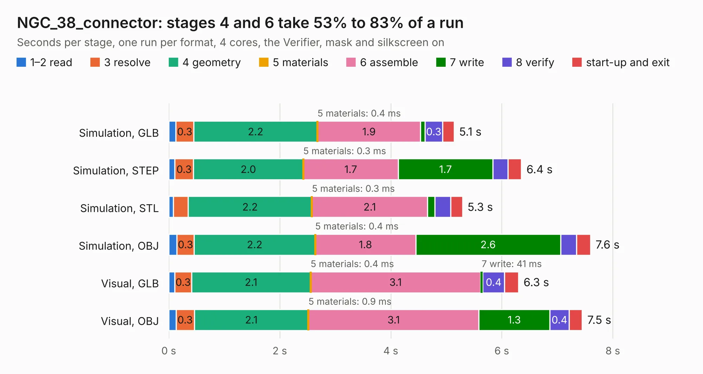

# 2460. NGC_38_connector

Board 2,460 of the 3,109 of [Corpus Testing](../Corpus-Testing.md), on [Corpus Page 23](../CorpusTestingPages/Corpus-Testing-23.md#2460-ngc_38_connector).

| Mode and format | 1–2 read | 3 resolve | 4 geometry | 5 materials | 6 assemble | 7 write | 8 verify | start-up and exit | Total |
|---|---:|---:|---:|---:|---:|---:|---:|---:|---:|
| Simulation, GLB | 0.1 | 0.3 | 2.2 | 0.4&nbsp;ms | 1.9 | 81&nbsp;ms | 0.3 | 0.2 | 5.1 |
| Simulation, STEP | 0.1 | 0.3 | 2.0 | 0.3&nbsp;ms | 1.7 | 1.7 | 0.3 | 0.2 | 6.4 |
| Simulation, STL | 84&nbsp;ms | 0.3 | 2.2 | 0.3&nbsp;ms | 2.1 | 0.1 | 0.3 | 0.2 | 5.3 |
| Simulation, OBJ | 0.1 | 0.3 | 2.2 | 0.4&nbsp;ms | 1.8 | 2.6 | 0.3 | 0.3 | 7.6 |
| Visual, GLB | 0.1 | 0.3 | 2.1 | 0.4&nbsp;ms | 3.1 | 41&nbsp;ms | 0.4 | 0.3 | 6.3 |
| Visual, OBJ | 0.1 | 0.3 | 2.1 | 0.9&nbsp;ms | 3.1 | 1.3 | 0.4 | 0.2 | 7.5 |

<table align="center"><tr><td valign="top">

| Board | Repo: [rusefi/rusefi-hardware](https://github.com/rusefi/rusefi-hardware) Board: `NGC_38_connector.kicad_pcb` |
|---|---|
| Folder | classic-designs / rusefi_hardware_history / NGC_38_connector_rev00.11 / NGC_38_connector |
| Complexity | 134&nbsp;/&nbsp;1000 (size&nbsp;134, features&nbsp;0) |
| Tested | 9th November 2026 |
| Copper&nbsp;layers | 2 |
| File&nbsp;format | KiCad 3 (3) |
| Parts,&nbsp;tracks,&nbsp;vias | 9, 276, 0 |
| Triangles,&nbsp;simulation | 501,166 in 49 parts |
| Verifier | PASS in all six runs |

</td><td valign="top">

<table>
<tr><th>File type</th><th>File size</th><th>Peak memory used</th></tr>
<tr><th colspan="3" align="left">Simulation</th></tr>
<tr><td>GLB</td><td align="right">16&nbsp;MB</td><td align="right">271&nbsp;MB</td></tr>
<tr><td>STEP</td><td align="right">70&nbsp;MB</td><td align="right">339&nbsp;MB</td></tr>
<tr><td>STL</td><td align="right">25&nbsp;MB</td><td align="right">271&nbsp;MB</td></tr>
<tr><td>OBJ</td><td align="right">50&nbsp;MB</td><td align="right">377&nbsp;MB</td></tr>
<tr><th colspan="3" align="left">Visual</th></tr>
<tr><td>GLB</td><td align="right">9.1&nbsp;MB</td><td align="right">321&nbsp;MB</td></tr>
<tr><td>OBJ</td><td align="right">27&nbsp;MB</td><td align="right">311&nbsp;MB</td></tr>
</table>

</td></tr></table>

| Previous | Next |
|:---|---:|
| [2459. NGC_38_connector](b2459b_rusefi-hardware_classic-designs-rusefi-hardware-history-NGC-38-connector-rev00-10-NGC-38-connector_NGC-38-connector.md) | [2461. NGC_38_connector](b2461b_rusefi-hardware_classic-designs-rusefi-hardware-history-NGC-38-connector-rev00-20-NGC-38-connector_NGC-38-connector.md) |
