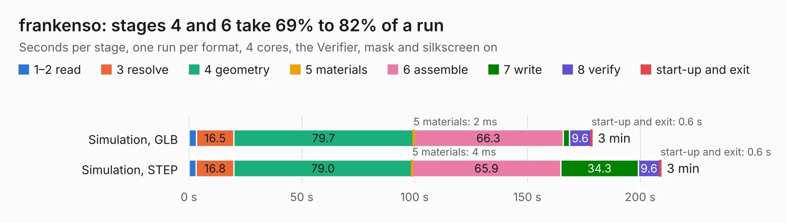

# 2460. frankenso

Board 2,460 of the 3,122 of [Corpus Testing](../Corpus-Testing.md), on [Corpus Page 23](../CorpusTestingPages/Corpus-Testing-23.md#2460-frankenso).

| Mode and format | 1–2 read | 3 resolve | 4 geometry | 5 materials | 6 assemble | 7 write | 8 verify | start-up and exit | Total |
|---|---:|---:|---:|---:|---:|---:|---:|---:|---:|
| Simulation, GLB | 3.3 | 16.5 | 79.7 | 2&nbsp;ms | 66.3 | 2.7 | 9.6 | 0.6 | 178.7 |
| Simulation, STEP | 3.2 | 16.8 | 79.0 | 4&nbsp;ms | 65.9 | 34.3 | 9.6 | 0.6 | 209.3 |
| Simulation, STL | 3.4 | 16.6 | 79.7 | 2&nbsp;ms | 65.5 | 5.7 | 9.1 | 0.5 | 180.6 |
| Simulation, OBJ | 3.3 | 15.8 | 79.0 | 4&nbsp;ms | 65.4 | 76.7 | 9.4 | 0.6 | 250.2 |
| Visual, GLB | 3.3 | 16.9 | 81.8 | 4&nbsp;ms | 165.4 | 1.4 | 14.4 | 0.6 | 283.6 |
| Visual, OBJ | 3.5 | 16.9 | 81.1 | 2&nbsp;ms | 165.3 | 42.6 | 14.7 | 0.6 | 324.7 |

<table align="center"><tr><td valign="top">

| Board | Repo: [rusefi/rusefi-hardware](https://github.com/rusefi/rusefi-hardware) Board: `frankenso.kicad_pcb` |
|---|---|
| Folder | classic-designs / rusefi_hardware_history / frankenso_rev00.40 / frankenso |
| Complexity | 354&nbsp;/&nbsp;1000 (size&nbsp;289, features&nbsp;65) |
| KESE&nbsp;features | through vias, slotted holes, filled zones, copper text, curved board outline |
| Tested | 9th November 2026 |
| Copper&nbsp;layers | 4 |
| File&nbsp;format | KiCad 4 (4) |
| Parts,&nbsp;tracks,&nbsp;vias | 528, 5,233, 1,013 |
| Triangles,&nbsp;simulation | 13,229,682 in 384 parts |
| Verifier | PASS in all six runs |

</td><td valign="top">

<table>
<tr><th>File type</th><th>File size</th><th>Peak memory used</th></tr>
<tr><th colspan="3" align="left">Simulation</th></tr>
<tr><td>GLB</td><td align="right">458&nbsp;MB</td><td align="right">3.0&nbsp;GB</td></tr>
<tr><td>STEP</td><td align="right">2.0&nbsp;GB</td><td align="right">3.9&nbsp;GB</td></tr>
<tr><td>STL</td><td align="right">662&nbsp;MB</td><td align="right">3.0&nbsp;GB</td></tr>
<tr><td>OBJ</td><td align="right">1.5&nbsp;GB</td><td align="right">8.4&nbsp;GB</td></tr>
<tr><th colspan="3" align="left">Visual</th></tr>
<tr><td>GLB</td><td align="right">265&nbsp;MB</td><td align="right">4.1&nbsp;GB</td></tr>
<tr><td>OBJ</td><td align="right">844&nbsp;MB</td><td align="right">5.4&nbsp;GB</td></tr>
</table>

</td></tr></table>

| Previous | Next |
|:---|---:|
| [2459. frankenso](b2459b_rusefi-hardware_classic-designs-rusefi-hardware-history-frankenso-rev00-20-frankenso_frankenso.md) | [2461. frankenso](b2461b_rusefi-hardware_classic-designs-rusefi-hardware-history-frankenso-rev00-50-frankenso_frankenso.md) |
