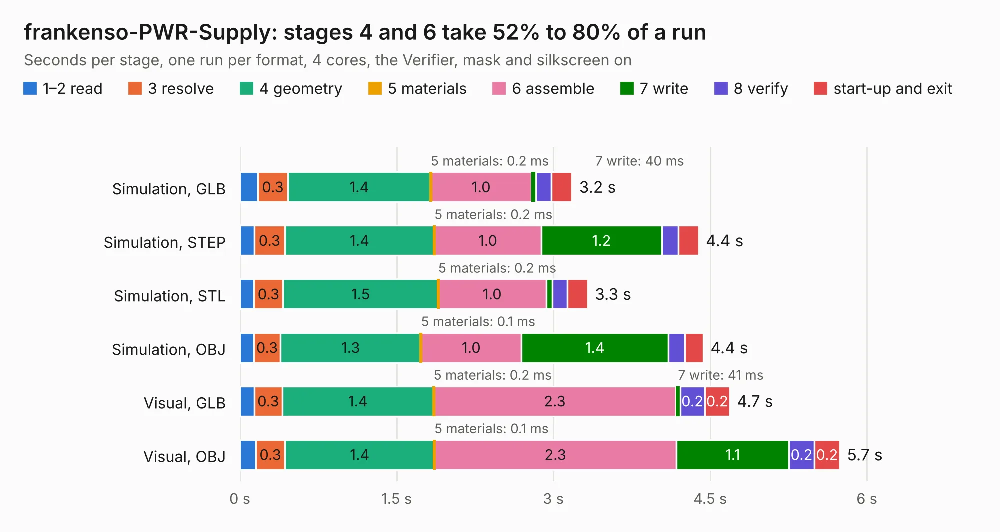

# 2461. frankenso-PWR-Supply

Board 2,461 of the 3,125 of [Corpus Testing](../Corpus-Testing.md), on [Corpus Page 23](../CorpusTestingPages/Corpus-Testing-23.md#2461-frankenso-pwr-supply).

| Mode and format | 1–2 read | 3 resolve | 4 geometry | 5 materials | 6 assemble | 7 write | 8 verify | start-up and exit | Total |
|---|---:|---:|---:|---:|---:|---:|---:|---:|---:|
| Simulation, GLB | 0.2 | 0.3 | 1.4 | 0.2&nbsp;ms | 1.0 | 40&nbsp;ms | 0.1 | 0.2 | 3.2 |
| Simulation, STEP | 0.1 | 0.3 | 1.4 | 0.2&nbsp;ms | 1.0 | 1.2 | 0.2 | 0.2 | 4.4 |
| Simulation, STL | 0.1 | 0.3 | 1.5 | 0.2&nbsp;ms | 1.0 | 58&nbsp;ms | 0.1 | 0.2 | 3.3 |
| Simulation, OBJ | 0.1 | 0.3 | 1.3 | 0.1&nbsp;ms | 1.0 | 1.4 | 0.2 | 0.2 | 4.4 |
| Visual, GLB | 0.1 | 0.3 | 1.4 | 0.2&nbsp;ms | 2.3 | 41&nbsp;ms | 0.2 | 0.2 | 4.7 |
| Visual, OBJ | 0.2 | 0.3 | 1.4 | 0.1&nbsp;ms | 2.3 | 1.1 | 0.2 | 0.2 | 5.7 |

<table align="center"><tr><td valign="top">

| Board | Repo: [rusefi/rusefi-hardware](https://github.com/rusefi/rusefi-hardware) Board: `frankenso-PWR-Supply.kicad_pcb` |
|---|---|
| Folder | classic-designs / rusefi_hardware_history / frankenso_power_supply_rev00.10 / frankenso-PWR-Supply |
| Complexity | 191&nbsp;/&nbsp;1000 (size&nbsp;136, features&nbsp;55) |
| KESE&nbsp;features | through vias, slotted holes, filled zones, copper text |
| Tested | 9th November 2026 |
| Copper&nbsp;layers | 2 |
| File&nbsp;format | KiCad 4 (4) |
| Parts,&nbsp;tracks,&nbsp;vias | 21, 107, 25 |
| Triangles,&nbsp;simulation | 264,622 in 24 parts |
| Verifier | PASS in all six runs |

</td><td valign="top">

<table>
<tr><th>File type</th><th>File size</th><th>Peak memory used</th></tr>
<tr><th colspan="3" align="left">Simulation</th></tr>
<tr><td>GLB</td><td align="right">9.5&nbsp;MB</td><td align="right">239&nbsp;MB</td></tr>
<tr><td>STEP</td><td align="right">47&nbsp;MB</td><td align="right">255&nbsp;MB</td></tr>
<tr><td>STL</td><td align="right">13&nbsp;MB</td><td align="right">237&nbsp;MB</td></tr>
<tr><td>OBJ</td><td align="right">27&nbsp;MB</td><td align="right">242&nbsp;MB</td></tr>
<tr><th colspan="3" align="left">Visual</th></tr>
<tr><td>GLB</td><td align="right">7.0&nbsp;MB</td><td align="right">224&nbsp;MB</td></tr>
<tr><td>OBJ</td><td align="right">20&nbsp;MB</td><td align="right">231&nbsp;MB</td></tr>
</table>

</td></tr></table>

| Previous | Next |
|:---|---:|
| [2460. DDPAK_breakout](b2460b_rusefi-hardware_DDPAK-breakout.md) | [2462. frankenso](b2462b_rusefi-hardware_classic-designs-rusefi-hardware-history-frankenso-rev00-20-frankenso_frankenso.md) |
