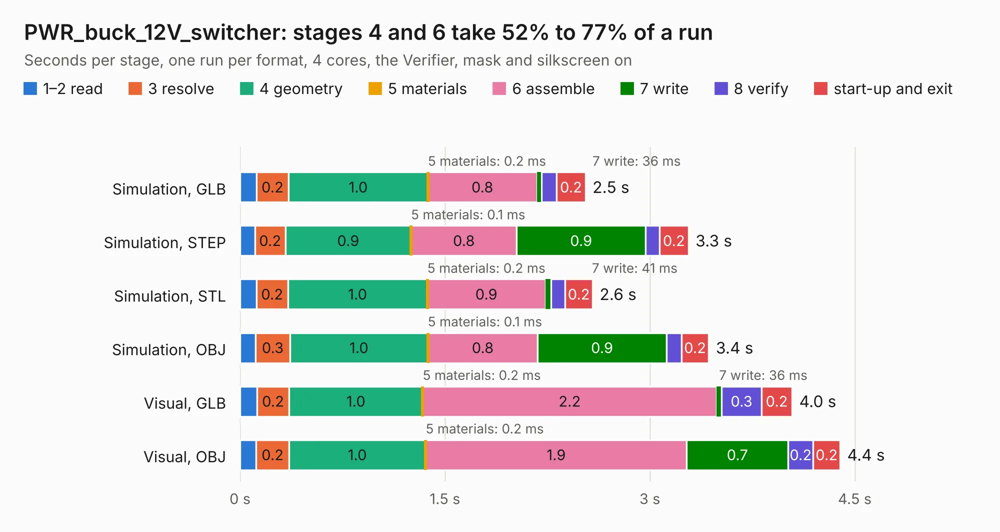

# 2465. PWR_buck_12V_switcher

Board 2,465 of the 3,111 of [Corpus Testing](../Corpus-Testing.md), on [Corpus Page 23](../CorpusTestingPages/Corpus-Testing-23.md#2465-pwr_buck_12v_switcher).

| Mode and format | 1–2 read | 3 resolve | 4 geometry | 5 materials | 6 assemble | 7 write | 8 verify | start-up and exit | Total |
|---|---:|---:|---:|---:|---:|---:|---:|---:|---:|
| Simulation, GLB | 0.1 | 0.2 | 1.0 | 0.2&nbsp;ms | 0.8 | 36&nbsp;ms | 0.1 | 0.2 | 2.5 |
| Simulation, STEP | 0.1 | 0.2 | 0.9 | 0.1&nbsp;ms | 0.8 | 0.9 | 0.1 | 0.2 | 3.3 |
| Simulation, STL | 0.1 | 0.2 | 1.0 | 0.2&nbsp;ms | 0.9 | 41&nbsp;ms | 0.1 | 0.2 | 2.6 |
| Simulation, OBJ | 0.1 | 0.3 | 1.0 | 0.1&nbsp;ms | 0.8 | 0.9 | 0.1 | 0.2 | 3.4 |
| Visual, GLB | 0.1 | 0.2 | 1.0 | 0.2&nbsp;ms | 2.2 | 36&nbsp;ms | 0.3 | 0.2 | 4.0 |
| Visual, OBJ | 0.1 | 0.2 | 1.0 | 0.2&nbsp;ms | 1.9 | 0.7 | 0.2 | 0.2 | 4.4 |

<table align="center"><tr><td valign="top">

| Board | Repo: [rusefi/rusefi-hardware](https://github.com/rusefi/rusefi-hardware) Board: `PWR_buck_12V_switcher.kicad_pcb` |
|---|---|
| Folder | classic-designs / rusefi_hardware_history / power_supply_kb1gtt_rev00.10 |
| Complexity | 166&nbsp;/&nbsp;1000 (size&nbsp;131, features&nbsp;35) |
| KESE&nbsp;features | through vias, filled zones |
| Tested | 9th November 2026 |
| Copper&nbsp;layers | 2 |
| File&nbsp;format | KiCad 3 (3) |
| Parts,&nbsp;tracks,&nbsp;vias | 18, 86, 22 |
| Triangles,&nbsp;simulation | 225,100 in 20 parts |
| Verifier | PASS in all six runs |

</td><td valign="top">

<table>
<tr><th>File type</th><th>File size</th><th>Peak memory used</th></tr>
<tr><th colspan="3" align="left">Simulation</th></tr>
<tr><td>GLB</td><td align="right">8.1&nbsp;MB</td><td align="right">220&nbsp;MB</td></tr>
<tr><td>STEP</td><td align="right">40&nbsp;MB</td><td align="right">236&nbsp;MB</td></tr>
<tr><td>STL</td><td align="right">11&nbsp;MB</td><td align="right">212&nbsp;MB</td></tr>
<tr><td>OBJ</td><td align="right">24&nbsp;MB</td><td align="right">214&nbsp;MB</td></tr>
<tr><th colspan="3" align="left">Visual</th></tr>
<tr><td>GLB</td><td align="right">6.3&nbsp;MB</td><td align="right">201&nbsp;MB</td></tr>
<tr><td>OBJ</td><td align="right">18&nbsp;MB</td><td align="right">202&nbsp;MB</td></tr>
</table>

</td></tr></table>

| Previous | Next |
|:---|---:|
| [2464. NGC_38_connector](b2464b_rusefi-hardware_classic-designs-rusefi-hardware-history-NGC-38-connector-rev00-30-NGC-38-connector_NGC-38-connector.md) | [2466. PowerSSO-24_breakout](b2466b_rusefi-hardware_PowerSSO-24-breakout.md) |
