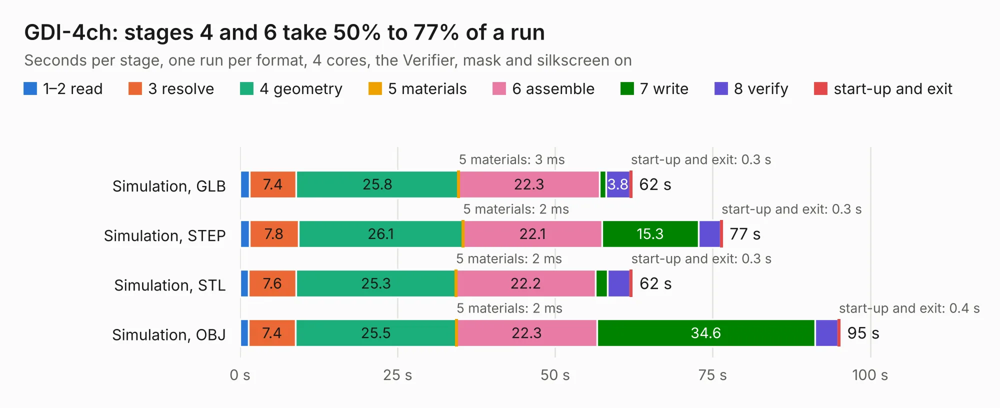

# 2469. GDI-4ch

Board 2,469 of the 3,106 of [Corpus Testing](../Corpus-Testing.md), on [Corpus Page 23](../CorpusTestingPages/Corpus-Testing-23.md#2469-gdi-4ch).

| Mode and format | 1–2 read | 3 resolve | 4 geometry | 5 materials | 6 assemble | 7 write | 8 verify | start-up and exit | Total |
|---|---:|---:|---:|---:|---:|---:|---:|---:|---:|
| Simulation, GLB | 1.5 | 7.4 | 25.8 | 3&nbsp;ms | 22.3 | 1.0 | 3.8 | 0.3 | 62.2 |
| Simulation, STEP | 1.5 | 7.8 | 26.1 | 2&nbsp;ms | 22.1 | 15.3 | 3.5 | 0.3 | 76.5 |
| Simulation, STL | 1.4 | 7.6 | 25.3 | 2&nbsp;ms | 22.2 | 1.9 | 3.6 | 0.3 | 62.2 |
| Simulation, OBJ | 1.4 | 7.4 | 25.5 | 2&nbsp;ms | 22.3 | 34.6 | 3.6 | 0.4 | 95.2 |
| Visual, GLB | 1.5 | 7.6 | 25.3 | 2&nbsp;ms | 50.3 | 0.6 | 6.7 | 0.3 | 92.2 |
| Visual, OBJ | 1.4 | 7.6 | 25.4 | 2&nbsp;ms | 50.7 | 23.1 | 7.2 | 0.3 | 115.8 |

<table align="center"><tr><td valign="top">

| Board | Repo: [rusefi/rusefi-hardware](https://github.com/rusefi/rusefi-hardware) Board: `GDI-4ch.kicad_pcb` |
|---|---|
| Folder | GDI-4ch |
| Complexity | 390&nbsp;/&nbsp;1000 (size&nbsp;280, features&nbsp;110) |
| KESE&nbsp;features | through vias, custom pads, rounded, trapezoid or chamfered pads, filled zones, copper drawings, curved board outline, stack-up, dielectric εr and tanδ |
| Tested | 9th November 2026 |
| Copper&nbsp;layers | 4 |
| File&nbsp;format | KiCad 7 (20221018) |
| Parts,&nbsp;tracks,&nbsp;vias | 296, 2,669, 664 |
| Triangles,&nbsp;simulation | 5,698,984 in 302 parts |
| Verifier | PASS in all six runs |

</td><td valign="top">

<table>
<tr><th>File type</th><th>File size</th><th>Peak memory used</th></tr>
<tr><th colspan="3" align="left">Simulation</th></tr>
<tr><td>GLB</td><td align="right">189&nbsp;MB</td><td align="right">1.6&nbsp;GB</td></tr>
<tr><td>STEP</td><td align="right">798&nbsp;MB</td><td align="right">2.2&nbsp;GB</td></tr>
<tr><td>STL</td><td align="right">285&nbsp;MB</td><td align="right">1.6&nbsp;GB</td></tr>
<tr><td>OBJ</td><td align="right">605&nbsp;MB</td><td align="right">3.6&nbsp;GB</td></tr>
<tr><th colspan="3" align="left">Visual</th></tr>
<tr><td>GLB</td><td align="right">131&nbsp;MB</td><td align="right">2.1&nbsp;GB</td></tr>
<tr><td>OBJ</td><td align="right">416&nbsp;MB</td><td align="right">2.5&nbsp;GB</td></tr>
</table>

</td></tr></table>

| Previous | Next |
|:---|---:|
| [2468. frequency-divider](b2468b_rusefi-hardware_frequency-divider.md) | [2470. GDI-6ch](b2470b_rusefi-hardware_GDI-6ch.md) |
