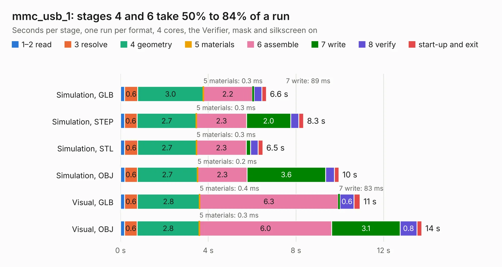

# 2469. mmc_usb_1

Board 2,469 of the 3,108 of [Corpus Testing](../Corpus-Testing.md), on [Corpus Page 23](../CorpusTestingPages/Corpus-Testing-23.md#2469-mmc_usb_1).

| Mode and format | 1–2 read | 3 resolve | 4 geometry | 5 materials | 6 assemble | 7 write | 8 verify | start-up and exit | Total |
|---|---:|---:|---:|---:|---:|---:|---:|---:|---:|
| Simulation, GLB | 0.2 | 0.6 | 3.0 | 0.3&nbsp;ms | 2.2 | 89&nbsp;ms | 0.4 | 0.2 | 6.6 |
| Simulation, STEP | 0.2 | 0.6 | 2.7 | 0.3&nbsp;ms | 2.3 | 2.0 | 0.4 | 0.2 | 8.3 |
| Simulation, STL | 0.2 | 0.6 | 2.7 | 0.3&nbsp;ms | 2.3 | 0.2 | 0.3 | 0.2 | 6.5 |
| Simulation, OBJ | 0.2 | 0.6 | 2.7 | 0.2&nbsp;ms | 2.3 | 3.6 | 0.4 | 0.2 | 10.0 |
| Visual, GLB | 0.2 | 0.6 | 2.8 | 0.4&nbsp;ms | 6.3 | 83&nbsp;ms | 0.6 | 0.3 | 10.9 |
| Visual, OBJ | 0.2 | 0.6 | 2.8 | 0.3&nbsp;ms | 6.0 | 3.1 | 0.8 | 0.2 | 13.7 |

<table align="center"><tr><td valign="top">

| Board | Repo: [rusefi/rusefi-hardware](https://github.com/rusefi/rusefi-hardware) Board: `mmc_usb_1.kicad_pcb` |
|---|---|
| Folder | classic-designs / rusefi_hardware_history / usb_mmc_spi_rev00.30 / usb_mmc_spi |
| Complexity | 190&nbsp;/&nbsp;1000 (size&nbsp;155, features&nbsp;35) |
| KESE&nbsp;features | through vias, filled zones |
| Tested | 9th November 2026 |
| Copper&nbsp;layers | 2 |
| File&nbsp;format | KiCad 3 (3) |
| Parts,&nbsp;tracks,&nbsp;vias | 22, 450, 47 |
| Triangles,&nbsp;simulation | 653,104 in 71 parts |
| Verifier | PASS in all six runs |

</td><td valign="top">

<table>
<tr><th>File type</th><th>File size</th><th>Peak memory used</th></tr>
<tr><th colspan="3" align="left">Simulation</th></tr>
<tr><td>GLB</td><td align="right">22&nbsp;MB</td><td align="right">345&nbsp;MB</td></tr>
<tr><td>STEP</td><td align="right">110&nbsp;MB</td><td align="right">401&nbsp;MB</td></tr>
<tr><td>STL</td><td align="right">33&nbsp;MB</td><td align="right">363&nbsp;MB</td></tr>
<tr><td>OBJ</td><td align="right">66&nbsp;MB</td><td align="right">466&nbsp;MB</td></tr>
<tr><th colspan="3" align="left">Visual</th></tr>
<tr><td>GLB</td><td align="right">18&nbsp;MB</td><td align="right">447&nbsp;MB</td></tr>
<tr><td>OBJ</td><td align="right">55&nbsp;MB</td><td align="right">471&nbsp;MB</td></tr>
</table>

</td></tr></table>

| Previous | Next |
|:---|---:|
| [2468. mmc_usb_1](b2468b_rusefi-hardware_classic-designs-rusefi-hardware-history-usb-mmc-spi-rev00-20_mmc-usb-1.md) | [2470. frequency-divider](b2470b_rusefi-hardware_frequency-divider.md) |
