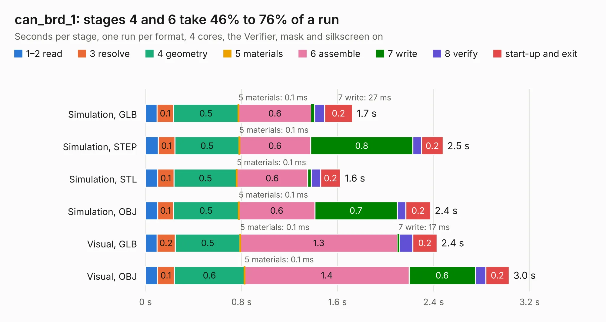

# 2470. can_brd_1

Board 2,470 of the 3,139 of [Corpus Testing](../Corpus-Testing.md), on [Corpus Page 23](../CorpusTestingPages/Corpus-Testing-23.md#2470-can_brd_1).

| Mode and format | 1–2 read | 3 resolve | 4 geometry | 5 materials | 6 assemble | 7 write | 8 verify | start-up and exit | Total |
|---|---:|---:|---:|---:|---:|---:|---:|---:|---:|
| Simulation, GLB | 96&nbsp;ms | 0.1 | 0.5 | 0.1&nbsp;ms | 0.6 | 27&nbsp;ms | 83&nbsp;ms | 0.2 | 1.7 |
| Simulation, STEP | 0.1 | 0.1 | 0.5 | 0.1&nbsp;ms | 0.6 | 0.8 | 74&nbsp;ms | 0.2 | 2.5 |
| Simulation, STL | 0.1 | 0.1 | 0.5 | 0.1&nbsp;ms | 0.6 | 31&nbsp;ms | 77&nbsp;ms | 0.2 | 1.6 |
| Simulation, OBJ | 0.1 | 0.1 | 0.5 | 0.1&nbsp;ms | 0.6 | 0.7 | 73&nbsp;ms | 0.2 | 2.4 |
| Visual, GLB | 95&nbsp;ms | 0.2 | 0.5 | 0.1&nbsp;ms | 1.3 | 17&nbsp;ms | 0.1 | 0.2 | 2.4 |
| Visual, OBJ | 98&nbsp;ms | 0.1 | 0.6 | 0.1&nbsp;ms | 1.4 | 0.6 | 87&nbsp;ms | 0.2 | 3.0 |

<table align="center"><tr><td valign="top">

| Board | Repo: [rusefi/rusefi-hardware](https://github.com/rusefi/rusefi-hardware) Board: `can_brd_1.kicad_pcb` |
|---|---|
| Folder | classic-designs / rusefi_hardware_history / can_board_rev00.20 / can_board |
| Complexity | 151&nbsp;/&nbsp;1000 (size&nbsp;116, features&nbsp;35) |
| KESE&nbsp;features | through vias, filled zones |
| Tested | 9th November 2026 |
| Copper&nbsp;layers | 2 |
| File&nbsp;format | KiCad 3 (3) |
| Parts,&nbsp;tracks,&nbsp;vias | 11, 71, 3 |
| Triangles,&nbsp;simulation | 131,798 in 22 parts |
| Verifier | PASS in all six runs |

</td><td valign="top">

<table>
<tr><th>File type</th><th>File size</th><th>Peak memory used</th></tr>
<tr><th colspan="3" align="left">Simulation</th></tr>
<tr><td>GLB</td><td align="right">4.6&nbsp;MB</td><td align="right">202&nbsp;MB</td></tr>
<tr><td>STEP</td><td align="right">25&nbsp;MB</td><td align="right">210&nbsp;MB</td></tr>
<tr><td>STL</td><td align="right">6.6&nbsp;MB</td><td align="right">200&nbsp;MB</td></tr>
<tr><td>OBJ</td><td align="right">13&nbsp;MB</td><td align="right">190&nbsp;MB</td></tr>
<tr><th colspan="3" align="left">Visual</th></tr>
<tr><td>GLB</td><td align="right">3.7&nbsp;MB</td><td align="right">166&nbsp;MB</td></tr>
<tr><td>OBJ</td><td align="right">10&nbsp;MB</td><td align="right">168&nbsp;MB</td></tr>
</table>

</td></tr></table>

| Previous | Next |
|:---|---:|
| [2469. can_brd_1](b2469b_rusefi-hardware_classic-designs-rusefi-hardware-history-can-board-rev00-10_can-brd-1.md) | [2471. O2_input_CJ125](b2471b_rusefi-hardware_O2-input-CJ125.md) |
